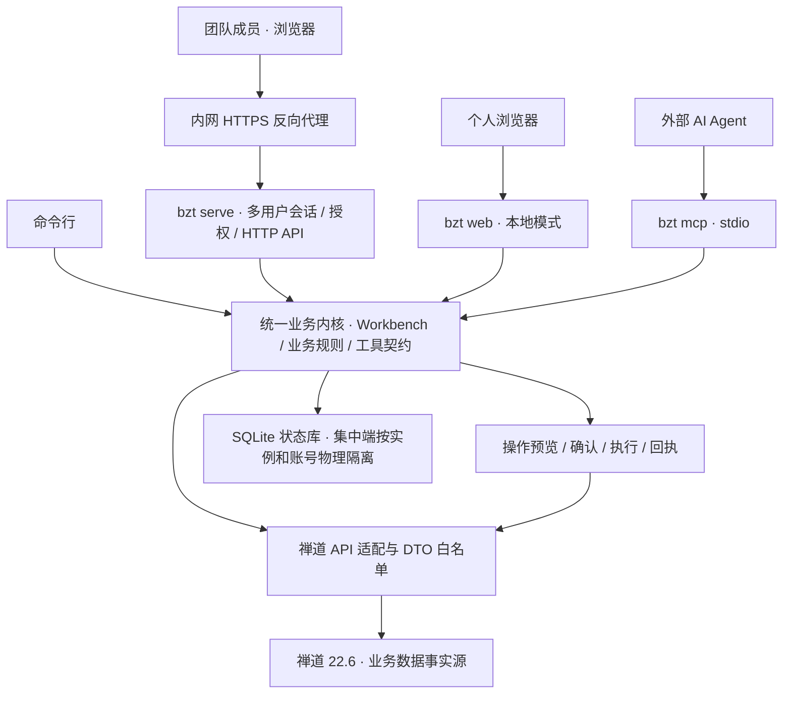

# better-zentao

**面向禅道 22.6 的团队协作工作台与 AI Agent 工具集。**

better-zentao 在保留禅道作为业务数据事实源的基础上，把需求、任务、排期、发布与风险管理中的重复操作和分散信息，封装为面向不同职责的工作台及可复用业务工具。团队成员可以通过浏览器处理日常工作，也可以让支持 MCP 的 AI Agent 用自然语言查询和协作，无须改变现有禅道数据结构。

## 能做什么

| 场景 | 能力 |
| --- | --- |
| 个人工作 | 查看本人待办、逾期、待处理事项及月度工作进展 |
| 需求管理 | 提交需求、查看需求进度、指派与移交、挪月、收尾 |
| 研发协作 | 按业务规范拆解阶段任务、查看团队任务与成员排期 |
| 交付管理 | 查看月度研发队列、计划兑现、版本交付及发布门禁 |
| 风险识别 | 扫描流程断点、逾期与交付风险，提供处理建议 |
| AI 协作 | 通过 stdio MCP 和配套 Skill，让外部 Agent 调用 19 个业务工具 |

实际可用视图和操作取决于禅道账号权限、门户职责、部署模式及已验证的禅道接口能力。受控写入先生成操作预览，再按规则确认、执行并核对回执；未开放的高风险操作仍由用户在禅道中处理。

## 使用方式

| 入口 | 适合谁 | 运行方式 |
| --- | --- | --- |
| 集中 Web 工作台 | 团队成员、产品及研发管理人员 | 管理员内网部署，成员通过浏览器使用本人禅道账号登录 |
| 本地 Web 工作台 | 个人使用、独立试用 | 在自己的电脑上运行 `bzt web` |
| MCP / CLI | AI Agent 用户、开发与运维人员 | 在本地运行 `bzt mcp` 或 CLI 命令 |

Web 工作台提供按职责组织的工作台、提需求、需求流转、拆解与排期、发布与风险页面。顶部操作栏提供工作月份切换、手动同步与真实快照状态反馈，首页提供表格台账、混合视图、卡片概览等个人视图偏好。集中端的职责由管理员统一维护，个人模式允许本机用户配置自己的职责。

**当前交付范围**：Server 1.0 已实现多用户集中服务端并独立推进内网试用；2.0 Product RC（分支 `feat/bzt-2.0-rc`，见 [CR-009 2.0 架构与原位协作](docs/changes/CR-009-platform-2.0-baseline.md)）在保持 1.0 人工工作台完全兼容的前提下，完成了前端外壳产品化与默认关闭（`ai.enabled: false`）的**原位 AI 协作助手（In-context Copilot）**（含 L1 规则短路 + L3 个人大模型意图兜底、个人企业大模型网关加密凭据隔离与受控出站传输）。真实公司企业大模型网关协议、私有 CA 与业务数据出网授权仍待项目所有者在受控私网环境独立验证，尚未合入 `main` 或上线现网。

## 快速开始

需要 Node.js 24.11 至 24.x、Corepack / pnpm，以及可访问的禅道开源版 22.6 实例。

```sh
git clone https://github.com/Dylan5237/better-zentao.git
cd better-zentao
corepack pnpm install --frozen-lockfile
corepack pnpm build
```

### 1. 团队集中部署（Server 1.0）

由管理员准备独立的运行配置、团队配置、持久化数据目录及受控内网 HTTPS 反向代理。参考 [服务配置示例](config/server.example.json) 和 [服务端部署指南](docs/server-deployment.md)。

```sh
node dist/adapters/cli/bzt.js serve --server-config /etc/bzt/server.json
```

也可以参考 [Docker Compose 部署模板](docker/compose.example.yml) 和 [Nginx 配置示例](docker/nginx.example.conf)。按部署指南配置监听地址、可信代理及证书后，先在隔离环境验证，再开放内网访问。

默认只读（`readOnly: true`），管理员验证双用户隔离、权限及业务读取后才可显式开启写入。集中端只允许管理员预登记的禅道实例，禁止普通用户自行更改共享角色配置，默认关闭企微群推。服务重启或上游认证失效后用户须重新登录。

#### 2.0 原位 AI 助手启用说明（默认关闭）

集中服务端默认 `ai.enabled: false`，所有 AI 控件隐藏，人工工作台零大模型依赖。仅在私有内网经管理员授权后，可在 `server.json` 中显式启用：

- **独立主密钥（D-203）**：通过环境变量 `BZT_AI_MASTER_KEY`（64 位十六进制 32 字节密钥）或 `ai.masterKeyFile`（独立于业务数据目录、`0600` 权限）注入；若主密钥缺失，系统仅降级关闭 AI 功能，人工工作台 100% 正常可用。
- **受信任网关白名单**：在 `ai.allowedGateways` 中精确配置公司授权模型网关的 `origin` 与 `pathPrefix`（禁止放宽 TLS 或允许未授权内网地址）。
- **个人凭据与验证**：员工登录工作台后，在右上角账号菜单 → **个人 AI 设置** 中填写个人模型 Token 并通过最小探活测试后，方可使用原位 AI 助手；绝不共享或回退他人 Token。
- **当前状态**：上述配置已在本地离线/受控 loopback 替身环境验证通过，真实公司企业模型网关尚未完成私网联调上线。

### 2. 个人本地工作台

Windows 用户可双击仓库根目录的 **打开禅道工作台.cmd**，或在完成依赖安装与构建后运行：

```sh
corepack pnpm web
```

本地门户默认监听 `http://127.0.0.1:17329`。使用终端提供的启动链接登录，首次使用按提示选择职责。本地模式支持快照优先显示和手动同步；集中模式则不复用未经上游鉴权的历史业务报表。

### 3. 接入 AI Agent

按 [配置说明](docs/08-配置说明.md) 配置本人禅道连接及团队配置，再将以下命令作为 Agent 的 stdio MCP Server 启动命令（客户端应使用正确的仓库工作目录或绝对路径）：

```sh
node dist/adapters/cli/bzt.js mcp
```

将 [better-zentao Skill](skills/better-zentao/SKILL.md) 提供给支持 Skill 的 Agent，可进一步约束需求拟稿、业务口径、写入确认与结果表达。

可以尝试询问 Agent：

- 我本月有哪些逾期任务？优先处理什么？
- 查询指定需求的当前进展、阻塞点及后续任务。
- 帮我拟一条需求，确认后提交禅道。
- 查看团队本月研发队列及下个版本的发布风险。

工具清单与调用契约见 [工具契约](docs/07-工具契约.md)。CLI 可通过 `node dist/adapters/cli/bzt.js --help` 查看用法。

## 系统架构

双部署模式共用同一业务内核，各入口独立运行；集中服务端是单进程模块化单体，不依赖外部数据库、Redis 或微服务。



技术栈：原生 HTML / CSS / JavaScript、Node.js、TypeScript、Zod、内置 SQLite、MCP SDK。

### 安全与部署边界

- 集中模式使用本人禅道 Token、独立会话、角色与业务范围校验；不长期持有或持久化登录密码。
- 集中端按禅道实例及账号物理分库，报表读取实时向上游验证权限；上游拒绝时不回退未经验证的历史业务报表。
- 写入通过预览、确认、目标重检和回执保护；结果不确定时反查，不盲目重试创建。进程内写入协调不替代禅道全局锁。
- Server 1.0 仅支持受控内网单进程部署和本地持久化磁盘，不支持多副本共享数据库或公网暴露。
- 不提交或分发真实账号密码、Token、内网配置、业务数据、个人数据库及会话信息。

详细设计见 [系统架构](docs/05-系统架构.md) 与 [CR-008 服务端化](docs/changes/CR-008-server-multi-user.md)。

## 开发与验证

```sh
corepack pnpm lint
corepack pnpm typecheck
corepack pnpm test
```

默认测试使用脱敏夹具和 fake-zentao，不执行真实禅道写入。真实环境只读冒烟及受控能力探查遵循 [测试与验收](docs/09-测试与验收.md) 和 [编码守则](AGENTS.md)，不能以真实环境替代离线测试。

## 文档索引

| 文档 | 用途 |
| --- | --- |
| [评审摘要](docs/00-评审摘要.md) · [需求分析](docs/01-需求分析.md) | 项目背景、需求与方案 |
| [角色与用户故事](docs/02-角色与用户故事.md) · [协作规范](docs/03-协作规范.md) | 角色职责、团队协作方式 |
| [领域模型与业务规则](docs/04-领域模型与业务规则.md) | 业务口径、生命周期和风险规则 |
| [系统架构](docs/05-系统架构.md) · [禅道接口适配](docs/06-禅道接口适配.md) | 系统分层、接口验证与约束 |
| [工具契约](docs/07-工具契约.md) · [配置说明](docs/08-配置说明.md) | 工具输入输出、个人及团队配置 |
| [测试与验收](docs/09-测试与验收.md) · [实施计划](docs/10-实施计划.md) | 测试门禁与实施路径 |
| [需求演进指南](docs/11-需求演进指南.md) · [架构决策](docs/12-决策与待确认.md) · [术语与追溯](docs/13-术语与追溯.md) | 演进、ADR 和需求追溯 |
| [服务端部署指南](docs/server-deployment.md) · [Server 1.0 需求卡](docs/changes/CR-008-server-multi-user.md) · [2.0 平台与原位协作需求卡](docs/changes/CR-009-platform-2.0-baseline.md) | 集中部署、运维升级与 2.0 架构演进 |
| [AGENTS.md](AGENTS.md) · [Agent Skill](skills/better-zentao/SKILL.md) | 编码 Agent 守则及使用者 Agent 业务指导 |

业务规范与工程文档的优先级和变更规则以 [AGENTS.md](AGENTS.md) 为准。新需求遵循 CR / ADR 流程，避免不同入口产生不同业务口径。
