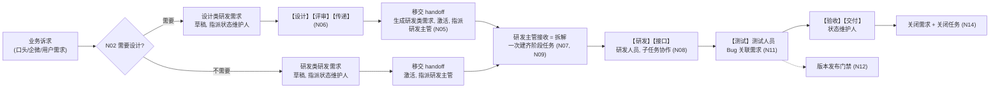

# 03 协作规范（推荐的统一禅道用法）

> 本文给出一套**统一的**禅道使用规范。每条规范都说明：现在有哪些不同用法、推荐怎么做、为什么、对各角色有什么好处、系统如何让它零成本执行、如何过渡。
>
> 规范的出发点是 01 中的五个基本问题：为什么做、承诺做什么、谁在何时做、怎样证明做完、下一步谁接。**规范与系统是一体的**：系统的默认行为就是规范，按规范做比不按规范做更省事。

## 1. 规范总表

| 编号 | 规范 | 一句话 | 主要解决 | 状态 |
| --- | --- | --- | --- | --- |
| N01 | 来源必登记 | 每条研发需求都有反馈者与来源渠道 | 反馈者追踪不到 | 【待评审】 |
| N02 | 先判断是否需要设计 | 按判定标准决定先建设计类还是直接建研发类 | 设计与研发需求混乱 | 【待评审】 |
| N03 | 需求正文模板 | 研发类需求必须写"本次实现范围" | 范围不清，研发反复确认 | 【待评审】 |
| N04 | L3 只表达月度模块计划 | 计划 = 月 × 模块（负责人）；版本用标签 | 计划语义冲突，无法按 L3 看完成 | 【待评审】 |
| N05 | 指派即行动 | `指派给`永远是下一步要行动的人；激活前不指派研发 | 研发不知道该做什么，设计找不到需求 | 【待评审】 |
| N06 | 设计类需求三段任务 | 【设计】【评审】【传递】，细分用子任务 | 设计进度看不清 | 【待评审】 |
| N07 | 研发类需求一次建齐阶段任务 | 拆解时一次建好【研发】【接口】【测试】【验收】【交付】 | 测试迟迟不建、测试无法排期 | 【待评审】 |
| N08 | 协作用子任务 | 不用多人任务，一人一子任务 | 责任与逾期归属不清 | 【待评审】 |
| N09 | 接收时限 | 激活移交后 3 个工作日内完成拆解 | 需求滞留无人接 | 【待确认】参数 |
| N10 | 跨模块提给研发主管 | 提给被依赖模块的研发主管，发起方是状态维护人 | 绕开排期、负载不可见 | 【待评审】 |
| N11 | Bug 必关联需求 | 测试发现的 Bug 同时关联执行 | Bug 看不到、发布门禁失真 | 【待评审】 |
| N12 | 发布门禁 | 版本内需求测试完成、严重 Bug 清零才发布；例外要登记 | 测试未完成就发布 | 【待评审】 |
| N13 | 挪月留痕 | 挪月通过系统并填原因；月初保存承诺快照 | 顺延不可见 | 【待评审】 |
| N14 | 关闭即收尾 | 需求关闭时一并关闭其任务；周期清理兜底 | 历史任务堆积 | 【待评审】 |
| N15 | 先录后做 | 超过半天的工作先一句话建草稿需求；Git 提交带需求号 | 先做后录、提交关联不上 | 【待评审】 |
| N16 | 工作量只作参考 | 只称"禅道可见投入"，不排名、不评分 | 工作量误读 | 【待评审】 |
| N17 | 通知走摘要 | 系统每日摘要 + 关键事件推送；禅道邮件保持现状 | 研发感知不到新需求 | 【待评审】 |

## 2. 一条需求的标准流程



| 步骤 | 角色 | 需求状态 | 需求`指派给` | 系统动作 |
| --- | --- | --- | --- | --- |
| 1 登记诉求 | 设计主管 / 设计人员 | — | — | `create_story` 记录原始诉求、反馈者（N01） |
| 2 建需求 | 设计人员 | 草稿 | **状态维护人** | 模板正文（N03）、挂 L3（N04） |
| 3 设计（如需要） | 设计人员 | 草稿 / 激活 | 状态维护人 | 一键生成三段任务（N06） |
| 4 移交 | 设计人员 | **激活** | **研发主管** | `handoff_story`：生成或激活研发类需求、指派、通知（N05、N17） |
| 5 接收与拆解 | 研发主管 | 激活 | 研发主管 | `decompose_stories`：一次建齐阶段任务（N07），关联本月研发迭代 |
| 6 研发 | 研发人员 | 激活 | 研发主管 | 子任务协作（N08） |
| 7 测试 | 测试人员 | 激活 | 研发主管 | 研发完成即提醒测试可开始；Bug 关联需求（N11） |
| 8 验收、交付 | 状态维护人 | 激活 | **状态维护人** | 测试完成后系统提示把需求转回状态维护人 |
| 9 关闭 | 状态维护人 | 关闭 | — | `close_stories`：检查阶段任务、关闭任务与需求（N14） |

**需求`指派给`只在两个时点变化**：移交时交给研发主管；测试完成后交回状态维护人。任务的`指派给`才是具体执行人。

## 3. 规范详述

### N01 来源必登记

- **规范：** 每条研发需求都填写**反馈者**（禅道 `feedbackBy`）与**来源渠道**（口头、企微、禅道用户需求、管理规划）。来自禅道用户需求的，必须与该用户需求关联。
- **现状：** 反馈者靠手工维护；口头和企微需求的来源经常丢失；用户需求需要手工回去关联。
- **理由：** "为什么做"是五个基本问题之一；没有来源就无法回复反馈者，也无法评估需求价值。
- **价值：** 业务反馈者能查到进展；设计主管能一键回复；产品管理能分析需求来源。
- **系统支持：** `create_story` 自动识别反馈者、记录原文与渠道；传入用户需求编号时自动关联。
- **过渡：** 存量需求不补录；新需求立即执行。

### N02 先判断是否需要设计

- **规范：** 接到诉求后，由设计主管（或其授权的设计人员）按下表判断。需要设计的，**先只建设计类需求**；研发类需求在评审通过后由移交操作生成。

  | 需要设计（建设计类） | 不需要设计（直接建研发类） |
  | --- | --- |
  | 新功能、新页面、交互流程变化 | 缺陷修复、文案或配置调整 |
  | 涉及多个模块或多个产品 | 纯技术改造（性能、重构、依赖升级） |
  | 需要评审才能确定方案 | 方案已明确的小改动（约 2 人日以内） |

- **现状：** 管理视角是传递后才建研发类；设计视角是判断需要设计时就同时建两条。
- **理由：** 提前建的研发类需求处于草稿时容易被误指派（N05 要解决的问题）；传递后手工建又容易漏建。由移交操作自动生成，两个问题同时消除。
- **价值：** 设计人员少建一条；研发主管收到的都是已就绪的需求；不会漏建。
- **系统支持：** `create_story` 给出判定建议；`handoff_story(mode=from_design)` 按产品生成研发类需求，继承范围与验收条件，并关联设计类需求。
- **过渡：** 已经同时建好两条的存量需求，研发类保持草稿并指派状态维护人，移交时走 `handoff_story(mode=activate)`。
- **例外：** 如果需要提前占用研发月度计划，可以用 `create_story(pair=true)` 同时建两条，研发类保持草稿、指派状态维护人。

### N03 需求正文模板

- **规范：** 研发类需求的描述（`spec`）使用以下模板，验收标准写在 `verify` 字段。**"本次实现范围"必填**；引用设计文档时必须写章节或版本。

  ```markdown
  ## 背景与问题
  ## 本次实现范围
  - 做：……
  - 不做 / 已实现：……
  ## 设计文档
  - 链接：……  章节 / 版本：……
  ## 来源
  - 反馈者：……  渠道：口头 / 企微 / 禅道用户需求 #……
  - 衍生自：#……（跨模块时）
  ```

- **现状：** 设计文档常常同时包含历史设计和已实现内容，研发要自己分辨或再问产品。
- **理由：** "承诺做什么"必须写在需求里，而不是由研发从文档中推断。
- **价值：** 研发人员不再反复确认；测试人员知道测什么；验收有依据。
- **系统支持：** 提需时 Agent 起草正文并追问范围；缺范围时警告（R05）；研发视图卡片直接展示范围、章节和验收标准。
- **过渡：** 新需求执行；存量需求在移交或拆解时补齐。

### N04 L3 只表达月度模块计划

- **规范：**
  1. **L3 计划 = 月 × 模块**，一个模块一个负责人；命名为 `【负责人】模块名-YYYY年MM月`，起止日期覆盖当月。
  2. 所有研发需求都挂 L3（同一产品内）。
  3. **发布版本不再用计划表达**：需求的版本归属写在关键词字段（`版本:V7.0.3`），版本的发布日期由产品管理维护在发布日历中（优先使用禅道"发布"对象，接口未验证前使用配置文件）。
  4. 迭代命名为 `【产品】【职能】YYYY年MM月迭代`，职能为设计、研发、UI。
- **现状：** 天宫管理与前端按"月 × 负责人"建计划；后端按当月发布版本建计划，一个版本一个计划。
- **理由：** 禅道一条需求只能挂一个计划。如果计划有时表示"模块负责人的月度目标"，有时表示"版本"，按版本建计划的需求就会离开 L3，"所有需求挂 L3""基于 L3 看完成情况"两条管理要求都会失效。版本按时间组织需求，标签就能表达，不需要占用计划。
- **价值：** 产品管理可以统一按 L3 看完成情况；研发主管（后端）仍能看到"版本发布前必须完成的需求"（发布就绪视图，N12），而且比按计划统计多了测试与 Bug 信息。
- **系统支持：** `create_story` 只推荐 L3 计划，并询问版本；`get_plan_progress(view=release)` 按版本标签汇总；R06 检查未挂 L3。
- **过渡：** 现有按版本建的计划保留到当月结束，次月起按新规范；系统在过渡期把这类计划识别为"版本计划"，统计时不计入 L3 汇总，并提示迁移。

### N05 指派即行动

- **规范：** 需求和任务的`指派给`永远表示**下一步需要行动的人**。
  - 草稿、评审中的需求指派给**状态维护人**（设计人员），**不得指派给研发**。
  - 激活即移交：激活与指派研发主管在同一个操作中完成，并通知研发主管。
  - 测试完成后，需求转回状态维护人做验收、交付与关闭。
- **现状：** 部分需求在草稿或评审中就已指派给研发主管：研发主管看到需求却不知道该做什么，设计主管（状态维护人）又不方便找到这些需求继续维护。
- **理由：** 一个字段只承担一种含义，信息才可靠。"最终谁接收"由系统另行记录（接收人）。
- **价值：** 研发主管的待办里都是可做的事；状态维护人的待办里都是要推进的需求；不再需要口头确认"这条现在该谁动"。
- **系统支持：** `create_story` 默认指派状态维护人；`handoff_story` 一步完成激活、指派、通知；`get_my_work` 分为"需要我处理""已指派但未就绪""我维护的"三组；R04 检测违规。
- **过渡：** 存量违规需求由系统列出，状态维护人通过 `handoff_story` 或改指派处理。

### N06 设计类需求三段任务

- **规范：** 设计类需求下建三个任务：**【设计】**（调研、概要设计、原型等内容，需要细分时建子任务）、**【评审】**、**【传递】**。设计类需求以评审与传递完成作为完成标准。
- **现状：** 管理视角是按调研、概设、原型、评审、传递拆五个任务；设计主管习惯一条需求对应一个任务。
- **理由：** 管理视角判断设计是否完成看的是"评审"和"传递"两个节点，所以这两个必须是独立任务；调研、概设、原型是设计人员内部的工作分解，粒度交给执行者，用子任务即可。三段式兼顾两边的诉求。
- **价值：** 设计主管与管理角色能看到"卡在评审还是卡在传递"；设计人员操作量不增加（一键生成）。
- **系统支持：** `decompose_stories(template=design)` 一次生成三段任务，自动填写必填项。
- **过渡：** 存量设计类需求不重拆，系统按标题关键词识别阶段（可信度为"推测"）。

### N07 研发类需求一次建齐阶段任务

- **规范：** 研发主管拆解研发类需求时，**一次建齐所需的阶段任务**：

  | 阶段任务 | 数量 | 负责人 | 计划开始 / 截止（系统默认，可改） |
  | --- | --- | --- | --- |
  | 【研发】 | 1 个（多人时建子任务） | 研发人员 | 拆解日 / 迭代内指定 |
  | 【接口】 | 每个协作组 1 个（需要跨组时） | 对方组研发人员 | 同上 |
  | 【测试】 | 1 个 | 模块测试负责人 | 研发截止日的下一个工作日 / 再加测试预估 |
  | 【验收】 | 1 个 | 状态维护人 | 测试截止日的下一个工作日 / 再加 1 个工作日 |
  | 【交付】 | 按需（如培训） | 状态维护人 | 验收之后 |

  任务名统一以阶段前缀开头，系统同时在描述中写入机器可读的阶段标记。
- **现状：** 研发完成后才建测试任务，测试通过后才建验收任务；"批量转任务"有限制，所以大多一条需求一个任务。
- **理由：** "迟迟没有测试任务"的直接原因是**下游任务依赖人在事后想起来创建**。拆解时一次建齐，缺口就从结构上消除了；测试人员也能提前看到即将到来的工作并排期。一个阶段只建一个任务，保持了"一需求一任务"的简单性。
- **价值：**
  - 研发主管：一次操作完成，不再多页跳转；
  - 测试人员：提前知道要测什么、大概什么时候；
  - 设计人员：验收、交付不遗漏；
  - 管理角色：阶段清晰，完成判断有依据。
- **任务开始时间：** 保留"预计开始"必填（排期面板需要），由系统按上表自动填写，不再手工填写。"实际开始""消耗工时"属于事实，系统不代填。
- **系统支持：** `decompose_stories(template=feature)` 一次处理多条需求；R02 检查研发完成但测试未接续；R11 检查测试后缺验收、交付。
- **过渡：** 存量需求不重拆；研发完成但没有测试任务的，由 R02 列出，通过 `decompose_stories(template=next_stage)` 补建。

### N08 协作用子任务

- **规范：** 不使用禅道的多人任务（串行、并行），多人协作一律在阶段任务下拆子任务，一人一个子任务。子任务就是 L4。
- **现状：** 多人任务与子任务并存，后端倾向子任务。
- **理由：** 串行多人任务只显示当前顺位人，逾期与负载无法准确归属到人；子任务每人一条，责任清晰，排期面板也能准确统计。
- **价值：** 研发人员责任清楚；研发主管的排期面板准确。
- **系统支持：** `decompose_stories(template=subtasks)`；R06 检测新建的多人任务。
- **过渡：** 存量多人任务按责任规则（04 §4.3）统计，不强制改造。

### N09 接收时限

- **规范：** 研发类需求激活并移交研发主管后，研发主管在 **3 个工作日**内完成拆解。**拆解即接收**，不需要另外的接收动作。
- **现状：** 研发主管习惯两三天扫一遍待处理需求。
- **理由：** 把现有习惯明确为时限，系统才能提醒，管理角色也才能判断是否滞留。
- **价值：** 状态维护人知道研发已经接收；需求不会无人接。
- **系统支持：** 移交时通知；每日摘要列出待接收需求；R03 检测超时。
- **参数：** 3 个工作日【待确认】。

### N10 跨模块需求提给研发主管

- **规范：** 一个模块的需求依赖另一个模块的能力时（例如低代码平台依赖后端建模），由发起方设计人员向**被依赖模块**提研发类需求：模块填被依赖模块，**接收人是该模块的研发主管**，可以在正文中写建议的研发人员；**发起方设计人员是状态维护人**；新需求与发起方需求建立"衍生自"关系。
- **现状：** 前端模块的设计人员会直接向后端建模研发人员提需求。
- **理由：** 直接提给研发人员会绕过研发主管的排期，研发主管的负载视图失真；由发起方维护状态，是因为只有发起方知道依赖什么、何时需要。
- **价值：** 研发主管（被依赖方）负载可见、排期可控；发起方能在自己需求的进展中看到依赖的状态。
- **系统支持：** `create_story(crossModule=true, derivesFrom)` 按被依赖模块归属自动找到研发主管；进展卡片展示依赖需求的阶段。

### N11 Bug 必关联需求

- **规范：** 所有 Bug 都关联对应的研发需求；测试过程中发现的 Bug 同时关联执行（迭代）。推荐从执行下的测试入口创建 Bug。
- **现状：** 从主菜单"测试"入口创建的 Bug 可能没有关联执行，"关联执行"不是必填项，执行视图看不到这些 Bug。
- **理由：** Bug 是"怎样证明做完"的重要证据；不关联需求，需求进展和发布门禁就会失真。
- **价值：** 测试人员的 Bug 能对上需求；研发主管能在执行中看到全部 Bug；产品管理的发布判断准确。
- **系统支持：** 需求进展从产品级 Bug 列表按需求归集，不依赖执行视图；R12 列出未关联的 Bug；P3 提供强制关联的 `create_bug`。

### N12 发布门禁

- **规范：** 版本发布前须同时满足：① 版本内每条研发需求的【测试】任务已完成；② 关联的严重程度 1–2 级 Bug 全部关闭。不满足但必须发布时，由**产品管理**批准并登记例外原因。
- **现状：** 测试周期较长，存在测试尚未完成就已经发布的情况。
- **理由：** "已发布"和"已完成"是两件事；测试未完成就发布有时不可避免，但应当是有记录、有人负责的例外，而不是默认状态。
- **价值：** 产品管理对发布质量心中有数；测试人员的工作被纳入发布节奏；事后可以回溯。
- **系统支持：** 发布就绪视图（距发布日工作日数、未完成项、未关闭 Bug）；发布前 3 个工作日预警（R13）；`set_story_meta(waiver)` 登记例外。

### N13 挪月留痕

- **规范：**
  1. 每月第一个工作日，项目管理保存本月承诺快照（L3 + 研发迭代中的需求集合）。
  2. 月底挪月由研发主管通过系统完成，**同时调整 L3 与迭代，并必须填写原因**。
  3. 原承诺快照保留不变；挪走的需求计为顺延。
- **现状：** 研发类需求先放本月计划，月底研发主管把做不完的挪到下个月，不留记录。
- **理由：** 挪月本身合理，但不留痕就无法回答"原计划完成了多少""哪些需求反复顺延"。
- **价值：** 产品管理能看到真实兑现率；研发主管的挪月有据可查；反复顺延的需求能被识别。
- **系统支持：** `reschedule_story`（W2，需要原因）；`bzt snapshot` 定时采集；`get_plan_progress(view=commitment)`。

### N14 关闭即收尾

- **规范：** 研发需求的所有阶段任务完成（或注明原因取消）后，由状态维护人关闭需求，**系统同时关闭该需求下已完成的任务**。研发主管每两个月做一次历史任务清理，作为兜底。
- **现状：** 研发主管每两个月回看并清理历史任务：先核对需求是否完成，再关闭任务。
- **理由：** 周期清理是"关闭需求时没有同步关闭任务"的补救；在关闭需求时顺手收尾，清理工作量就会大幅减少。
- **价值：** 研发主管减少周期清理负担；任务列表只剩下真正进行中的工作。
- **系统支持：** `close_stories(mode=story)` 关闭前检查、一并关闭；`close_stories(mode=cleanup)` 分类列出清理候选（R14）。

### N15 先录后做

- **规范：** 预计超过半天的工作，开工前先建需求。急事可以由研发人员一句话建草稿需求，状态维护人为对应模块的设计人员，事后补全。Git 提交信息中写需求号（如 `story#12345`）。
- **现状：** 研发通过企微或线下接到需求，先开展工作，再请产品补录；工作发生在需求创建之前时，提交记录无法按常规关联。
- **理由：** 先做后录的根因是提需门槛高；当提需只需要一句话时，先录后做的成本几乎为零。
- **价值：** 研发的工作有据可查；设计人员不再被动补录；后续 GitLab 联动的数据完整。
- **系统支持：** `create_story(backfilled)` 允许事后补录，记录用户提供的实际开始时间；P3 的 `link_commits` 补关联提交；R16 识别疑似先做后录。

### N16 工作量只作参考

- **规范：** 系统中所有基于工时、任务数的数据都称为**"禅道可见投入"**，不用于个人排名或绩效评分。
- **现状：** 研发的实际工作不一定都记录在禅道中，了解工作量需要综合禅道、企微沟通、Git 提交和人工判断。
- **理由：** 不完整的数据被当作绩效依据，会导致数据失真与抵触。
- **价值：** 研发人员愿意如实记录；研发主管把排期面板当作排期工具，而不是考核工具。
- **系统支持：** 输出固定注明口径；不提供排名类接口。

### N17 通知走摘要

- **规范：** 禅道邮件维持现状（只在关闭时发送）。新需求、新任务、可开始的测试或验收、风险提醒，由系统通过**每日摘要**和**关键事件推送**送达（企微群机器人），同一事项一天最多提醒一次。
- **现状：** 产品提了需求，如果没有另外在企微或线下告知，研发就感知不到；禅道邮件干扰多，所以只在关闭时发送。
- **理由：** 通知的价值在于"及时 + 少打扰"。每日摘要聚合，关键事件（移交、拆解完成）即时推送，就可以两者兼顾。
- **价值：** 研发主管与研发人员及时知道新工作；测试人员、设计人员及时知道可以开始；不再依赖口头通知。
- **系统支持：** P1：`get_my_work` 显示"自上次以来新增"；P2：`bzt digest` 定时推送、移交与拆解完成事件推送；P3：企微应用个人消息与待办。

## 4. 字段与命名速查

| 对象 | 字段 / 命名 | 规范 |
| --- | --- | --- |
| L3 计划 | 标题 | `【负责人】模块名-YYYY年MM月`，起止覆盖当月 |
| 迭代 | 标题 | `【产品】【职能】YYYY年MM月迭代` |
| 研发需求 | 类别 | 设计类 / 研发类（N02） |
| 研发需求 | 计划 | 必填，挂 L3（N04） |
| 研发需求 | 反馈者、来源 | 必填（N01） |
| 研发需求 | 描述 | 模板，本次实现范围必填（N03） |
| 研发需求 | 关键词 | 版本标签 `版本:Vx.y.z`（N04） |
| 研发需求 | 指派给 | 草稿时为状态维护人；激活后为研发主管；测试完成后为状态维护人（N05） |
| 任务 | 标题 | 阶段前缀：【设计】【评审】【传递】【研发】【接口】【测试】【验收】【交付】 |
| 任务 | 预计开始 | 系统默认填写（N07） |
| 任务 | 多人 | 不使用，改用子任务（N08） |
| Bug | 关联 | 需求必填；测试中发现的同时关联执行（N11） |
| Git 提交 | 信息 | 包含 `story#需求号` 或 `task#任务号`（N15） |

## 5. 规范推行

1. **评审：** 团队评审会逐条确认 N01–N17，状态由【待评审】改为【已定】，或记录调整意见（12）。
2. **试点：** 选一个设计组 + 一个研发组（建议前端），在 P1 上线后试行 2 周，跟踪 R04、R05、R06 的命中数变化。
3. **推广：** P2 上线后全组推行；系统默认值即规范，偏离时给出提示而不是阻断（`strict-ai` 模式除外）。
4. **度量：** 项目管理每月查看规范执行情况（US-PM-03），重点看：未挂 L3 率、缺范围率、未就绪先指派数、研发完成测试未接续数、Bug 未关联率。
5. **调整：** 规范的修改走 11 中的演进流程，并在 12 中记录 ADR。
