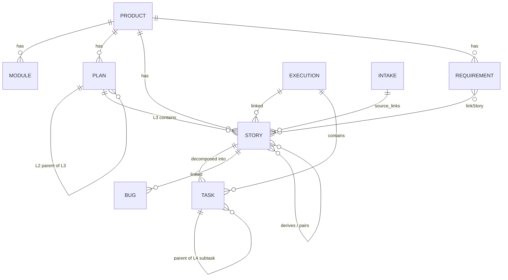

# 04 领域模型与业务规则

> 本文定义"怎么判断、怎么算"。所有规则在代码中以**纯函数**实现（`src/domain/`、`src/rules/`），输入为标准化对象与配置，输出带证据的结果。**口径只在这里定义一次**，工具、Skill、入口都不得另立口径。

## 1. 对象模型



| 对象 | 禅道实体 | 关键字段（标准化后） | 说明 |
| --- | --- | --- | --- |
| Product | `product` | `id, name, status` | #42 天宫平台（设计态），#43 OneLink 7.0（运行态），#44 运营交付平台（交付态，预留） |
| Module | `module` | `id, productId, path, name` | 模块决定默认的设计主管、研发主管、测试负责人（08 `modules`） |
| Plan | `productplan` | `id, productId, parent, title, begin, end, level(L2/L3), kind(l3/legacyRelease), owner` | L2 为 `parent=-1`，L3 在其 `children` 中 |
| Execution | `execution` | `id, projectId, name, begin, end, status, month, function(design/dev/ui)` | 月度迭代 |
| Requirement | `story(type=requirement)` | `id, productId, title, status, openedBy, linkedStories[]` | 用户需求 |
| Story | `story(type=story)` | `id, productId, moduleId, planIds[], category(design/feature), status, stage, assignedTo, openedBy, feedbackBy, source, keywords, spec, verify, executions[], versionTag, roles` | 研发需求 |
| Task | `task` | `id, storyId, executionId, parent, isParent, name, type, status, assignedTo, mode, team[], estStarted, deadline, estimate, consumed, left, finishedDate, stage, stageConfidence` | 阶段任务与 L4 子任务 |
| Bug | `bug` | `id, productId, storyId, executionId, taskId, severity, status, openedBy, assignedTo` | |
| Intake | 本地 | `id, rawText, feedbackByText, feedbackByAccount, channel, createdBy, backfilled, actualStartedAt` | 原始诉求 |
| Operation | 本地 | 见 05 §5 | 写操作回执 |

### 1.1 层级映射

团队口中的 L2/L3/L4 是**管理层级**，与禅道的 `epic / requirement / story` 三级需求**不是一回事**。

| 管理层级 | 含义 | 禅道对象 |
| --- | --- | --- |
| L2 | 建设目标 | 父计划 `【L2-建设目标】…` |
| L3 | 月度模块计划（产品管理拆分，一人一模块） | 子计划 |
| — | 研发需求（设计类 / 研发类） | `story` |
| — | 阶段任务（研发主管或设计人员拆出） | `task`（`parent=0`） |
| L4 | 子任务（任务负责人按人拆分，可协作） | `task`（`parent>0`） |

### 1.2 两个独立维度

"设计态"是**产品**，"设计类"是**工作性质**，两者正交。

| | 设计类（`design`） | 研发类（`feature`） |
| --- | --- | --- |
| 天宫平台 #42（设计态） | 天宫的设计工作 | 天宫功能的研发、测试、验收、交付 |
| OneLink 7.0 #43（运行态） | 按需 | OneLink 功能的研发、测试、验收、交付 |

同一原始诉求需要两个产品都实现时，各产品分别建研发需求、分别挂 L3、分别排迭代，通过同一 `intake` 与 `pairs` 关系关联。

## 2. 人员角色

| 角色 | 解析来源（优先级从高到低） |
| --- | --- |
| 反馈者 | `intake.feedbackByAccount` → `story.feedbackBy`（自由文本，按"、，,;"拆分后在目录中模糊匹配，保留原文） |
| 提出人 | `story.openedBy` |
| 状态维护人 | 正文角色标签 `maintainer` → 本地 `story_roles` → 模块设计主管指定的设计人员 → `openedBy` |
| 当前处理人 | `story.assignedTo` |
| 接收人 | 正文角色标签 `receiver` → 本地 `story_roles` → 模块研发主管 |

**角色标签格式【已定】：** 优先写在需求描述末尾的 HTML 注释中；若 Phase 0 实测发现禅道富文本二次编辑会剥离 HTML 注释，则自动回退为页脚微标签（解析器同时兼容两种格式，只认最后一个标签；写入时整体替换）：

```html
<!-- 首选：HTML 注释 -->
<!-- bzt:v1 maintainer=<account>;receiver=<account>;intake=<intakeId> -->

<!-- 备选回退（若禅道富文本过滤注释）：可见微标签 -->
<p style="color:#999;font-size:12px">[bzt:v1 maintainer=<account>;receiver=<account>;intake=<intakeId>]</p>
```

**跨人共享元数据协议（阶段裁剪与规则豁免）【已定】：**
为避免单机 SQLite 状态孤岛，阶段要求（`stage_requirements`）与规则/发布门禁豁免（`waivers`）以禅道需求评论（`story.comment`）中的结构化标签作为**跨人共享权威来源**，本地 SQLite 仅作加速缓存：

```text
[bzt:meta v1] stage.delivery=false | reason=纯后台改造无需培训
[bzt:waiver v1] rule=R13 | version=V7.0.3 | approvedBy=acct_pm | reason=客户急用先发补测
```

读取需求详情 `actions`（评论列表）时按时间顺序折叠还原最新状态；无评论记录时回退读本地表。

## 3. 阶段模型

### 3.1 阶段与任务前缀

| 类别 | 阶段 | 任务前缀 | 默认必需 |
| --- | --- | --- | --- |
| design | `design` 设计（调研、概设、原型） | 【设计】 | 是 |
| design | `review` 评审 | 【评审】 | 是 |
| design | `handoff` 传递 | 【传递】 | 是 |
| feature | `dev` 研发 | 【研发】 | 是 |
| feature | `interface` 跨组接口 | 【接口】 | 按需 |
| feature | `test` 测试 | 【测试】 | 是 |
| feature | `acceptance` 产品验收 | 【验收】 | 是 |
| feature | `delivery` 交付（如培训） | 【交付】 | 按需（需求声明需要时为必需） |

阶段要求可以按需求调整（`set_story_meta`），保存在 `stage_requirements`；未声明的按上表默认值。

### 3.2 阶段识别

| 证据等级 | 条件 | 可信度 |
| --- | --- | --- |
| 1 | 任务描述含阶段标记 `<!-- bzt:stage=test -->`（本系统创建） | `confirmed` |
| 2 | 任务名以标准前缀开头 | `confirmed` |
| 3 | 存量任务：按关键词、`task.type`、迭代职能、负责人所在组加权投票（见下） | `inferred` |
| 4 | 都不满足 | `unknown` |

存量识别的加权投票（权重可配置）：

| 信号 | 权重 | 说明 |
| --- | --- | --- |
| 标题关键词（含子任务标题） | 3 | `调研/概要/概设/原型/UI → design`，`评审 → review`，`传递 → handoff`，`开发/研发 → dev`，`接口/联调 → interface`，`测试/用例 → test`，`验收 → acceptance`，`交付/培训/手册 → delivery` |
| 负责人所在组 | 2 | 测试组 → `test`；设计组 → `design / acceptance` |
| 迭代职能 | 1 | 【设计】迭代 → design 类阶段 |
| `task.type` | 1 | `test → test`，`design → design`；**`devel` 不作为证据**（现网验收、原型任务大量使用 `devel`） |

得分最高且 ≥ 3 → 该阶段（`inferred`）；否则 `unknown`。

### 3.3 阶段完成

- 一个阶段的状态由该阶段的叶子任务汇总：全部 `done` 或 `closed`（关闭原因不是取消）→ 完成；任一未完成 → 进行中；全部 `cancel` → 已取消（需要原因，否则视为缺失）。
- 没有该阶段的任务 → 缺失。
- 阶段的完成时间 = 该阶段叶子任务中最晚的 `finishedDate`。

## 4. 计算口径

### 4.1 时间

- 业务时区默认为 `Asia/Shanghai`。日期型截止日按当天 23:59:59 计算，时钟回拨导致该时刻重复时取最后一次。
- 工作日历默认周一到周五。`calendar.workdays` 使用 ISO 星期编号（周一为 1，周日为 7），至少配置一天且不重复。`holidays` 排除指定日期，`extraWorkdays` 加入指定日期。同一天出现在两个列表中时拒绝该配置。
- "N 个工作日"从起算日的下一个工作日开始计。负数向前数，零保留起算日。计算两个日期之间的工作日时，沿起点到终点的方向计数，排除起点，终点为工作日则计入。反向计数为负数。
- N07 默认日期落在非工作日时顺延至下一工作日。已是工作日时保留该日期。需要从截止日的下一个工作日开始时，加 1 个工作日。

### 4.2 任务时间状态（叶子任务）

```text
未完成 := status ∉ {done, closed, cancel}
if not 未完成:                    完成 (如 finishedDate > deadline 另记"历史延期")
elif deadline 为空或无效:          缺少排期
elif today > deadline:            当前逾期          # pause、changed 也算
elif today == deadline:           今日到期
elif deadline ≤ today + N 工作日: 临期 (N 默认 3)
else:                             正常
```

服务端 `status=delayed` 只用于加速取数，结论以本规则为准。

### 4.3 父子任务与多人任务

- **计数以叶子任务为准**：`isParent=1` 的父任务不计入逾期数与负载；父任务自身截止日已过时，另列为"父级风险"。
- 子任务未能全部取到时，结果标记为不完整，不给精确汇总。
- 多人任务（存量）：`linear` 只计当前顺位人；`multi` 按 `team[].status` 计未完成成员；取不到成员状态时只显示参与关系。
- 姓名一律按 `account` 反查目录（禅道 `team[].realname` 有缺陷）。
- 团队汇总时，**任务数**按任务 ID 去重；**人次**单独统计，不混用。

### 4.4 业务进展（研发类需求）

按以下顺序判定，取第一个命中的结果：

```text
if story.status in {draft, reviewing}:                    未就绪
if story.status == closed:
    if closedReason in {cancel, willnotdo, duplicate...}: 已取消
    elif 必需阶段都完成:                                     已完成
    else:                                                 已关闭·证据缺失
if 没有任何阶段任务:                                         待接收        # 移交后待拆解
if dev/interface 有未完成:                                   研发中
if test 缺失:                                              待测试 ⚠ (R02 缺口)
if test 未完成 or 关联严重 Bug 未关闭:                         测试中
if acceptance 必需且 (缺失 or 未完成):                         待验收
if delivery 必需且 (缺失 or 未完成):                           待交付
else:                                                      可关闭 (R09)
附加标记: 版本发布日已过且 test 未完成 → "已发布·测试未完成" (R13)
```

### 4.5 业务进展（设计类需求）

```text
if status in {draft, reviewing} 且 没有任务:     未就绪
if design 未完成:                               设计中
if review 缺失或未完成:                          待评审
if handoff 缺失或未完成:                         待传递
if 没有 derives/pairs 关联的研发类需求:            待移交 ⚠ (R07)
else:                                           已移交
```

### 4.6 月度范围

| 问题 | 口径 |
| --- | --- |
| 本月 L3 | 计划 `begin~end` 与本月有重叠；标题月份只作辅助 |
| 本月研发迭代 | 名称解析月份与职能 → 日期 → 配置覆盖 |
| 本月研发主池 | 本月 L3 下的研发类需求 ∪ 本月研发迭代中的需求 |
| 跨月遗留 | 上月承诺快照中未完成的需求；没有快照时从动作历史还原并标注 |

**五桶（`get_monthly_dev_queue`）：**

| 桶 | 条件 | 说明 |
| --- | --- | --- |
| ① 待接收 | 主池中业务进展为"待接收"的需求 | 可直接进入拆解；"未就绪"需求单列，不计入 |
| ② 在研 | 主池中业务进展为研发中、待测试、测试中的需求 | |
| ③ 上月遗留 | 在上月快照中且未完成的需求 | 与①②可以重叠，用标记表示，不重复计数 |
| ④ 计划有但未排迭代 | 在本月 L3 中，不在任何本月研发迭代中 | R10 |
| ⑤ 迭代有但缺计划 | 在本月研发迭代中，未挂 L3 | R06 |

月最后 7 个工作日，在①②中标出"阶段任务未开始"的需求，作为挪月决策参考。

### 4.7 计划汇总（L3）

先按需求 ID 去重，再按业务进展分类为：已完成 / 执行中（研发中至待交付）/ 待接收 / 未就绪 / 已取消 / 无法判断。

- **需求交付率** = 已完成 ÷（总数 − 已取消），注明分母与统计时间。
- **任务完成率** = 已完成叶子任务 ÷ 未取消叶子任务。
- 两个比率分开展示，不得互相替代。

### 4.8 版本就绪

- 版本内需求 = `keywords` 含 `版本:<v>` 的需求（过渡期也包括存量的版本型计划中的需求）。
- 发布日 = 禅道"发布"对象的日期 → 配置 `releaseCalendar` → 存量版本型计划的结束日。
- 输出：距发布日工作日数；按业务进展分组；测试未完成的需求；关联的未关闭 Bug（按严重程度）；截止日晚于发布日的叶子任务；已登记的例外。
- 门禁满足 := 版本内每条需求的 test 阶段完成，且关联的严重程度 1–2 级 Bug 全部关闭（N12）。

### 4.9 成员排期

| 项 | 口径 |
| --- | --- |
| 对象 | 成员名下未完成的叶子任务（多人任务按 §4.3） |
| 时间轴 | 默认未来 4 周，按日或周分桶；"逾期""未排期"单列 |
| 落点 | 按截止日落桶 |
| 负荷 | 桶内 `left` 之和；`left` 为空时按任务数展示并注明"缺工时" |
| 容量 | 工作日数 × 每日可用工时（默认 6 小时）− 负荷 |
| 指派建议 | 输入预估工时与期望截止日：按"截止日前剩余容量"降序取前 3，附每人截止日前的任务清单；容量相同时，逾期少者优先 |

### 4.10 工作量边界

所有基于工时、任务数的输出都标注"禅道可见投入（不含禅道外工作）"；不提供个人排名（N16）。

## 5. 风险规则目录

| ID | 名称 | 判定 | 滞留阈值（默认） | 严重度 | 证据 | 阶段 |
| --- | --- | --- | --- | --- | --- | --- |
| R01 | 任务逾期 | 叶子任务"当前逾期"（§4.2） | — | 高 | 记录 | P1 |
| R02 | 研发完成测试未接续 | 研发类需求有效，test 必需；dev、interface 全部完成；且 test 缺失（缺口），或 test 存在但超过阈值仍为 `wait`（等待） | 缺失：1 个工作日；等待：2 个工作日 | 高 | 记录 / 推测 | P1 |
| R03 | 接收超时 | 业务进展为"待接收"，自移交（激活或指派研发主管的动作时间）起超过阈值 | 3 个工作日（N09） | 中 | 记录 | P1 |
| R04 | 未就绪先指派 | 需求为草稿或评审中，`assignedTo` 不是状态维护人，且是研发侧人员 | — | 中 | 记录 | P1 |
| R05 | 需求缺范围 | 研发类需求描述中没有"本次实现范围"段落，或引用了设计文档但没写章节或版本 | — | 低 | 记录 | P1 |
| R06 | 结构违规 | ① 研发需求未挂 L3；② 任务不属于任何需求；③ 本系统上线后新建的多人任务；④ 研发需求已拆解但缺少必需阶段任务 | — | 中 | 记录 | P2 |
| R07 | 设计完成未移交 | 设计类需求评审、传递都已完成，没有关联的研发类需求 | 2 个工作日 | 中 | 推测 | P2 |
| R08 | 用户需求未关联 | 用户需求未关联任何研发需求 | 5 个工作日 | 低 | 记录 | P2 |
| R09 | 应关未关 | 业务进展为"可关闭" | 5 个工作日 | 低 | 推测 | P2 |
| R10 | 计划与迭代脱节 | 本月 L3 中的研发类需求不在任何本月研发迭代中 | 本月第 5 个工作日起 | 中 | 记录 | P2 |
| R11 | 测试后缺验收或交付 | test 完成，acceptance 或必需的 delivery 缺失 | 1 个工作日 | 中 | 记录 / 推测 | P2 |
| R12 | Bug 未关联 | Bug 未关联需求；或测试期间创建的 Bug 未关联执行 | — | 中 | 记录 | P2 |
| R13 | 发布门禁未满足 | 距发布日 ≤ 阈值且门禁未满足；发布日已过时标为"已发布·测试未完成" | 发布前 3 个工作日 | 高 | 记录 / 推测 | P2 |
| R14 | 历史任务待清理 | A：任务已完成，需求已完成或关闭；B：任务未完成，需求已关闭；C：任务没有关联需求（清理动作建议每双月执行一次） | 任务结转或停留超 30 自然日 | 低 | 记录 | P2 |
| R15 | 跨产品不对称 | 同一原始诉求下，一个产品已完成，另一个产品仍未就绪或待接收 | 10 个工作日 | 低 | 来源关系 | P3 |
| R16 | 疑似先做后录 | 需求创建时间晚于其任务的实际开始时间，或晚于首个引用该需求的提交 | — | 信息 | 记录 | P3 |

### 5.1 规则通用约定

1. **结果结构：** `{ ruleId, objectType, objectId, state: gap|stalled, severity, confidence, since, evidence[], suggestion }`。
2. **缺口与滞留：** 满足判定即为"缺口"；超过阈值升级为"滞留"。起算时间取上游实际完成时间或动作时间；取不到时 `since=null` 并说明"起点未知"，不升级为滞留。
3. **阈值来源：** 输出注明阈值来自"默认"还是"已确认配置"。
4. **可信度：** `inferred` 与 `unknown` 的结果只提示，不触发任何写操作。
5. **豁免：** 通过 `set_story_meta(waiver)` 登记原因与登记人后，该对象的该规则不再告警。
6. **历史数据：** 规则只对数据做判断，不批量改写历史数据。R06 的 ③④ 只针对上线后新建的对象。

## 6. 历史数据兼容

| 存量情况 | 处理 |
| --- | --- |
| 按版本建的计划 | `kind=legacyRelease`：不计入 L3 汇总；其中的需求计入版本就绪；提示迁移 |
| 任务名没有阶段前缀 | 按 §3.2 证据等级 3 推测阶段 |
| 一条需求一个综合任务 | 阶段为 `unknown`，业务进展最多判到"研发中 / 无法判断"，不判"已完成" |
| 多人任务 | 按 §4.3 统计，不改造 |
| 草稿就指派给研发的需求 | R04 列出，交给状态维护人处理 |
| 没有角色标签的需求 | 按 §2 的回退顺序解析状态维护人与接收人 |
