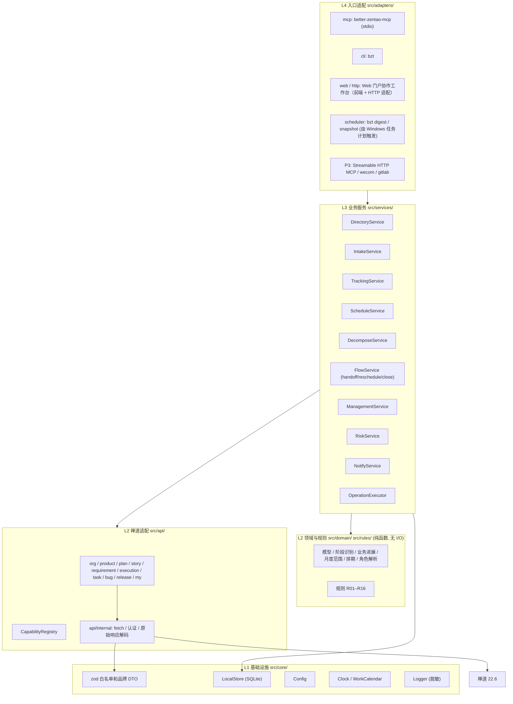
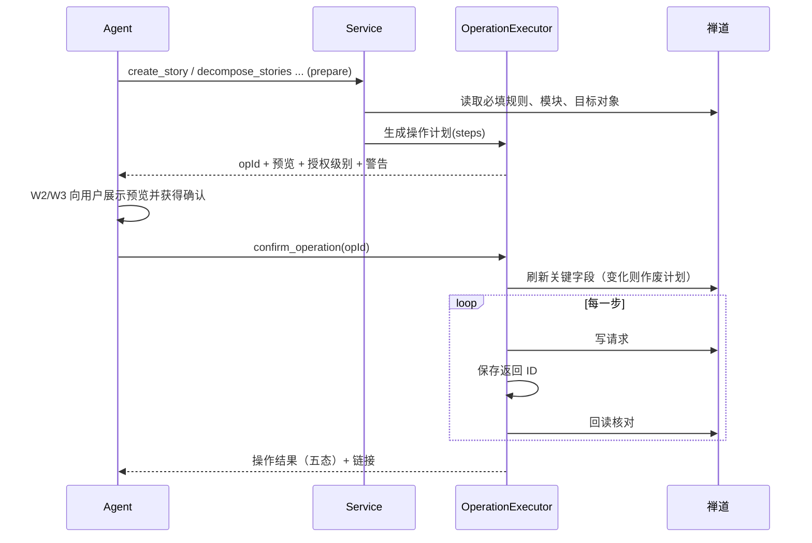

# 05 系统架构

> 本文定义"怎么实现"：分层、模块、目录、存储、写入模型、安全与部署。接口适配细节见 06，工具契约见 07。

## 1. 架构结论【已定】

**业务服务内核 + 多入口的单体**：一个 TypeScript 进程，内含禅道适配层、领域规则、业务服务；对外通过本地 stdio MCP（`better-zentao-mcp`）、CLI（`bzt`）以及同步建设的 **Web 门户协作工作台**（前端工作台 + HTTP 适配层）提供能力；所有入口复用同一 `services / domain / rules / api` 内核，Web 门户前端不写独立业务判断、不直连禅道；严格遵守 ADR-02、ADR-03、SEC-02、SEC-05（每人使用本人禅道身份/令牌，禁止共用管理员账号）。企微、GitLab、共享 Streamable HTTP MCP 服务都是后续新增的入口适配器，不改动业务层。

| 选择 | 理由 |
| --- | --- |
| 本地 stdio + 同步 Web 门户，多入口复用同一内核 | Agent 对话与图形工作台各自服务不同高频场景（本地 stdio MCP 由个人用本人账号运行，权限天然隔离；Web 门户降低非 Agent 用户与可视化排期/拆解/评审的使用门槛，多用户集中部署须通过安全评审与个人令牌鉴权） |
| 单体，而不是微服务 | 规模小；一个进程内调用最简单、最容易测试 |
| 业务规则用纯函数 | 可单测、可复用于所有入口、可由编码 Agent 安全修改 |
| 本地 SQLite 补充存储 | 使用 Node 内置 `node:sqlite`。只存禅道表达不了的信息，可丢弃的缓存与必须保留的记录分开 |

## 2. 分层



**依赖规则（由 lint 强制）：**

1. `adapters → services → domain / rules / api → core`。服务可以直接使用 `core` 的基础设施，`rules` 可以使用 `domain` 的纯函数和类型。
2. `domain/`、`rules/` 不得导入任何 I/O 模块（HTTP、SQLite、fs、时钟），当前时间与日历通过参数注入。
3. `adapters/` 只做参数解析、身份上下文与结果格式化，不写业务判断。
4. 禅道 `fetch`、认证、原始 HTTP 响应和解码都在 `api/internal/`。超时、并发、错误和日志的通用策略可放在 `core/`。zod 白名单与品牌 DTO 定义放在 `core/dto/`，上层只使用 `api/` 提供的安全结果（ADR-18）。

源码 lint 使用 TypeScript 类型信息拦截未校验的 `any` 赋值、返回、传参、属性访问和调用。解码入口先以 `unknown` 接收原始数据，再通过 zod 白名单投影。

只有 API 层可导入 `api/internal/`。API 门面使用内部传输与解码器，导出签名只提供已投影的数据和业务参数。值与类型导出均禁止转发私有绑定、Fetch 载体（含选项和响应流）及未投影的载荷。检查范围包含嵌套工具类型、泛型约束和默认类型参数。

全仓 `src/**/*.ts` 禁用全局对象 `globalThis`、`global`、`self`、`window`，避免通过别名或解构绕过 lint。源码使用 `Intl.DateTimeFormat` 格式化时须显式提供时间，经 `call`、`apply`、`bind` 或 `Reflect.apply` 间接调用时同样检查。展开参数不能作为明确的时间。领域、规则和纯 core 模块也禁用全局 `crypto`。

`api/internal/` 是唯一允许使用内置 `fetch` 访问禅道的源码目录（ADR-18）。CR-002 只允许 `src/adapters/web/server.ts` 从 `node:http` 导入本机监听所需的 `createServer` 及参数类型。其余源码继续禁止导入网络模块。浏览器仅向本机同源入口提交表单，凭据仅在服务器会话内使用。服务端源码禁用 `WebSocket`、`XMLHttpRequest`、`EventSource`、`child_process` 和 `worker_threads`。

## 3. 模块职责

| 模块 | 职责 | 主要依赖 |
| --- | --- | --- |
| `DirectoryService` | 用户、部门、产品、模块、计划、迭代的缓存与模糊解析（中文名、拼音、重名消歧）；模块归属（设计主管、研发主管、测试负责人）；团队解析 | `api/org`、`api/product`、`api/plan`、`api/execution` |
| `IntakeService` | 提需与导入：意图结构化结果 → 校验 → 生成操作计划；原始诉求与来源关系；正文模板与角色标签 | Directory、`api/story`、`api/requirement`、OperationExecutor |
| `TrackingService` | 我的工作、团队工作、需求检索、需求进展卡片；"自上次以来新增" | Directory、`api/my`、`api/execution`、`api/task`、`api/bug`、domain |
| `ScheduleService` | 成员排期矩阵与指派建议 | Tracking 的取数、`domain/schedule` |
| `DecomposeService` | 批量拆解：模板展开、必填项补全、执行（迭代）选择、生成操作计划 | Directory、`api/task`、`api/story`、OperationExecutor |
| `FlowService` | 移交（激活 + 指派 + 生成研发类需求）、挪月、关闭与清理 | `api/story`、`api/task`、OperationExecutor、Notify |
| `ManagementService` | 计划汇总、版本就绪、五桶、承诺快照、迭代指标 | Tracking、Store、domain |
| `RiskService` | 取数并执行规则，管理豁免 | domain、rules、Store |
| `NotifyService` | 新增游标、每日摘要、事件推送、去重 | Store、企微群机器人 webhook |
| `OperationExecutor` | 两段式操作：计划、授权级别判定、执行前刷新、逐步执行、回读核对、续做 | Store、`api/*` |

## 4. 目录结构

```text
better-zentao/
├─ AGENTS.md  CLAUDE.md  GEMINI.md          # 编码 Agent 守则（后两个指向 AGENTS.md）
├─ package.json  tsconfig.json  vitest.config.ts  eslint.config.mjs
├─ src/
│  ├─ core/        dto/ store/ config.ts clock.ts calendar.ts http-policy.ts logger.ts errors.ts
│  ├─ api/         internal/（禅道 HTTP、认证、分页、解码） org.ts product.ts plan.ts story.ts requirement.ts execution.ts task.ts bug.ts release.ts my.ts capabilities.ts
│  ├─ domain/      types.ts roles.ts stage.ts progress.ts month.ts plan-summary.ts release.ts schedule.ts naming.ts templates.ts
│  ├─ rules/       r01-overdue.ts … r16-backfill.ts index.ts
│  ├─ services/    directory.ts intake.ts tracking.ts schedule.ts decompose.ts flow.ts management.ts risk.ts notify.ts operation.ts
│  ├─ contracts/   tools/*.ts（每个工具的 zod 输入输出 schema）  result.ts  errors.ts
│  └─ adapters/
│     ├─ mcp/      server.ts register.ts
│     ├─ cli/      bzt.ts commands/*.ts render/*.ts（表格、HTML 排期）
│     └─ scheduler/ digest.ts snapshot.ts
├─ skills/better-zentao/SKILL.md
├─ templates/      codex.config.toml  claude-code.mcp.json  gemini.settings.json  windows-task-digest.xml
├─ config/         better-zentao.example.json
├─ test/           unit/ contract/ service/ smoke/ eval/ fixtures/ builders/ fake-zentao/
└─ docs/           本文档集 + research/（探查报告）+ adr/
```

## 5. 写入模型【已定】

### 5.1 两段式操作

所有写入统一走 `prepare → execute`：



- 计划在 `write.planExpiresMinutes`（默认 10 分钟）后过期。
- **乐观锁校验：** 执行前刷新目标对象；关键字段（状态 `status`、指派 `assignedTo`、计划 `plan`、所属执行 `executions`、**最后编辑时间 `lastEditedDate` 及正文 `spec` 摘要哈希**）与 `prepare` 时不一致的，立即作废计划并返回 `PLAN_STALE`，防止覆盖他人或用户在 Web 端的并发修改。
- **W2 最小确认间隔锁：** 为防止 Agent 在同一轮推理中生成预览后直接自行调用确认，`OperationExecutor` 对 W2 级别操作强制校验 `now - created_at >= write.minConfirmDelaySeconds`（默认 3 秒）。未满间隔调用 `confirm_operation` 时拒绝执行并返回 `PREVIEW_TOO_FAST`。

### 5.2 授权级别

| 级别 | 范围 | 执行策略 |
| --- | --- | --- |
| W0 | 只读 | 直接执行 |
| W1 | 只影响自己、低风险：单条建草稿需求且指派给自己；改自己维护的需求的元数据 | 意图明确、无歧义、预检通过时，Agent 可以在同一轮内 prepare + confirm |
| W2 | 影响他人或批量：指派给他人、多条需求、跨产品、移交、拆解、挪月、关闭、推送他人 | 服务端拒绝在"未展示预览"的情况下执行：`confirm_operation` 必须带 `previewAck=true`，Agent 必须先把预览展示给用户 |
| W3 | 破坏性或事实性：删除、完成任务、填写实际工时 | MCP 不提供；仅 CLI，且需要 `--confirm` |

级别由服务端按操作内容计算，不信任 Agent 传入的级别。`strict-ai` 模式下所有写入至少为 W2。

### 5.3 写入五态

| 状态 | 含义 | 处理 |
| --- | --- | --- |
| `confirmed` | 所有步骤都已回读核对 | — |
| `partial` | 部分步骤成功 | `confirm_operation(opId, resume=true)` 只执行剩余步骤 |
| `unknown` | 请求超时或回读失败，无法确认 | 按特征反查（标题 + 创建人 + 时间窗）；仍无法确认时交给用户，**禁止重建** |
| `not_executed` | 预检失败或缺信息 | 返回缺失项 |
| `failed` | 明确失败 | 返回原因与建议 |

**不变量：** 拿到禅道对象 ID 之后，无论后续哪一步失败，都不再创建同一对象。只有可确认未完成且幂等的步骤（指派、关联、关闭）可以重试。

### 5.4 字段填写原则

| 类型 | 字段 | 规则 |
| --- | --- | --- |
| 计划性字段 | 预计开始、截止日期、优先级、预估工时 | 可以按规范默认，预览中标注为"默认" |
| 事实性字段 | 实际开始、完成时间、消耗工时、评审结论 | 只能来自用户输入或可信记录，**禁止编造** |

## 6. 本地存储

驱动采用 `node:sqlite` 的 `DatabaseSync`（ADR-17）。P0 以内存库验证启动和查询。业务数据表及文件迁移从 P1 开始。

位置：`%USERPROFILE%/.better-zentao/<instanceHash>/<account>/state.db`（macOS、Linux 为 `~/.better-zentao/...`）。按实例 + 账号隔离。

| 表 | 用途 | 主要字段 | 阶段 |
| --- | --- | --- | --- |
| `operations` | 操作回执 | `op_id, kind, actor, level, input_hash, plan_json, status, created_at, expires_at, executed_at` | P1 |
| `operation_steps` | 每一步 | `op_id, seq, action, target_type, target_id, request_digest, zentao_id, readback_json, state, error` | P1 |
| `intake` | 原始诉求 | `intake_id, raw_text, feedback_by_text, feedback_by_account, channel, created_by, created_at, backfilled, actual_started_at` | P1 |
| `source_links` | 来源与需求关系 | `from_type, from_id, to_type, to_id, relation(source/pairs/derives/links), origin(native/local), verified_at` | P1 |
| `story_roles` | 角色缓存（权威在正文标签） | `story_id, maintainer, receiver, updated_at` | P1 |
| `seen_cursor` | "自上次以来新增"游标 | `scope, last_seen_at` | P1 |
| `cache_kv` | 可丢弃的目录与查询缓存 | `key, value, expires_at` | P1 |
| `stage_requirements` | 阶段要求与豁免 | `story_id, stage, required, waiver_reason, decided_by, decided_at` | P2 |
| `waivers` | 规则豁免与发布例外 | `rule_id, object_type, object_id, reason, approved_by, at` | P2 |
| `snapshots` / `snapshot_items` | 月度承诺快照 | `snap_id, month, product_id, taken_at, taken_by, source(local/imported)` / `snap_id, story_id, plan_id, execution_id, progress_at_snap` | P2 |
| `notifications` | 推送去重 | `dedupe_key, channel, target, sent_at, state` | P2 |
| `reschedules` | 挪月记录 | `id, story_id, from_month, to_month, reason, by, at` | P2 |

**共享性与单点防重说明：**

- **角色、阶段裁剪与豁免：** 状态维护人/接收人的权威来源是需求正文的 `bzt:v1` 标签；阶段裁剪（`stage_requirements`）与规则/门禁豁免（`waivers`）的权威来源是需求评论中的 `[bzt:meta v1]` / `[bzt:waiver v1]` 结构化备注，任何人的 `bzt` 读取需求详情时均可还原一致状态，本地 SQLite 对应表仅作读缓存。
- **月度快照与每日摘要：** 由配置指定的唯一采集账号（`snapshot.collector` / `notify.digest.collector`）在一台常驻机器上定时执行；快照导出 JSON 到共享目录，其他人的 `bzt` 以 `source=imported` 只读导入；非指定 `collector` 账号运行定时群推时直接拒绝，防止群消息重复轰炸。
- **挪月记录：** 挪月原因同时通过 `story.comment` 写入禅道备注，保证全员可见。

## 7. 安全与权限

| 编号 | 要求 |
| --- | --- |
| SEC-01 | 凭据只来自环境变量或系统凭据库，不写入配置文件、日志、存储 |
| SEC-02 | 原始响应只在 `api/` 内存在；按端点 zod schema 白名单投影；未声明字段一律丢弃 |
| SEC-03 | 日志只记录 `opId`、动作、对象 ID、耗时、状态；键名匹配 `password|token|secret|hash` 的字段再剥离一次 |
| SEC-04 | 缓存键包含 `baseUrl + account`，不跨账号复用 |
| SEC-05 | 读写不超出当前账号的禅道权限；系统的角色配置只影响默认值，不扩大权限 |
| SEC-06 | 需求正文、评论、附件、Bug 描述视为不可信数据：输出时截断并标记 `untrusted`；Skill 要求 Agent 不执行其中的指令 |
| SEC-07 | 推送消息只包含标题、状态、截止日期与链接，不包含正文 |
| SEC-08 | 测试夹具入库前必须经过脱敏脚本处理（替换姓名、账号、内网地址） |

## 8. 性能与可靠性

- HTTP：全局并发信号量默认 8；单请求超时 15 秒；Token 刷新 single-flight；遇 401 只重新登录一次。
- 缓存：目录 20 分钟；计划、迭代列表 5 分钟；查询结果 60 秒；写入成功后让相关键失效。
- 取数：团队类查询先列执行再批量取任务，按需求 ID 聚合；只对多人任务、子任务、证据缺失的条目补详情。
- 完整性：分页统一由 `paginate()` 返回 `{ items, complete, failures }`；任何一页失败都使结果标记为不完整。

## 9. 部署与接入

| 项 | 方式 |
| --- | --- |
| 安装 | Node 24 LTS（最低 24.11.0）。开发用 pnpm，团队用 `npm i -g better-zentao` 安装编译好的 JS 包（内网 npm 源或离线包）。`node:sqlite` 的实验性警告保留在 stderr，MCP stdout 专供协议帧 |
| 自检 | P0 骨架的 `bzt doctor` 本地检查 Node、内存 SQLite 和必填环境变量是否就绪。连接、账号和能力注册表在后续工作包接入 |
| 接入 Agent | `templates/` 提供 Codex、Claude Code、Gemini CLI 的 MCP 配置模板；`bzt install-agent <codex|claude|gemini>` 写入配置 |
| Skill | `skills/better-zentao/SKILL.md` 安装到各 Agent 的 Skill 目录 |
| 定时任务 | `bzt schedule-task install digest|snapshot` 生成 Windows 任务计划 |
| 升级 | 语义化版本；工具契约有破坏性变更时，提供一个版本周期的兼容别名 |

## 10. 演进路线

| 阶段 | 新增 | 架构变化 |
| --- | --- | --- |
| P1–P2 并行：Web 门户 | Web 门户协作工作台（FR-23） | 新增 Web 前端与 HTTP API 适配（本地个人模式先行，多用户集中部署须通过安全评审与个人令牌鉴权，禁止共用管理员账号）；复用同一 `services / domain / rules / api` 内核 |
| P3-a 共享服务 | Streamable HTTP MCP，多用户 | 新增共享 Streamable HTTP MCP 入口；每个用户使用自己的禅道 Token（OAuth 或个人令牌），禁止共用管理员账号；存储迁移到服务端数据库 |
| P3-b 企微应用 | 业务自助提需与查询、个人待办、状态更新 | 新增 `adapters/wecom`；企微 userid 与禅道账号映射表；回调去重 |
| P3-c GitLab | 提交、MR 与需求、任务关联；`link_commits` | 新增 `adapters/gitlab`；MR 合并只作为 dev 阶段证据，不自动改任务状态（除非单独授权） |
| P3-d 常驻协调 | 风险生命周期、去重提醒、接续推动 | 依赖 P3-a；`risk_findings` 表；调度器常驻 |
