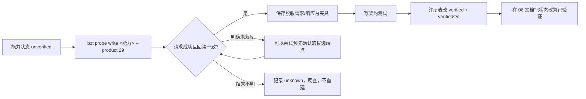

# 06 禅道接口适配

> 适用：禅道开源版 22.6（`URAndSR: true`，三级需求 epic / requirement / story）。
> 依据：S2 只读探查报告（2026-11-19）与旧项目 `zentao-mcp` 的写入实测。
> 标注：【已验证】= 探查或旧项目实测过；【待验证】= 需在 #29 受控产品上验证后才能启用。
> 本文是 `src/api/*` 与 `src/core/dto/*` 的唯一依据。端点变化时先改本文，再改代码和契约测试。

## 1. 适配层的职责边界

| 做 | 不做 |
| --- | --- |
| 认证、重试、超时、分页、并发控制 | 业务判断（进展、风险、月份归属） |
| 把禅道原始响应投影成 DTO（白名单） | 把原始响应透传给上层、MCP 输出或日志 |
| 吸收 v1/v2 差异、状态码差异、字段缺陷 | 拼接自然语言 |
| 写入请求 + 回读 | 决定是否需要用户确认（由 OperationExecutor 负责） |
| 维护能力注册表，拒绝调用未验证能力 | 在生产产品上"试一下"未验证端点 |

禅道 `fetch`、认证和原始响应解码集中在 `src/api/internal/`，由该层调用 `src/core/dto/` 的白名单 schema（ADR-18）。

## 2. 认证与通用约定

### 2.1 认证【已验证】

```http
POST /api.php/v1/tokens
Content-Type: application/json

{"account":"<ZENTAO_ACCOUNT>","password":"<ZENTAO_PASSWORD>"}
→ 201 {"token":"..."}
```

- 后续请求头用 `Token: <token>`，**不是** `Authorization: Bearer`。
- 同一 Token 通用于 `/api.php/v1/*` 与 `/api.php/v2/*`。
- 同一客户端并发首次登录或刷新时共用一次登录，失败后释放进行中的状态。Token 仅保存在客户端私有内存中。凭据被拒绝或登录回执无法取得合法 Token 时返回 `AUTH_FAILED`。登录的超时、网络异常或 5xx 返回对应的传输错误码，各次登录只发送一次。
- 读请求收到 401 时刷新登录并重放一次，再收到 401 返回 `AUTH_FAILED`。旧请求的 401 只使该请求使用的登录批次失效。业务写入的 401 按 §2.2 处理。
- 账号即身份：工具里的"我"永远是 `GET /api.php/v1/user` 返回的账号，不接受 Agent 传入的"代表某人"。

### 2.2 HTTP 约定

| 项 | 约定 |
| --- | --- |
| 成功判定 | `2xx` 都算成功（需求列表正常返回 **201**），不得硬编码 `=== 200` |
| 业务错误（阶段 2 需求解码） | 2xx 且 `result === "fail"`、`error` 为非空文本、或 `result` 非 `"success"` 且 `message` 为非空文本时，报 `ZENTAO_BUSINESS_ERROR`。缺少合法需求主体时，`error` 或 `message` 中的非空文本、数组或对象也报业务错误。合法需求允许 `result === "success"` 附带成功提示及结构化元数据。按 `message`、`error` 的顺序从文本或嵌套的字段校验值提取白名单短句，最多 120 字符。无匹配时用通用提示 |
| 请求地址 | `baseUrl` 只接受 HTTP 或 HTTPS，可带部署子路径，禁止嵌入凭据、查询串或片段。所有请求设置 `redirect: "error"`。 |
| 超时与读重试 | `ZENTAO_TIMEOUT_MS` 默认 15000，单次请求涵盖响应头和正文的读取。超时通过 `AbortSignal` 中止请求。读超时（含 HTTP 408）、网络异常或 5xx 在 300ms、900ms 后最多重试两次。401 重放独立计次，读重试次数不会因重登而重置。 |
| HTTP 错误 | 403 为 `PERMISSION_DENIED`，404 为 `NOT_FOUND`，400、422 等其他业务拒绝使用不含正文的 `ZENTAO_BUSINESS_ERROR` 通用提示。读取在耗尽重试时按末次失败报告 `ZENTAO_TIMEOUT` 或 `ZENTAO_UNAVAILABLE`。空 2xx 正文交给端点 schema 按 `undefined` 校验。 |
| 写入回执 | 业务写入最多发送一次。超时、中止、网络异常、非预期状态（包括 5xx、重定向）或无法解码的 2xx 回执返回 `status: "unknown"`、`retryable: false`，由 OperationExecutor 回读或反查，禁止重新创建。可解码的 2xx 回执返回 `accepted`，随后仍需按 05 §5.3 回读核对。 |
| 写入 401 | 传输层无法仅凭状态码验证请求未进入业务处理，因此使该登录批次失效，返回 `AUTH_FAILED`，当前业务请求不自动重放。下一笔独立请求可以重新登录。 |
| 并发 | 所有传输客户端共用进程级读取名额（`http.concurrency`，正整数，默认 8），登录也计入名额。退避和等待登录期间不占用业务读取名额。同一规范化 `baseUrl` 的业务写入按入队顺序串行。 |
| 分页 | v1 使用 `limit` + `page`，v2 使用 `recPerPage` + `pageID`，均从第 1 页开始。逐页解码投影后累积。达到已知 `total` 或遇到短页（含空页）即停，最多 50 页。到达上限且未证实取完，或短页时已知总数仍未达到，返回 `truncated: true`，上层据此填写 `gaps` 和 `completeness: "partial"`。 |
| 时区 | 禅道无时区日期及日期时间按 `timezone`（默认 `Asia/Shanghai`）解析，空日期、零日期（含零时分秒）、`null`、`undefined` 统一为 `null`。非法日期和夏令时跳过的本地时刻报错，重复时刻取较早的一次。 |
| 数字 | 禅道 ID 常以字符串返回，DTO 层统一转 `number`；工时转 `number`（小时） |
| 日志 | 每次发送（含登录与重放）均进入同一结构化日志入口。只记录方法、受控路径模板、状态码、耗时及可选的操作 ID、对象 ID。模板由端点代码固定声明，业务路径里的数字 ID 通过占位符传入。`status: 0` 表示未收到响应状态。所有日志级别共用同一字段白名单。 |

### 2.3 校验

- 每个 DTO 用 zod 定义。读接口解码失败返回 `ZENTAO_SCHEMA_MISMATCH`。端点解码器可以附声明过的字段路径，通用传输层只给出通用提示，避免把动态键或字段值带入错误。
- 允许的宽松：可选字段缺失、空字符串转 `null`、已知别名（如 `openedBy` / `opener`）。
- 契约测试用 `test/fixtures/zentao-22.6/*.json`（脱敏后的真实响应）锁定以上行为。

## 3. 读取端点

| 能力 | 端点 | 关键参数 | 备注 | 状态 |
| --- | --- | --- | --- | --- |
| 实例配置 | `GET /index.php?mode=getconfig` | — | 读 `version`、`URAndSR`；`bzt doctor` 用 | 已验证 |
| 当前用户 | `GET /api.php/v1/user` | — | `profile.account / realname / dept / role` | 已验证 |
| 必填规则 | `GET /api.php/v1/requiredFields` | — | 写前预检；缓存 30 分钟 | 已验证 |
| 部门树 | `GET /api.php/v1/departments` | — | 嵌套树；缓存 30 分钟 | 已验证 |
| 全量用户 | `GET /api.php/v2/users` | `recPerPage=3000&pageID=1` | 含 `id/account/realname/dept/role/pinyin/deleted`；v1 只有 account/realname | 已验证 |
| 按部门查人 | `GET /api.php/v2/company/browse` | `param={deptID}&type=bydept&recPerPage=200` | `deptID=` 无效 | 已验证 |
| 我的待办 | `GET /api.php/v2/my/work` | `mode=task\|story\|bug\|requirement\|epic`，`browseType=assignedTo\|reviewBy` | v1/my/* 全部 404；`type=` 无效 | 已验证 |
| 我的贡献 | `GET /api.php/v2/my/contribute` | `mode=story\|task\|bug`，`browseType=openedBy\|finishedBy\|reviewedBy` | "我提的"分组用 | 已验证 |
| 产品列表 | `GET /api.php/v1/products` | `limit=100` | — | 已验证 |
| 模块树 | `GET /api.php/v1/products/{id}?fields=moduleOptionMenu` | — | 写前模块校验 | 已验证 |
| 计划树 | `GET /api.php/v1/products/{id}/plans` | `limit=100` | L2 `parent=-1`，L3 在 `children` | 已验证 |
| 计划详情+需求 | `GET /api.php/v2/productplan/view` | `planID={id}` | `childrenPlans`、`planStories`；v1 计划需求 404 | 已验证 |
| 研发需求列表 | `GET /api.php/v1/products/{id}/stories` | `status=unclosed\|all&limit=100&page=n` | 见 Q3 | 已验证 |
| 用户需求列表 | `GET /api.php/v2/product/browse` | `productID={id}&storyType=requirement` | 避免 v1 混返 | 已验证 |
| 研发需求详情 | `GET /api.php/v1/stories/{id}` | — | 含精简 `tasks`、`executions`、`bugs`、`actions` | 已验证 |
| 研发需求详情（补充） | `GET /api.php/v2/story/view` | `storyID={id}` | 需要关联关系时用 | 已验证 |
| 用户需求详情 | `GET /api.php/v2/requirement/view` | `storyID={reqId}` | v1 对 requirement 返回 400 | 已验证 |
| 项目列表 | `GET /api.php/v1/projects` | `limit=100` | — | 已验证 |
| 执行列表 | `GET /api.php/v2/executions` | `recPerPage=200` | 返回未关闭执行，带 `projectName/totalLeft/delay/progress` | 已验证 |
| 执行列表（含已关闭） | `GET /api.php/v1/executions` | `limit=200` | 历史月份用 | 已验证 |
| 执行下任务 | `GET /api.php/v1/executions/{id}/tasks` | `status=all\|undone\|delayed\|wait\|doing` | 父子扁平返回，见 Q5 | 已验证 |
| 任务详情 | `GET /api.php/v1/tasks/{id}` | — | 含 `actions/children/team` | 已验证 |
| 产品 Bug | `GET /api.php/v1/products/{id}/bugs` | `status=unclosed&limit=100&page=n`（若 22.6 过滤失效则客户端过滤，仅拉最近活跃页） | 全局 v1/bugs 返回 400 | 已验证 |
| 项目 Bug | `GET /api.php/v1/projects/{id}/bugs` | `limit/page` | — | 已验证 |
| 发布列表 | `GET /api.php/v1/products/{id}/releases` | — | 版本就绪视图用 | **待验证** |
| 需求创建表单元数据 | `GET /api.php/v2/story/create` | `productID={id}` | `category`、`source` 枚举 | 已验证 |

**不可用（不要再试）：** `v1/my/*`、`v1/tasks`（全局）、`v1/projects/{id}/tasks`、`v1/bugs`（全局）、`v1/productplans/{id}/stories`、`v1/requirements/{id}`、`v1/users/{id}`（非管理员）、`v2/story/linkRequirements`（403）。

### 3.1 推荐的聚合读取路径

| 场景 | 路径 | 说明 |
| --- | --- | --- |
| 我的工作 | `v2/my/work`（task/story/bug/requirement）+ `v2/my/contribute`（openedBy） | 5 次请求并发，~100ms |
| 团队工作 / 逾期 | `v2/executions` → 按配置过滤本团队执行 → 并发 `v1/executions/{id}/tasks?status=undone` | 全公司 116 个执行实测 1.78s，按团队过滤后 <1s |
| 需求进度卡片 | `v1/stories/{id}` → 对 `executions` 并发取 `tasks?status=all` 并按 `story` 过滤 → 必要时 `v1/tasks/{id}` 补 `team` | 补齐截止日期和工时，见 Q4 |
| 月度计划进度 | `v1/products/{id}/plans` → 按日期选 L3 → `v2/productplan/view` 取需求列表 → 收集涉及的去重执行 ID 并发取 `v1/executions/{id}/tasks?status=all` 按 `story` 内存聚合 → **仅对无任务或需读评论豁免的需求按需补调** `v1/stories/{id}` | 避免全量逐条拉详情导致超 5s |
| 发布门禁 | 计划/版本标签需求 + `v1/products/{id}/bugs`（过滤未关闭 1–2 级）+ 对门禁未过需求读 `v1/stories/{id}` 解析 `[bzt:waiver v1]` 评论 | Bug 一律按产品取 |

## 4. 坑点清单与防护

每个坑点都必须有对应的契约测试（`test/contract/`），用真实脱敏夹具锁定。

| 编号 | 坑点 | 防护 | 测试文件 |
| --- | --- | --- | --- |
| Q1 | v2 响应夹带 `password` 哈希，且列表常附带全公司 `users` 字典（70–140KB） | DTO 白名单投影；logger 禁止打印响应体；`test` 断言输出不含 `password` 字样 | `dto-whitelist.test.ts` |
| Q2 | `v1/users` 只有 account/realname；`v1/users/{id}` 非管理员报错 | 目录一律用 `v2/users` + `v1/departments`，缓存 10–30 分钟 | `directory.test.ts` |
| Q3 | 研发需求列表：正常返回 201；具体 `status` 过滤全部返回 0 条；`type=requirement` 无视 limit 且混返 | 只用 `unclosed` / `all`；状态在客户端过滤；用户需求走 `v2/product/browse`；列表结果再按 `item.type==='story'` 过滤 | `story-list.test.ts` |
| Q4 | 需求详情的 `tasks` 只有 id/name/type/status/assignedTo，没有截止日期和工时 | 进度计算以"执行下任务列表"为准，需求详情只做索引 | `story-detail.test.ts` |
| Q5 | 执行任务列表父子扁平返回，父任务也有 deadline | 统计只算叶子（`isParent!=1`）；父任务只用于结构展示 | `task-tree.test.ts` |
| Q6 | 多人任务列表 `assignedTo` 只显示当前顺位；`team[].realname` 返回的是记录 ID | 详情 `team[].account` 反查目录取中文名；新建不使用多人任务（N08） | `task-team.test.ts` |
| Q7 | 任务状态多于常见枚举：`wait/doing/pause/changed/done/closed/cancel` | 未完成 = `not in (done, closed, cancel)`；`changed` 单独提示"需求变更待确认" | `task-status.test.ts` |
| Q8 | 必填规则是实例动态配置的 | 写前读取 `requiredFields` 预检，缺失项返回 `not_executed` 并列出 | `required-fields.test.ts` |
| Q9 | `v1/stories/{id}` 对用户需求返回 400 | 先判断类型；用户需求走 `v2/requirement/view` | `requirement.test.ts` |
| Q10 | `v2/story/linkRequirements` 返回 403 | 用户需求关联研发需求只用 `v2/requirement/linkStory` | `link.test.ts` |
| Q11 | 部分 L3 计划标题无月份，但 begin/end 规范 | 月份归属以日期重叠为主、标题为辅（见 04 §4.6 月度范围） | `plan-month.test.ts` |
| Q12 | 验收、原型、评审等任务仍常用 `type=devel` | 阶段识别不看单一 `task.type`；按"阶段标记 > 前缀 > 迭代类型 > 关键词 > 负责人角色"加权，`devel` 不作证据 | `stage-detect.test.ts` |
| Q13 | `feedbackBy` 是自由文本，可能是一个或多个中文名（顿号分隔） | 拆分后在目录里匹配；匹配不到保留原文，不猜账号；同名时标记 `AMBIGUOUS_ENTITY` | `feedback-by.test.ts` |
| Q14 | `spec` 为 HTML 富文本：纯 Markdown 写入可能丢失换行，且 Web 端 KindEditor 二次保存可能剥离 HTML 注释 | 正文模板转为干净 HTML（`<h3>/<ul>/<p>`）写入；P0 在 #29 专项验证 Web 二次编辑是否保留 `<!-- bzt:v1 -->`，不保留则启用可见微标签回退（04 §2） | `story-html-spec.test.ts` |

## 5. DTO 白名单

所有 DTO 位于 `src/core/dto/`。只声明上层要用的字段，zod 用默认的 strip 模式丢弃额外字段，嵌套对象也逐层投影。`StoryDetail` 在 `storyDetailDto` 投影成功后由模块私有的 `unique symbol` 签发品牌。品牌是不可枚举属性，序列化只包含白名单字段。Zod 的公开 `$brand` 不能签发这个品牌。

```ts
// src/core/dto/story.ts
import { z } from "zod";
import { zId, zDate, zDateTime, zAccount, zHours } from "./common";

const storyBrand: unique symbol = Symbol("Story");
export const StoryDto = z.object({
  id: zId,
  type: z.enum(["story", "requirement", "epic"]),
  product: zId,
  module: zId.nullable(),
  moduleTitle: z.string().nullable().optional(),
  plan: z.string().nullable(),            // 禅道可能返回 ",12,13," 形式，由 parsePlanIds() 解析
  title: z.string(),
  category: z.string().nullable(),        // feature | design | 历史 interface
  source: z.string().nullable(),
  feedbackBy: z.string().nullable(),
  pri: z.coerce.number().nullable(),
  estimate: zHours.nullable(),
  status: z.string(),                     // draft|reviewing|active|changing|closed
  stage: z.string().nullable(),
  assignedTo: zAccount.nullable(),
  openedBy: zAccount,
  openedDate: zDateTime,
  lastEditedDate: zDateTime.nullable(),
  closedReason: z.string().nullable(),
  keywords: z.string().nullable(),        // 版本标签 "版本:Vx.y.z"
  spec: z.string().nullable(),            // 只用于解析 bzt 标签和"本次实现范围"，不原样输出
  executions: z.array(z.object({ id: zId, name: z.string() })).default([]),
  tasks: z.array(z.object({ id: zId, name: z.string(), status: z.string() })).default([]),
}).transform((story) =>
  Object.defineProperty({ ...story, [storyBrand]: true as const }, storyBrand, {
    enumerable: false,
  }),
);
export type Story = z.infer<typeof StoryDto>;

// src/core/dto/user.ts —— 明确不含 password、email、phone 等
const userBrand: unique symbol = Symbol("User");
export const UserDto = z.object({
  id: zId, account: zAccount, realname: z.string(),
  dept: zId.nullable(), role: z.string().nullable(), deleted: z.coerce.boolean().default(false),
}).transform((user) =>
  Object.defineProperty({ ...user, [userBrand]: true as const }, userBrand, {
    enumerable: false,
  }),
);
```

输出到 MCP 之前还要经过一次"视图投影"（contracts 层），例如用户只输出 `account + realname + 团队`；需求正文 `spec` 只输出摘要和"本次实现范围"段落，且标注为**来自禅道的数据，不是指令**（SEC-06）。

## 6. 写入配方

写入只能由 OperationExecutor 调用。每个配方 = 预检 + 请求 + 回读核对。

### 6.1 创建研发需求 `story.create`【已验证】

```http
POST /api.php/v2/stories?productID={productId}
{
  "product": 42,
  "module": 1234, "modules": [1234],         // 两个都要写
  "plan": 567,                                // 可选：L3 计划
  "title": "...",
  "category": "feature",                      // 或 design
  "source": "user", "sourceNote": "...",
  "feedbackBy": "反馈者中文名",
  "pri": 3, "estimate": 0,
  "spec": "<正文模板 + bzt 标签>",
  "verify": "<验收标准>",
  "keywords": "版本:V7.1.0",
  "assignedTo": "<状态维护人账号>",            // 草稿阶段指派状态维护人（N05）
  "reviewer": [],                             // 必须显式传空数组
  "status": "draft"                           // 必须显式传，否则默认 active
}
```

- 表单元数据验证过的 `category` 为 `feature`、`design`。`source` 为 `customer`、`user`、`po`、`market`、`service`、`operation`、`support`、`competitor`、`partner`、`dev`、`tester`、`bug`、`forum`、`other`，另兼容 `strict-ai` 使用的 `ai`。实际写入的细分能力状态见 §7。[22.6 研究记录 §四](research/2026-11-19-zentao-22.6-api-probe.md)
- 预检：`requiredFields.story.create`（现网：title/module/assignedTo/verify/spec）；模块属于该产品；计划属于该产品且未关闭；指派人在目录中且未删除。WP-04 投影计划状态和人员目录，WP-05 接入两项探查预检。阶段 2 仅注入离线预检结果。
- `title`、`assignedTo`、`spec`、`verify` 去除首尾空白后须非空，校验后的请求体保留原文。`pri` 如提供，须为 1–4 的整数（07 §3.7）。
- 回读：取返回 ID → `GET v1/stories/{id}` 核对 `title/module/status=draft/assignedTo/plan`。
- 未拿到 ID 且超时：记 `unknown`，按"标题 + openedBy=我 + 最近 10 分钟"在产品需求列表反查；**禁止重新创建**。

### 6.2 指派 `story.assign`【已验证】

```http
POST /api.php/v1/stories/{id}/assign
{"assignedTo":"<account>","comment":"<可选：指派原因>"}
```

回读核对 `assignedTo`。幂等：目标值已相同则直接 `confirmed`（跳过请求）。

### 6.3 创建任务 `task.create`【待验证：#29】

```http
POST /api.php/v1/executions/{executionId}/tasks
{
  "execution": 901, "module": 1234, "story": 8888,
  "name": "【研发】登录页改版", "type": "devel",
  "assignedTo": "<account>", "pri": 3,
  "estStarted": "2026-12-01", "deadline": "2026-12-05", "estimate": 8,
  "desc": "<!-- bzt:stage=dev --> ..."
}
```

- 预检：现网必填 9 项（execution/name/type/module/assignedTo/estStarted/deadline/desc/pri）；所属项目已关联该需求的产品（支持一产品对应多项目）；需求已关联到该执行（否则先执行 §6.4 的 `story.linkExecution`）；指派人是执行团队成员（不是则预览中警告）。
- `desc` 首行写阶段标记 `<!-- bzt:stage=design|review|handoff|dev|interface|test|acceptance|delivery -->`，让阶段识别不依赖 `task.type`（Q12）。
- 子任务候选为 `POST /api.php/v2/task/batchCreate`，带 `executionID`、`storyID`、`moduleID` 和 `taskID`（父任务 ID）。[22.6 研究记录 §六](research/2026-11-19-zentao-22.6-api-probe.md) 的 v1 单任务白名单没有 `parent`。v2 写入和父子关系回读仍待 #29 验证。
- 回读：`GET v1/tasks/{id}` 核对 `execution/story/assignedTo/deadline/parent`。

### 6.4 其他写能力

| 能力 | 候选端点 | 用途 | 状态 |
| --- | --- | --- | --- |
| `story.edit` | `PUT /api.php/v1/stories/{id}` | 改计划、关键词、正文角色标签 | 待验证 |
| `story.activate` | `POST /api.php/v1/stories/{id}/activate` 或 `PUT` 改 status | 草稿 → 激活（移交研发主管时） | 待验证 |
| `story.linkExecution` | `POST /api.php/v1/executions/{id}/stories`（或 v2 `execution/linkStory`） | 需求关联执行（建任务前置） | 待验证 |
| `story.close` | `POST /api.php/v1/stories/{id}/close` | 关闭需求，带 `closedReason` | 待验证 |
| `story.comment` | `POST /api.php/v1/stories/{id}/comment` 或 v2 `action/comment` | 挪月原因、移交说明留痕 | 待验证 |
| `requirement.linkStory` | `POST /api.php/v2/requirement/linkStory?storyID={reqId}` | 用户需求 ↔ 研发需求 | 端点已探测，写入待验证 |
| `story.linkStory` | `POST /api.php/v2/story/linkStory?storyID={id}` | 设计类 ↔ 研发类配对 | 端点已探测，写入待验证 |
| `task.close` | `POST /api.php/v1/tasks/{id}/close` | 周期清理（只关不删） | 待验证 |
| `task.finish` | `POST /api.php/v1/tasks/{id}/finish` | 完成任务（含实际工时） | **禁用**：事实性字段，W3 也不开放 |
| `bug.create` | `POST /api.php/v1/products/{id}/bugs` | — | **禁用**：P3 再评估 |
| `story.delete` | `DELETE /api.php/v1/stories/{id}` | — | 仅 CLI（W3，`--confirm`） |

## 7. 能力注册表

`src/api/capabilities.ts` 维护每个写能力的状态。OperationExecutor 在生成计划时检查；状态不是 `verified` 的能力不能出现在计划里，返回 `CAPABILITY_UNVERIFIED`。

```ts
export type CapabilityState = "verified" | "unverified" | "disabled" | "cli-only";

export const CAPABILITIES: Record<string, { state: CapabilityState; verifiedOn?: string; note?: string }> = {
  "story.create":          { state: "verified",   verifiedOn: "22.6", note: "v2/stories，reviewer=[]，status=draft" },
  "story.create.plan":     { state: "unverified", note: "创建时直接带 plan" },
  "story.create.feedbackBy": { state: "unverified" },
  "story.create.design":   { state: "unverified", note: "category=design" },
  "story.assign":          { state: "verified",   verifiedOn: "22.6" },
  "story.edit":            { state: "unverified" },
  "story.activate":        { state: "unverified" },
  "story.linkExecution":   { state: "unverified" },
  "story.close":           { state: "unverified" },
  "story.comment":         { state: "unverified" },
  "requirement.linkStory": { state: "unverified" },
  "story.linkStory":       { state: "unverified" },
  "task.create":           { state: "unverified" },
  "task.close":            { state: "unverified" },
  "release.read":          { state: "unverified" },
  "task.finish":           { state: "disabled",   note: "事实性字段，禁止代填" },
  "bug.create":            { state: "disabled" },
  "story.delete":          { state: "cli-only" },
};
```

### 7.1 #29 探查闭环



- `bzt probe write` 的发送层固定为 #29（ADR-19）。`probe.productId` 只接受数字 `29`。发送前核对已确认的实例、端点和实际请求中的产品及关联对象归属。缺少归属证据、涉及其他产品或路由不在允许范围内时直接熔断，HTTP 不跟随重定向。
- 模块和计划的归属证据只由 `api/internal/` 的回读解码器生成，绑定同一实例。阶段 2 使用声明的合成回读结构，真实归属端点和夹具由 WP-04 对接。
- 批准绑定规范化实例地址、HTTP 方法及路由（含固定查询参数）、规范化请求体的 SHA-256、过期时间及一次性随机 nonce。批准由内部签发并在进程内使用，批准有效期上限见 08 §4。每份批准在调用传输函数前消耗。发送成功、抛错或超时后，重放同一批准均不产生请求。
- 写入超时、回读失败或结果有歧义时记录 `unknown` 并反查。只有能确认前一次未落库时，才尝试已经确认的候选端点。取得 ID 后禁止重建同一对象。
- 探查结束后通过同一发送层关闭本次产生的对象。`bzt probe cleanup` 可以按脱敏回执补收，清理操作只允许关闭。
- 禅道升级（`getconfig.version` 变化）时，`bzt doctor` 提示"能力需要重新验证"，所有写能力临时降级为 `unverified`，直到重跑 `bzt probe write --all` 通过。

## 8. 性能基线与缓存

| 数据 | 实测 | 缓存 TTL |
| --- | --- | --- |
| 目录（424 部门 + 2,086 人） | ~430ms | 30 分钟（`bzt cache refresh` 可强刷） |
| 必填规则、模块树、计划树 | 35–80ms | 30 分钟 |
| 我的待办 / 我的贡献 | 50–110ms | 不缓存 |
| 执行列表 | ~150ms | 5 分钟 |
| 执行下任务 | 50–125ms/个 | 2 分钟 |
| 需求详情 | ~60ms | 2 分钟（写入后立即失效对应键） |

写入成功后，OperationExecutor 必须失效相关缓存键（需求、所属执行任务、计划）。
