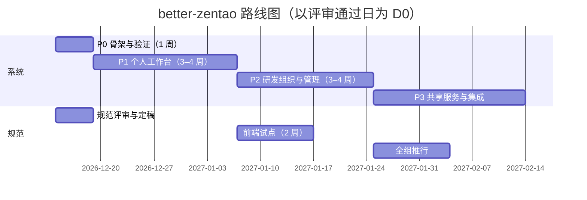

# 10 实施计划

> 本文把 05–09 拆成可交给编码 Agent 的工作包（WP）。每个 WP 有明确的文件、接口、测试和完成定义（DoD），可以单独开一个会话完成。
> 投入按"1 名熟悉 TypeScript 的开发者 + 编码 Agent"估算，单位为人日；不含规范评审会时间。

## 1. 路线图



| 阶段 | 周期 | 目标 | 交付给谁 | 出口条件 |
| --- | --- | --- | --- | --- |
| P0 | 1 周 | 工程骨架；只读链路打通；写能力验证 | 开发者 | 09 §7 P0 门槛 |
| P1 | 3–4 周 | "我的工作""提需""进度""逾期""排期"在 Agent 中可用 | 前端试点组（设计主管（前端）、研发主管（前端）及成员） | 09 §7 P1 门槛 |
| P2 | 3–4 周 | 拆解、移交、挪月、关闭、月度队列、计划与版本视图、摘要推送 | 全体研发、产品管理、项目管理 | 09 §7 P2 门槛 |
| P3 | 按需 | 共享 HTTP 服务、企微应用、GitLab、常驻协调 | 全员、业务反馈者 | 按需求卡片 |

**总投入估算（按下表 WP 汇总）：** P0 约 5.5 人日；P1 约 18.5 人日；P2 约 18 人日；合计 P0–P2 约 42 人日（含 15% 缓冲约 48 人日）。

## 2. P0 骨架与验证（1 周）

| WP | 内容 | 主要文件 | 测试 | DoD | 依赖 | 估算 |
| --- | --- | --- | --- | --- | --- | --- |
| WP-00 | Node 24 LTS（最低 24.11.0）、pnpm、TS strict、ESLint、Vitest、zod、`node:sqlite`、MCP SDK。CLI 用 `parseArgs`（ADR-17） | `package.json` `tsconfig.json` `vitest.config.ts` `eslint.config.mjs` | 分层、纯函数、stdio 负向自检，编译后 CLI 与 MCP 离线握手 | `pnpm lint/typecheck/test` 全绿 | — | 0.5 |
| WP-01 | `api/internal` 使用内置 `fetch` 处理禅道 HTTP、认证和原始解码。`core` 提供通用策略、品牌 DTO 定义、脱敏日志、错误、时钟和日历（ADR-18） | `src/api/internal/*` `src/core/*` | `http.test.ts` `calendar.test.ts` S01 脱敏测试 | 401 重登一次；日志无请求/响应体 | WP-00 | 1 |
| WP-02 | 配置加载与校验（08） | `src/core/config.ts` `config/*.json` | `config.test.ts` | CFG-01–CFG-10 可检查 | WP-00 | 0.5 |
| WP-03 | 夹具采集与脱敏：`bzt probe capture`、`sanitize-fixture.ts` | `scripts/` `test/fixtures/zentao-22.6/` | `sanitize.test.ts` | 夹具覆盖 06 §3 全部端点；无敏感字段 | WP-01 | 1 |
| WP-04 | DTO 与只读 API（06 §3、§5） | `src/core/dto/*` `src/api/*` | Q1–Q13 契约测试 | 全部通过 | WP-03 | 1.5 |
| WP-05 | 能力注册表 + `bzt probe write`（发送层固定 #29，ADR-19）+ `bzt doctor` | `src/api/capabilities.ts` `src/api/internal/probe-transport.ts` `src/adapters/cli/commands/{probe,doctor}.ts` | #29 熔断离线测试、`capabilities.test.ts`、`story-html-spec.test.ts` | `story.create`、`story.assign` 复验通过；**实测 HTML 正文换行渲染及 Web 富文本二次保存后 `bzt:v1` 标签留存情况**；尝试验证 `task.create`、`story.activate`、`story.linkExecution` | WP-04 | 1 |

骨架交付先验收 ADR-17–19、静态护栏、S01、编译后 CLI 和 MCP `initialize`、#29 发送层离线熔断。开发时用 `pnpm install` 还原依赖，`pnpm build` 输出 `dist`，`node dist/adapters/cli/bzt.js --help` 查看入口。真实探查单独确认调用清单后执行。

> P0 末尾产出《写能力验证记录》，更新 06 §6.4 与 §7 的状态。**P2 能否按计划进行取决于这一步。**

## 3. P1 个人工作台（3–4 周）

| WP | 内容 | 主要文件 | 测试 | DoD | 依赖 | 估算 |
| --- | --- | --- | --- | --- | --- | --- |
| WP-10 | 本地存储与迁移（05 §6 中 P1 表） | `src/core/store/*` | `store.test.ts` | 按实例+账号隔离；迁移可重复执行 | WP-01 | 1 |
| WP-11 | 领域：阶段识别、时间状态、父子/多人、业务进展、角色解析、月份归属（04 §2–§4.6） | `src/domain/*` | 09 §2 对应单元测试 | 覆盖率 ≥95% | WP-04 | 3 |
| WP-12 | 规则 R01–R05 | `src/rules/r01…r05` `index.ts` | 每条命中/不命中/边界 | `_coverage.test.ts` 通过 | WP-11 | 1 |
| WP-13 | DirectoryService + `resolve_context` | `services/directory.ts` `contracts/tools/resolve_context.ts` | AC-02 | 同名返回候选 | WP-04 | 1 |
| WP-14 | TrackingService：`get_my_work`、`get_team_work`、`query_stories`、`get_story_progress`（含卡片） | `services/tracking.ts` | AC-20–AC-34 | `partial` 正确传播 | WP-11、WP-13 | 3 |
| WP-15 | ScheduleService：`get_member_schedule`（表格；HTML 由 CLI 输出） | `services/schedule.ts` `adapters/cli/render/schedule-html.ts` | AC-40、AC-41 | 前 3 候选稳定 | WP-11 | 1.5 |
| WP-16 | OperationExecutor：两段式、W0–W3 判定、五态、回读、反查、resume、缓存失效 | `services/operation.ts` | SV-01–SV-11 | 无重复创建 | WP-10 | 2 |
| WP-17 | IntakeService：`create_story`、`import_stories`（模板、标签、配对、回关联、backfilled） | `services/intake.ts` `domain/templates.ts` | AC-01–AC-11 | 预览字段标注 origin | WP-16、WP-13 | 2.5 |
| WP-18 | FlowService（P1 部分）：`assign_story` | `services/flow.ts` | AC-22 | R04 警告 | WP-16 | 0.5 |
| WP-19 | RiskService：`scan_workflow_risks` | `services/risk.ts` | AC-53、AC-69（P1 规则范围） | 分组输出 | WP-12 | 1 |
| WP-20 | MCP 适配：19 个工具中 P1 的 12 个注册、description、输出投影 | `adapters/mcp/*` `contracts/*` | `adapters/mcp.test.ts`、AC-82–AC-85 | 与 07 契约一致 | WP-13–WP-19 | 1 |
| WP-21 | SKILL 与接入：`SKILL.md`、`bzt install-agent`、模板 | `skills/` `templates/` | eval：P1 路由与补问 | 三种 Agent 均可调用 | WP-20 | 1 |

**P1 试点：** 前端组 2 周。每日由研发主管（前端）记录问题；第 2 周末复盘：路由准确率、补问是否合理、是否出现错误结论，以及 R04/R05 命中数变化。

## 4. P2 研发组织与管理（3–4 周）

| WP | 内容 | 主要文件 | 测试 | DoD | 依赖 | 估算 |
| --- | --- | --- | --- | --- | --- | --- |
| WP-30 | 写能力补齐验证：`task.create`、`story.activate/edit/close/comment`、`story.linkExecution`、`*.linkStory`、`task.close`、`release.read` | `capabilities.ts` 夹具 | 契约测试 | 注册表更新；06 同步 | P0 | 2 |
| WP-31 | 领域：L3 汇总、版本就绪、五桶、默认日期、快照对比（04 §4.6–§4.9） | `domain/plan-summary.ts` `release.ts` `month.ts` `schedule.ts` | 09 §2 | 覆盖率 ≥95% | WP-11 | 2.5 |
| WP-32 | 规则 R06–R14 | `src/rules/` | 每条三类用例 | — | WP-31 | 2 |
| WP-33 | DecomposeService：`decompose_stories`（四模板、前置关联、通知） | `services/decompose.ts` | AC-42–AC-46、AC-49 | 一次建齐；回读 | WP-30 | 2.5 |
| WP-34 | FlowService：`handoff_story`、`reschedule_story`、`close_stories`、`set_story_meta` | `services/flow.ts` | AC-47、AC-48、AC-50–AC-52、AC-63 | 降级路径可用 | WP-30 | 3 |
| WP-35 | ManagementService：`get_plan_progress`（四视图）、`get_monthly_dev_queue` | `services/management.ts` | AC-54、AC-60–AC-68 | 分母与口径齐全 | WP-31 | 2.5 |
| WP-36 | 快照：`bzt snapshot`、导出与导入 | `adapters/scheduler/snapshot.ts` | AC-65 | 跨机器导入只读 | WP-35 | 1 |
| WP-37 | NotifyService：企微机器人、`bzt digest`、事件推送、去重、`bzt schedule-task install` | `services/notify.ts` `adapters/scheduler/digest.ts` | AC-45、AC-80、AC-81、SV-12 | 一天一次 | WP-33 | 1.5 |
| WP-38 | MCP 注册 P2 工具 + SKILL 更新 + eval | `adapters/mcp/*` `skills/` | eval | — | WP-33–WP-37 | 1 |

## 5. P3（按需，需求卡片立项）

| 方向 | 前置 | 说明 |
| --- | --- | --- |
| P3-a 共享 HTTP 服务 | 安全评审；个人令牌方案 | 每人用自己的禅道身份，禁止共用管理员账号 |
| P3-b 企微应用 | P3-a；企微管理员配合 | 业务反馈者自助提需与查询（US-FB-01–03 的完整形态） |
| P3-c GitLab 关联 | GitLab 访问令牌 | US-RD-05、R16 |
| P3-d 常驻协调 | P3-a | 风险生命周期与接续推动 |

## 6. 编码 Agent 执行方式

每个 WP 用一个独立会话完成，提示词模板：

```text
你在 better-zentao 仓库工作。先读 AGENTS.md，再读：
- docs/04 §<相关章节>、docs/07 §<相关工具>、docs/06 §<相关端点>（只读与本 WP 相关的部分）
本次工作包：WP-xx <名称>
范围：<文件列表>
先写测试（列出 09 中的用例编号），再实现；不要修改范围外的文件。
完成标准：<DoD>；pnpm lint && pnpm typecheck && pnpm test 全绿。
如果发现文档与实际禅道行为冲突：停止编码，在 docs/12 追加"待确认"条目并说明证据。
```

- WP 之间通过 `contracts/` 与 `domain/types.ts` 对接；先合并定义类型的 WP。
- 每个 WP 合并前，由人工审阅：是否有原始响应透传、是否编造事实字段、是否有未注册的写能力。

## 7. 规范推行计划

| 时间 | 动作 | 负责 | 产出 |
| --- | --- | --- | --- |
| D0 前 | 发出 00 评审摘要与 03 协作规范 | 项目管理 | 评审材料 |
| D0 | 评审会：逐条确认 N01–N17 与 12 中的待评审决策 | 产品管理主持，各主管参加 | 决议记录（更新 12） |
| D0+1 周 | 建好下月 L3（月 × 模块）与迭代（按 N04 命名）；配置 `modules`、`teams` | 产品管理、项目管理 | 团队配置 |
| P1 上线 | 前端试点：设计主管（前端）、研发主管（前端）及成员 | 研发主管（前端） | 试点日志 |
| 试点第 2 周末 | 复盘：R04、R05、R06 命中数；路由准确率；问题清单 | 项目管理 | 复盘记录，必要时修订规范 |
| P2 上线 | 全组推行；后端改用版本标签 + 发布日历，旧版本计划保留到当月结束 | 研发主管（后端）、产品管理 | 迁移完成 |
| 每月初 | 承诺快照；规范执行情况回顾（US-PM-03） | 项目管理 | 月度报告 |

## 8. 风险与应对

| 风险 | 影响 | 应对 |
| --- | --- | --- |
| 写能力验证不通过（如 `task.create`、`story.activate`） | P2 拆解、移交无法自动化 | 降级为"生成预览 + 禅道链接，用户手动完成"；继续尝试候选端点 |
| 规范评审拖延或分歧大 | 系统默认值无依据 | 系统先按 03 默认实现；分歧条目在 12 记录，按"提示不阻断"上线 |
| 历史数据不规范 | 进展、风险误报 | 推测标注；历史兼容规则（04 §6）；规则只对系统上线后新建对象严格检查 |
| 禅道升级 | 接口行为变化 | `bzt doctor` 检测版本；写能力自动降级；冒烟测试每日运行 |
| Agent 误路由或越权 | 错误写入 | 服务端级别判定；W2 预览确认；eval 回归 |
| 通知打扰 | 抵触 | 摘要聚合、一天一次、静默时段 |
