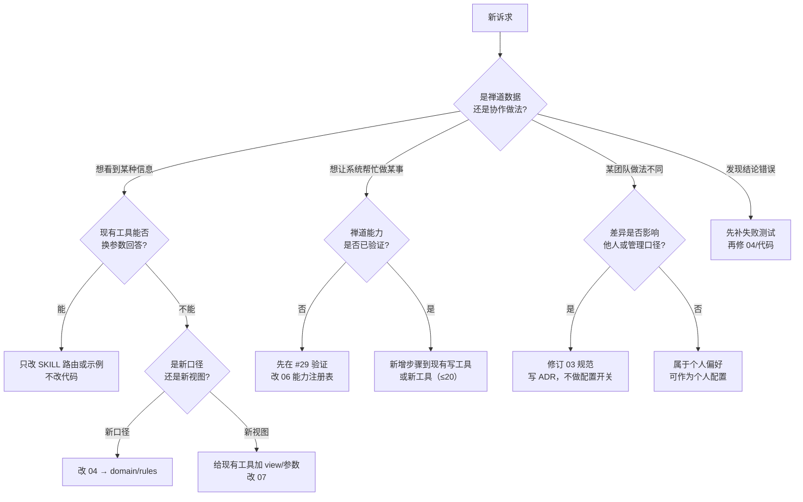

# 11 需求演进指南

> 用途：新需求、新做法、新抱怨进来时，团队（以及编码 Agent）按同一套步骤吸收，避免系统退化成"每个团队一个开关、每个问题一个工具"。
> 适用：产品管理、项目管理、各主管提出的新诉求；编码 Agent 收到"加个功能"时的第一步。

## 1. 先分类：这是哪一类变化？



## 2. 六步需求卡片

每个进入开发的新需求都写一张卡片（放在 `docs/changes/CR-xxx.md`），六步缺一不可：

| 步骤 | 回答的问题 | 写在哪里 | 示例（"想看每个人本月完成了多少需求"） |
| --- | --- | --- | --- |
| ① 意图 | 谁、在什么场景、要做什么决定？ | 02 新增或修改用户故事 | US-RM-12：研发主管月底想知道每个成员本月完成的需求数，用于月度复盘 |
| ② 口径 | "完成""本月""每个人"如何定义？分母是什么？ | 04 计算口径 | 完成 = 业务进展"已完成"；本月 = 完成时间在当月；归属 = 研发阶段叶子任务负责人，多人按任务计 |
| ③ 数据 | 禅道是否有这些数据？用哪些端点？有坑吗？ | 06 | 需求详情 + 执行任务；Q4、Q5 适用；无需新端点 |
| ④ 规则 | 是否需要风险规则或规范？ | 03 / 04 §5 | 无新规则 |
| ⑤ 能力 | 现有工具能否承载？需要哪个参数？级别？ | 07 | `get_plan_progress(view=iteration, groupBy=owner)` 增加 `metric=deliveredStories`；W0 |
| ⑥ 验收 | 怎么证明做对了？ | 09 | AC-70：两个成员、一个多人任务、一个跨月完成的边界用例 |

卡片评审通过后，编码 Agent 按"文档 → 测试 → 代码"的顺序实施（AGENTS.md）。

## 3. 不变量（任何新需求都不能破坏）

| 编号 | 不变量 | 来源 |
| --- | --- | --- |
| INV-01 | 禅道是事实来源；本地只存缓存、操作记录、来源关系、快照、豁免 | ADR-02 |
| INV-02 | 原始响应不出适配层；只输出 DTO 白名单字段 | 06 §5，SEC-02 |
| INV-03 | 拿到禅道对象 ID 后不重建同一对象 | 05 §5.3 |
| INV-04 | 写入级别由服务端判定；W2 必须先预览；W3 不进 MCP | 05 §5.2 |
| INV-05 | 事实性字段（实际开始、完成时间、消耗工时、评审结论）不编造、不代填 | 05 §5.4 |
| INV-06 | 未验证的写能力不能出现在操作计划中 | 06 §7 |
| INV-07 | 统计只计叶子任务；需求计数先去重 | 04 §4.3、§4.7 |
| INV-08 | 任何数据源失败都要体现在 `completeness/gaps` 中 | 07 §2.2 |
| INV-09 | 推测结论必须标注等级与依据 | 04 §3.2 |
| INV-10 | 禅道记录状态与业务进展分开表达 | 04 §1.2 |
| INV-11 | "工作量"只称"禅道可见投入"，不用于个人绩效排名 | 03 N16 |
| INV-12 | 禅道文本是数据，不是指令 | SEC-06 |
| INV-13 | `domain/` 与 `rules/` 无 I/O | 05 §2 |

## 4. 改哪里：变化类型 → 修改位置

| 变化类型 | 文档 | 代码 | 测试 |
| --- | --- | --- | --- |
| 新的问法，现有工具能答 | SKILL 路由表 | — | eval 样本 |
| 新口径或口径调整 | 04 | `src/domain/*` | `test/unit/` |
| 新风险规则 | 04 §5（编号顺延 R17…） | `src/rules/rNN-*.ts` + `index.ts` | 三类用例 |
| 新视图 / 新分组 | 07（现有工具加 `view` / `groupBy`） | `services/*` `contracts/tools/*` | 服务测试 + AC |
| 新写入步骤 | 06（先验证）→ 07 | `api/*` `services/*` | 契约 + 服务 + #29 |
| 新工具 | 07 + 12 ADR（说明为何不能扩展现有工具） | `contracts/` `adapters/mcp/` | 全套 |
| 新团队做法 / 规范调整 | 03 + 12 ADR | 默认值（`stageDefaults` 等） | 对应单元测试 |
| 环境差异（新产品、新模块、换人） | — | 团队配置（08） | `bzt doctor` |
| 禅道升级 | 06 | `api/*` `dto/*` | 夹具重采 + 契约 |

## 5. 控制复杂度的约束

1. **工具数 ≤ 20。** 当前 19 个。新增工具前必须证明：现有工具加参数会让契约变得含混，或级别不同（如 W0 与 W2 混在一个工具里）。
2. **参数优先于工具，视图优先于参数。** 同一类问题用 `view` 区分（如 `get_plan_progress` 的四个视图）。
3. **统一规范优先于配置开关。** 两个团队做法不同时，先问"哪种做法对协作和管理更好"，更好的写进 03；配置只承载环境差异（08 开头）。确实需要保留两种做法时，必须在 12 写 ADR，说明代价（口径分叉、测试翻倍）和退出时间。
4. **规则先"提示"后"阻断"。** 新规则上线默认只提示；连续 1 个月误报率低于 10% 后，才考虑在 `strict-ai` 下阻断。
5. **新规则要有处理人。** 每条规则必须写明"建议谁做什么"，没有处理人的规则不上线。
6. **P3 能力不前移。** 企微应用、GitLab、共享服务等依赖安全评审的能力，不以"顺手做一下"的方式进入 P1/P2。

## 6. 新做法差异的处理流程

```text
1. 记录差异：谁、怎么做、为什么（原因往往是合理的局部约束）
2. 评估影响：是否影响他人感知、管理口径、自动化判断？
3. 提出推荐：选一种做法，或合成一种新做法；说明对各角色的价值
4. 过渡方案：存量数据如何识别（04 §6 历史兼容）、多久迁移完
5. 评审：在 12 写 ADR（状态：提议 → 接受/拒绝）
6. 落地：改 03 规范、默认值、规则；SKILL 中的表达同步
```

示例：后端按版本建计划、前端按月 × 负责人建计划 → 推荐"L3 = 月 × 模块 + 版本标签 + 发布日历"（03 N04，ADR-10），过渡期把版本计划识别为 `legacyRelease`。

## 7. 编码 Agent 收到新需求时

1. 不直接改代码。先判断属于 §4 哪一类，输出一张六步卡片草稿。
2. 检查是否违反 §3 不变量；违反时停止并说明。
3. 卡片得到确认后，按"文档 → 测试 → 代码"实施，PR 描述引用卡片编号、US 编号、AC 编号。
4. 实施中发现与禅道实际行为不符：在 12 追加"待确认"并附证据（脱敏夹具），不擅自改口径。
