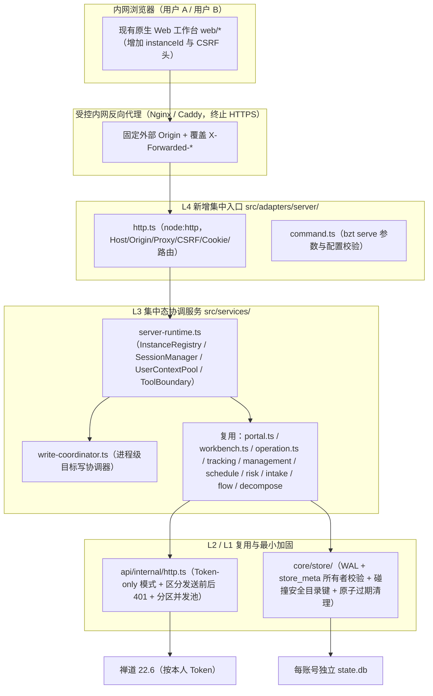

# CR-008 集中部署与多用户隔离（Server 1.0）

> 关联总控 Issue：#2
> 状态：**DESIGN REVIEW REQUESTED**（Gate A 方案与验收设计，等待评审决策）
> 基准 Commit：`99aab9a19dc57727d17dd59eef9b5e1f920830aa`
> 编制日期：2026-11-26

本文定义将 `better-zentao` 从单人本机 Web 门户（CR-002 / CR-003）演进为受控内网集中部署多用户工作台（**Server 1.0**）的架构方案、安全与隔离边界、部署拓扑、迁移与回滚路径、实施拆分及可执行验收矩阵。

---

## 1. 六步需求卡片（docs/11 §2）

| 步骤 | 内容 |
| --- | --- |
| ① 意图 | 让团队内多角色成员无需在个人电脑安装 Node 24 与维护本机配置，直接通过受控内网浏览器使用**本人禅道身份**登录统一工作台，并发完成查询、排期、拆解、移交、风险巡检与受控写入；同时保留现有本机 `bzt web`、CLI 与 stdio MCP 入口不退化，并为后续内置 AI 助手预留可复用的身份、会话与业务工具调用边界（本阶段不开发 AI 对话功能）。 |
| ② 口径 | 身份以禅道 `getCurrentUser` 回读账号为准，严格绑定管理员登记的禅道实例标识（`instanceId` / `instanceHash`）与团队配置中的 `roles` 表；业务口径（阶段识别、进展计算、月度范围、叶子任务统计、需求去重、缺失/推测标注）100% 沿用 `docs/04`；集中端授权取「个人禅道 ACL ∩ 本应用角色/能力范围」，普通用户不可自助扩权。 |
| ③ 数据 | 浏览器仅提交登录凭据（账号、密码、已登记实例 ID）与业务表单；服务端以本人身份调用禅道 22.6 API，原始响应不出 `src/api/`（SEC-02）。状态存储沿用单进程 Node 24 + 内置 `node:sqlite`（WAL 模式），按规范化 `(instanceHash, canonicalAccountKey)` 物理隔离各账号 `state.db` 并落盘 `store_meta` 所有者校验；团队/实例配置由管理员维护、运行时按不可变快照读取；个人偏好仅存显示项，与授权分离。 |
| ④ 规则 | 完整保留 `docs/11 §3` 全部 13 条不变量（INV-01–INV-13）、SEC-01–SEC-08、ADR-02/03/04/08/17/18/19/20。新增集中端安全门禁：多会话隔离与会话 ID 轮换、登录换 Token 且内存零密码留存、禁用本机启动凭证与自助改角色、固定外部 `externalOrigin` + 可信代理白名单 + 会话绑定 CSRF 令牌 + `__Host-` `Secure` Cookie、管理员实例白名单防 SSRF、跨账号同目标写入协调、派发后 401 保留 `unknown`、集中模式默认关闭企微群推与 W3/探查入口。 |
| ⑤ 能力 | 新增独立集中服务入口 `bzt serve`（`src/adapters/server/`），复用同一 `services / domain / rules / api / core` 内核与现有 19 个业务工具契约（不新增 MCP 工具，不新增禅道端点，不引入 HTTP 框架或 ORM）。原 `bzt web` 保持回环单人本机门户，CLI 与 stdio MCP 保持零退化。 |
| ⑥ 验收 | 23 条离线可执行验收用例（`SRV-AUTH-01..03`、`SRV-ISO-01..04`、`SRV-RBAC-01..02`、`SRV-OP-01..04`、`SRV-CONC-01..02`、`SRV-SEC-01..02`、`SRV-LIFE-01..03`、`SRV-REG-01..03`），全部基于双实例 `fake-zentao`、脱敏夹具与临时 SQLite 目录执行，零真实禅道写入、零外部网络请求。 |

---

## 2. 现有代码单用户假设与基线核查（文件/符号证据）

基于 `main@99aab9a19dc57727d17dd59eef9b5e1f920830aa` 的代码探查，以及 Codex 独立安全与架构审查（见 §9），现有代码存在以下与集中多用户部署不兼容的假设与缺陷：

| 维度 | 现状文件与符号证据 | 现状行为 | 集中多用户冲突 |
| --- | --- | --- | --- |
| **进程单会话与本机启动耦合** | `src/adapters/web/server.ts:184–199, 256–343, 344–360`（`startPortal`、`session`、`loggingIn`、`launchToken`）；`src/services/portal-startup.ts:98–186`（`preparePortalStartup`、`portal-identity.json`） | 全进程仅 1 个 `session` 变量与全局 `loggingIn` 锁；新登录直接 `forget()` 踢掉前一个用户；支持 `#launch=` 启动令牌、首次访问者绑定 `baseUrl`/`account`、使用进程环境变量密码代登录。 | 两人同时访问会互相顶号；非本机环境下启动令牌和进程凭据会造成严重越权与实例劫持（**P0 / F-01**）。 |
| **自助职责修改共享角色表** | `src/services/portal.ts:407–467, 501–511`（`mayEdit`、`saveRoles`、`updateRoles`）；`src/services/portal-role-settings.ts:91–167`（`createPortalRoleSettings.save`） | 本机所有者可在浏览器勾选任意职责并直接写回 `team.local.json` 的 `roles`，立即生效（含 `PM` 的 R13 例外写权限）。 | 集中端若开放此路径，普通用户可自助提权并覆盖共享配置（**P0 / F-02**）。 |
| **状态库路径碰撞与缺少所有者校验** | `src/core/store/location.ts:49–65, 67–104`（`sanitizeAccount`、`resolveStoreLocation`）；`src/core/store/store.ts:81–106, 140–158`（`openLocalStore`） | `sanitizeAccount` 对安全账号保留原始大小写；在大小写不敏感文件系统（Windows/macOS）上 `Alice` 与 `alice` 落入同一路径；`openLocalStore` 未校验库内所有者元数据；除 `cache_kv` 外，多数业务表依赖物理分库隔离。 | 账号别名或误传 `dbPath` 可能导致跨账号串库（**P0 / F-03**）。 |
| **反代、Origin、Cookie 与 CSRF 边界** | `src/adapters/web/server.ts:200–255, 335–338, 409–417, 451–467` | 硬编码 `http://127.0.0.1:<port>` 与 `"http://" + req.headers.host`；Cookie 无 `Secure`；无 `trustedProxies` 与转发头策略；无会话绑定 CSRF 令牌。 | 经反代/HTTPS 暴露后易受 Host/Origin 伪造、协议降级或 CSRF 攻击（**P0 / F-04**）。 |
| **明文密码滞留内存与会话生命周期不全** | `src/api/internal/http.ts:338–354`（`loginRequest.body`）；`src/api/internal/auth.ts:26–48`；`src/adapters/web/server.ts:195–199, 279–280, 426–441` | `createZentaoHttp` 在闭包中保留含明文密码的 `loginRequest.body` 以便 401 自动重登；Web 会话仅有空闲超时且在 `busy>0` 时不回收，无绝对有效期；上游永久 `AUTH_FAILED` 未撤销应用会话。 | 多用户常驻进程内存滞留大量明文密码；上游失效或密码修改后会话未及时撤销（**P1 / F-10**）。 |
| **跨会话缓存失效竞态** | `src/services/portal-snapshots.ts:45–52, 78–135, 175–186`（`inFlight`、`generation`、`invalidate`）；`src/core/store/repositories.ts:609–639`（`CacheRepository.get`） | `generation` 与 `inFlight` 存在于单次登录内存中；同账号双会话并发时，旧读可能在另一会话写入失效后落盘脏快照；`CacheRepository.get` 清理过期键时未带 `AND expires_at <= ?` 条件。 | 同账号多标签/多端可能读回过期脏数据或误删新缓存（**P1 / F-06**、**P2 / F-14**）。 |
| **Web 预览归属仅存内存与重放副作用** | `src/services/portal.ts:200–257, 451–463`（`previews`）；`src/services/operation.ts:503–542, 620–626`；`src/services/workbench.ts:328–338` | `previews` 存在单次登录内存，登出/重启后原用户无法通过 Web 查看已派发回执；`confirmOperation` 在 `executor.confirm` 幂等返回旧结果时仍会再次执行 `recordConfirmed` 与 `notifyConfirmed`。 | 登出/重启后丢失已派发回执可查性；重复确认存在重复收尾风险（**P1 / F-07**）。 |
| **跨账号同目标写入并发与非原子 prepare** | `src/services/operation.ts:341–375, 548–569, 682–733`；`src/core/http-policy.ts:42–57`（`withInstanceWriteLock`） | `confirm` 文件锁按账号 `dbPath` 隔离；不同账号可同时通过 `checkTargets`；`withInstanceWriteLock` 仅锁单次 HTTP 写请求而非「预检→写入→回读」；`prepare` 插入 `operations` 与 `operation_steps` 未包裹单事务。 | 两用户同时操作同一需求可能互相覆盖；崩溃时可能留下残缺计划（**P1 / F-08**）。 |
| **派发后 401 被误判为明确失败** | `src/api/internal/http.ts:467–476`；`src/services/operation.ts:296–303, 770–789`（`rejectWrite`） | HTTP 层注释明确 401 无法证明写入未进入禅道业务处理，但执行器 `rejectWrite` 将 `AUTH_FAILED` 归为明确拒绝，将检查点由 `unknown` 改写为 `failed`。 | 可能导致已落库步骤被误判失败或进入可重试集合（**P1 / F-09**）。 |
| **进程级全局读信号量与同步 SQLite 阻塞** | `src/core/http-policy.ts:7–40`（`withReadSlot`）；`src/core/store/store.ts:37, 128–138`（`busyTimeoutMs = 5_000`） | 全进程共享 8 个读槽位，无实例/用户公平配额且登录与重报表争抢同一队列；多会话重复打开同一 `state.db` 且同步阻塞最多 5 秒。 | 单实例慢查询或大报表可拖垮全服登录与其他实例（**P1 / F-11**）。 |
| **共享配置与个人配置混装、通知按账号去重** | `src/core/config.ts:648–704`；`src/services/portal.ts:469–473`；`src/services/workbench.ts:116, 189–218`；`src/services/notify.ts:339–358` | `loadFileConfig` 从状态根目录读单一 `config.json`；`portal.ts` 仅就地替换 `config.roles`；企微通知按进程环境变量配置，去重表在各账号 `state.db` 中。 | 多用户环境下个人偏好污染全局、通知无法跨账号去重导致群消息轰炸（**P1 / F-12**）。 |
| **前端状态未区分实例 & 入口耦合风险** | `web/app.js:975–994, 1092–1117`；`src/adapters/web/command.ts`；`eslint.config.mjs:472–499` | 前端 `sectionKey` 与 `periodAccount` 仅按账号/职责键控；`node:http` 仅对 `src/adapters/web/server.ts` 放行。 | 切实例后页面状态可能串用；若直接改造 `bzt web` 易破坏本机启动器与回环契约（**P2 / F-13、F-15**）。 |

---

## 3. 现状与目标差异对照

| 维度 | 现状（单人本机 `bzt web`） | 目标（集中多用户 Server 1.0 · `bzt serve`） |
| --- | --- | --- |
| 启动入口 | `bzt web [--config] [--port]`，强制监听 `127.0.0.1` | 新增 `bzt serve --server-config <path>`，默认监听 `127.0.0.1:17330`（可显式配置内网地址）；`bzt web` 保持不变 |
| 会话模型 | 进程单 `session` 对象，后登录替换前登录 | 进程内多用户会话表 `SessionStore`（`Map<sessionId, ServerSession>`），支持多用户/多标签独立并发，设上限与空闲/绝对 TTL |
| 上游禅道凭据 | 闭包保存明文密码以支持 401 自动重登；支持环境密码代登 | **推荐（ADR-22 提议）**：登录时一次性换取禅道 Token 并验明 `getCurrentUser`，随后立即丢弃密码；内存仅持 Token，默认不持久化；401/重启即失效重登 |
| 禅道实例选择 | 首次本机启动页可填写任意 `baseUrl` | 管理员在 `server.json` 预登记受信任实例白名单（`instances[]`）；前端仅从登记列表选择 `instanceId`，彻底阻断 SSRF |
| 角色与权限 | 本机所有者可经 `/api/roles` 自助修改 `team.local.json` | 共享 `team.json` 按实例由管理员维护、运行时只读/原子重载；普通用户禁用 `/api/roles`；个人偏好仅改显示（默认视图/主题等），不扩大权限 |
| 状态存储 | `<BZT_HOME>/<instanceHash>/<account>/state.db` | `<BZT_SERVER_DATA>/users/<instanceHash>/<canonicalAccountKey>/state.db`（WAL 模式）+ `store_meta(instance_hash, account)` 打开时强校验；同进程同账号复用单一引用计数 `LocalStore` |
| 缓存与快照 | 每次登录独立 `generation`/`inFlight` | 按 `(instanceHash, account)` 共享 `UserRuntime`（含共享 `generation`、`inFlight` 与活动探测节流）；过期清理原子条件 `expires_at <= ?` |
| 写入并发与恢复 | 仅按账号库文件锁 + 单次 HTTP 写锁；`previews` 仅存单次登录内存 | `prepare()` 单事务落盘；进程级目标写协调器序列化「预检→派发→回读」；区分发送前/后 401（发送后保持 `unknown`）；未执行预览绑定会话，已派发回执按所有者跨会话/重启可读 |
| 网络与代理安全 | 仅 `127.0.0.1` HTTP + `Origin` 检查 | 固定 `externalOrigin` + `trustedProxies` 白名单 + `__Host-` `Secure` Cookie（HTTPS 时）+ 会话绑定 CSRF 令牌（`X-Bzt-Csrf`）+ 严格 CSP + `no-store` |
| 企微通知与高危入口 | 沿用进程 `BZT_WECOM_WEBHOOK`；无 W3/探查 | Server 1.0 **默认关闭企微群推**（直至实现实例级去重存储）；保持禁用 W3 与 `probe` |
| 后续 AI 助手预留 | 无统一多用户调用边界 | 抽象 `Principal` + `ServerSession` + `ToolBoundary`，Web API 与未来内置 AI 助手/Streamable HTTP MCP 共用同一鉴权、角色门禁与两段式写入护栏 |

---

## 4. Server 1.0 目标架构设计

### 4.1 分层与模块边界

沿用 `docs/05 §2` 依赖方向（`adapters → services → (domain, rules, api) → core`），不引入任何 HTTP 框架、ORM 或新第三方依赖：



- **ESLint 守卫同步（Gate B）**：`eslint.config.mjs:472–499` 当前仅允许 `src/adapters/web/server.ts` 导入 `node:http` 的 `createServer` / `IncomingMessage` / `ServerResponse`。Gate B 仅扩展该白名单至 `src/adapters/server/http.ts`（并视需要允许读取 `socket.remoteAddress`），其余源码目录继续严格禁止网络模块导入。
- **未来内置 AI 助手边界预留**：`ToolBoundary` 接受不可伪造的服务端 `Principal = Readonly<{ instanceId: string; instanceHash: string; account: string; sessionId: string; roles: readonly PortalRole[]; configVersion: string }>`，封装「工具白名单校验 → 业务服务调用 → 两段式 `OperationExecutor` 预览/确认」。后续内置 AI 助手或 Streamable HTTP MCP 只需复用 `Principal` 与 `ToolBoundary`，不得绕过人工确认或 W2 延迟。

### 4.2 认证、会话与凭据生命周期

1. **登录流程（`POST /api/login`）**：
   - 输入严格校验 `{ instanceId, account, password }`（禁止 `baseUrl`、`launch`、`saved`）。
   - 核对 `instanceId` 存在于管理员登记的 `instances` 白名单中（否则直接 `400/403`，零出站请求）。
   - 使用一次性凭据调用禅道 `POST /api.php/v1/tokens` 换取 `token`，立即调用 `getCurrentUser` 核对 `viewer.account === account.trim()`（不匹配则拒绝，不建会话、不开库）。
   - **零密码留存（提议 ADR-22）**：登录验证通过后，**立即丢弃明文密码**，不写入闭包、不写入内存会话对象、不写入磁盘或日志。`createZentaoHttp` 新增 `token` 静态凭据模式（遇到 401 时不自动重登，直接清 Token 并上抛 `AUTH_FAILED`）。
   - 签发 256-bit 随机 `sessionId`（登录与重新认证均强制生成新 ID，防会话固定），同时生成 256-bit 会话绑定 `csrfToken`。
   - 返回身份信息（`instanceId`、`account`、`displayName`、`roles`、`csrfToken`、`dataMonth` 等，不含 `roleSetup`）；通过 `Set-Cookie` 下发会话 Cookie。
2. **会话期限与容量限制**：
   - **空闲超时（`idleTimeoutMinutes`）**：默认 480 分钟（8 小时），`/api/updates` 后台探测不续期。
   - **绝对超时（`absoluteTimeoutMinutes`）**：默认 1440 分钟（24 小时），到期强制注销。
   - **容量上限**：`maxSessions`（默认 500）、`maxSessionsPerUser`（默认 5，超出时淘汰该用户最旧空闲会话或拒绝），防止内存耗尽。
3. **撤销与退出流程**：
   - 触发条件：用户主动 `POST /api/logout`、空闲/绝对超时、上游禅道返回永久 `401 AUTH_FAILED`、服务优雅关闭/重启。
   - 行为：立即从 `SessionStore` 删除会话并标记 `revoked = true`、清空内存中的 `zentaoToken`、清除客户端 Cookie；**在途读取请求**完成后丢弃响应并返回 `401`；**在途写入请求**若尚在预检阶段则中止派发，若已派发则允许完成检查点落盘与回读以保账务一致，但不再向已撤销会话交付响应，用户重登后可通过 `get_operation` 查阅回执。
   - 服务重启：内存会话表清空，旧 Cookie 一律返回 `401`，用户重新登录；无密码或会话令牌落盘风险。

### 4.3 授权模型、角色边界与配置分离

1. **三类配置严格分离**：
   - **服务部署配置（`server.json`，管理员维护，启动加载）**：监听地址/端口、`externalOrigin`、`trustedProxies`、`dataDir`、会话 TTL/上限、HTTP 并发限额、已登记禅道实例列表（`instances: Record<instanceId, { name, baseUrl, teamConfigPath, enabled }>`）、默认 `notify.enabled = false`。
   - **实例团队配置（每实例一份 `team.json`，管理员维护）**：沿用 `docs/08` schema（`products`、`modules`、`teams`、`roles`、`releaseCalendar`、`write`、`rules` 等）。服务端通过文件哈希/mtime 原子加载为**不可变配置快照**（带 `configVersion`），单次请求全程使用同一快照，禁止在请求中就地修改 `config.roles`。
   - **个人偏好（每用户每实例独立存储）**：仅允许保存非授权显示偏好（如默认活跃角色——须属于其已授权角色集合、界面模式、主题等），**严禁**修改 `roles`、`mode`（放宽）或任何产品/团队权限。
2. **授权判定与撤权生效**：
   - 禁用普通用户的 `/api/roles` 写入端点（集中模式下直接返回 `403 PERMISSION_DENIED`）。
   - 每次 `/api/call` 与 `/api/session` 均按最新不可变团队配置快照重算 `roles`：外部撤销角色**立即生效**，并立即清理该用户在该角色下未执行的内存预览；外部新增角色在下次 `GET /api/session` 刷新或重登生效。
   - **角色 × 工具 × 对象范围**：严格沿用 `src/services/portal.ts` 的 `rolePages` 工具白名单与 `runPortalAction` 强制约束（如 FB 仅限 `raised` 且 `who = account`，RD/QA 排期仅限本人，PM 独享 R13 例外）；所有上游读取均以**本人禅道 Token**执行，因此实际对象可见性始终受「本人禅道权限 ∩ 门户职责工具白名单」双重收敛（SEC-05）。

### 4.4 存储、SQLite 评估与并发控制

**SQLite 适用性评估结论**：
- Server 1.0 定位为**受控内网单进程部署**（典型团队规模 10–100 人，读多写少，核心事实源仍在禅道 22.6，本地仅存缓存/操作回执/来源关系/快照）。
- 在此定位下，继续使用 Node 24 内置 `node:sqlite`（`DatabaseSync`）**完全适用且是最优最小方案**，无需引入 PostgreSQL/MySQL 或外部 Redis；但必须补齐以下 5 项集中化加固：
  1. **碰撞安全路径 + 持久所有者校验（关闭 F-03）**：
     - 服务端用户库路径采用 `<dataDir>/users/<instanceHash>/<canonicalAccountDir>/state.db`，其中 `canonicalAccountDir` 始终附带原始 `account` 完整 UTF-8 字节的 SHA-256 截断哈希（如 `<safePrefix>-<sha256_16>`），彻底消除大小写不敏感文件系统上的 `Alice`/`alice` 碰撞。
     - 新增迁移 `003-store-owner-meta`（`store_meta` 表，记录 `instance_hash` 与 `account`）：新库初始化时写入所有者；打开已有库时强制校验 `instance_hash === expected && account === expected`，不匹配立即拒绝并抛错（不读任何业务表）。对既有单人本地库，仅当 `store_meta` 为空且库中已有 `operations`/`cache_kv` 所有者唯一一致（或全空库）时才自动补写；若存在多主体记录则拒绝打开。
  2. **单进程每账号共享 `LocalStore` 句柄 + WAL 模式（关闭 F-11）**：
     - `UserContextPool` 按 `(instanceHash, account)` 维护单一 `LocalStore` 实例与引用计数（跨同一用户的多个浏览器标签/会话共享），空闲归零后按宽限期延迟关闭。
     - 打开时启用 `PRAGMA journal_mode = WAL; PRAGMA synchronous = NORMAL;`，将 `busy_timeout` 收敛为 1000ms（避免单次同步等待阻塞事件循环 5 秒）。
  3. **进程级缓存失效协调 + 原子过期清理（关闭 F-06、F-14）**：
     - `PortalSnapshots` 的 `generation`、`inFlight` 与 `activity` 探测提升至按 `(instanceHash, account)` 共享的 `UserContext`，任一会话触发写入失效都会递增共享 `generation`，阻止并发旧读取回写脏快照。
     - `CacheRepository.get` 清理过期条目改为 `DELETE FROM cache_kv WHERE instance_hash = ? AND account = ? AND "key" = ? AND expires_at <= ?`。
     - 上游返回 `401 AUTH_FAILED` 或 `403 PERMISSION_DENIED` 时严禁回退旧快照（已有基础逻辑，需补齐跨会话测试锁定）。
  4. **操作执行器原子化与跨账号目标写协调（关闭 F-07、F-08、F-09）**：
     - `OperationExecutor.prepare()` 将 `operations` 与 `operation_steps` 插入包裹在单一 `BEGIN IMMEDIATE ... COMMIT` 事务中。
     - 新增进程级 `TargetWriteCoordinator`：对同一 `(instanceHash, targetType, targetId)`（多目标按字典序加锁防死锁）串行化「`checkTargets` 目标指纹刷新 → `write` → `readback`」，防止账号 A 与账号 B 同时通过预检后互相覆盖。
     - 区分「发送前认证失败（`getSession()` 阶段）」与「派发后收到 401」：发送后 401 保留 `unknown` 检查点并失效 Token，不归类为 `failed`，禁止盲目重试；`confirmOperation` 仅在本次调用实际执行了步骤时触发 `recordConfirmed` 与 `notifyConfirmed`。
     - **预览与回执分离**：未执行预览绑定 `(sessionId, role, configVersion)`，登出或重启后不可直接确认；已派发操作（`confirmed`/`partial`/`unknown`/`failed`）的回执由原认证主体通过 `get_operation` 跨会话/重启可读（仍受角色/实例校验）。
  5. **分区 HTTP 并发池（关闭 F-11）**：
     - 将 `src/core/http-policy.ts` 的单一全局 8 槽队列演进为**可配置并发调度器**：默认按实例设上限（如每实例 16）、单用户上限（如 4），并为认证请求保留独立通道，避免单实例大报表饿死登录或其他实例。

### 4.5 反向代理、网络与 Web 安全边界（关闭 F-04、F-12）

| 安全项 | Server 1.0 强制要求 |
| --- | --- |
| 默认监听与网络暴露 | 默认监听 `127.0.0.1:17330`（推荐由本机或内网反向代理接入）；禁止未显式配置即监听公网地址；文档明确仅限受控内网部署。 |
| 固定外部源与 Host/Origin 校验 | `server.json` 必填 `externalOrigin`（如 `https://bzt.internal.example`）；校验请求 `Host` 与 `externalOrigin.host` 一致；所有非幂等 `POST` 必须携带与 `externalOrigin` 严格相等的 `Origin` 头和 `Content-Type: application/json`。默认严格同源，**不设置**宽松 `Access-Control-Allow-Origin` 或带凭据 CORS。 |
| 可信代理白名单 | 默认 `trustedProxies: []`（直连，忽略所有 `X-Forwarded-*`）；仅当 `req.socket.remoteAddress` 命中白名单时才采信 `X-Forwarded-Proto`（用于确认 HTTPS）与客户端 IP（仅用于限流/诊断，不写入非白名单日志）；反向代理配置模板强制覆盖客户端传入的 `X-Forwarded-*`。 |
| Cookie 策略 | `externalOrigin` 为 `https:` 时：Cookie 名使用 `__Host-bzt_session`（`Path=/; HttpOnly; Secure; SameSite=Strict`，不设 `Domain`）；内网纯 HTTP 调试模式（需显式 `allowInsecureHttp: true`）使用 `bzt_session_<port>`（`Path=/api/; HttpOnly; SameSite=Strict`）并输出启动安全警告。 |
| CSRF 防护 | 除 `SameSite=Strict` + `Origin` + `Content-Type: application/json` 外，所有认证后的 `POST`（`/api/call`、`/api/updates`、`/api/logout`）必须携带服务端签发的会话绑定 `X-Bzt-Csrf` 头（内存保存，不落 `localStorage`）。 |
| 安全响应头 | 全量响应保留 `Cache-Control: no-store`、`X-Content-Type-Options: nosniff`、`Referrer-Policy: no-referrer`、严格 CSP（`default-src 'none'; script-src 'self'; style-src 'self'; connect-src 'self'; img-src 'self'; form-action 'self'; base-uri 'none'; frame-ancestors 'none'`）；HTTPS 模式加 `Strict-Transport-Security`。 |
| 出站 SSRF 防护 | 仅允许访问 `server.json` 预登记实例的归一化 `baseUrl`；禅道 `fetch` 继续保持 `redirect: "error"`，不随重定向转发凭据。 |
| 日志与错误脱敏 | 严格沿用 `src/core/logger.ts` 与 `projectToolError` 白名单脱敏；新增会话/认证事件日志仅记录事件名、状态码、耗时、脱敏实例 ID，严禁记录账号明文密码、禅道 Token、Cookie、CSRF 令牌或业务正文；越权拒绝（跨账号/跨实例/无权对象）统一返回 `403` 且不泄露对象是否存在。 |

---

## 5. 部署拓扑、数据边界与运维（候选交付）

### 5.1 推荐拓扑（受控内网最小可复现部署）

```text
内网用户浏览器
   │  HTTPS (443)
   ▼
内网反向代理 (Nginx / Caddy)
   ├─ 终止 TLS，覆盖 X-Forwarded-Proto / X-Forwarded-For
   ├─ 仅转发至 127.0.0.1:17330
   ▼
better-zentao Server 单进程 (Node 24 LTS, bzt serve)
   ├─ 只读挂载：/etc/bzt/server.json + /etc/bzt/teams/*.json
   ├─ 持久化卷（本地磁盘，非 NFS/SMB）：/var/lib/bzt/users/<instanceHash>/<accountKey>/state.db
   ▼  HTTPS/HTTP（内网受控可达）
禅道 22.6 实例
```

- **单进程硬约束**：Server 1.0 仅支持**单副本单进程 + 本地持久化卷**（SQLite WAL 不支持跨主机 NFS/SMB 共享写锁）。启动时对 `dataDir/.server.lock` 加进程排他锁，防止误起双实例指向同一数据目录。
- **Docker Compose（候选交付）**：在 Gate B/D 提供 `docker/Dockerfile`（基于 `node:24-slim`，非 root 用户运行）、`docker/compose.example.yml`（含 `bzt-server` + 可选反代示例）及 `GET /healthz`（只返回 `{ ok: true, mode: "server" }`，不暴露内部配置与版本细节）。

### 5.2 共享配置与用户态存储边界

| 数据类别 | 存储位置 | 权限与生命周期 | 备份建议 |
| --- | --- | --- | --- |
| 服务配置 `server.json` | 运维配置目录（只读挂载） | 仅管理员可写，禁止含密码/Token/Webhook 密钥 | 纳入配置仓库/运维备份 |
| 实例团队配置 `team.<id>.json` | 运维配置目录（只读挂载） | 仅管理员经受控流程发布（可用 `bzt config-ui` 离线编辑后发布） | 纳入配置仓库/运维备份 |
| 账号状态库 `state.db` | `<dataDir>/users/<instanceHash>/<accountKey>/state.db` | 仅服务进程用户 `0700/0600` 可读写；含操作回执、来源关系、快照、缓存、个人偏好 | 定时在线备份（SQLite `.backup` / WAL checkpoint 后拷贝） |
| 浏览器会话与禅道 Token | 仅进程内存 | 不落盘；登出/超时/401/重启立即清空 | 无需备份 |

---

## 6. 迁移、升级与回滚路径

1. **并行共存与渐进启用**：
   - Server 1.0（`bzt serve`）与现有本机入口（`bzt web`、CLI、`bzt mcp`）完全解耦，可并行运行、互不干扰。
   - **只读先行选项**：`server.json` 支持 `readOnly: true` 全局开关（默认可先以只读灰度验证多用户登录、隔离与查询，再开启写入）。
2. **数据迁移策略**：
   - **默认冷启动（推荐）**：Server 1.0 以独立 `dataDir` 启动，按禅道事实源（ADR-02）实时拉取数据，无需迁移个人本机 `state.db`。
   - **数据库 Schema 升级**：复用 `src/core/store/migrations.ts` 幂等版本迁移（新增 `003-store-owner-meta`），启动/开库自动向前迁移并校验版本不高于程序支持上限。
3. **回滚路径**：
   - 若集中端出现故障：直接停止 `bzt serve` 容器/进程，保留 `dataDir` 备份；团队成员可零改动切回本机 `bzt web` / CLI / MCP（共享 `team.json` schema 向前兼容）。
   - 版本升级回滚：升级前对 `dataDir` 做一致性快照备份；若新版本包含新 SQLite 迁移，回滚代码时同步恢复升级前快照。

---

## 7. 阶段拆分与工程实施路线（Gate B → Gate D）

> 当前仅授权 Gate A。以下路线需 ChatGPT 批准 Gate A 后方可启动。

| 阶段 / PR | 负责 Agent | 范围与交付物 | 合并门禁 |
| --- | --- | --- | --- |
| **Gate A（当前）** | Antigravity + Codex | 本 CR-008 + 提议 ADR-21/22/23 + 23 条验收矩阵（文档型 Draft PR） | ChatGPT 批准设计并拍板 §11 待决策项 |
| **Gate B · PR-1（失败测试）** | Codex | 基于验收矩阵建立离线失败测试套件（`test/adapters/server-*.test.ts`、`test/service/server-*.test.ts`、`test/unit/store.test.ts` 扩展等） | 测试可复现失败，不改生产代码 |
| **Gate B · PR-2（核心隔离与写入加固）** | Claude Code | `store_meta` 所有者校验、碰撞安全账号键、WAL + 原子过期清理、Token-only HTTP 模式、发送前后 401 区分、`prepare` 单事务、`TargetWriteCoordinator`、`confirmOperation` 重放去重、分区并发池 | 既有测试 + 相关 `SRV-ISO`/`SRV-OP`/`SRV-CONC` 全绿 |
| **Gate B · PR-3（Server HTTP 入口与安全边界）** | Claude Code | `src/adapters/server/*`、`src/services/server-runtime.ts`、`bzt serve` CLI、多会话管理、CSRF/Proxy/Cookie/SSRF、只读配置快照、ESLint 白名单最小扩展、文档 05/08/09 同步 | `SRV-AUTH`/`SRV-RBAC`/`SRV-SEC`/`SRV-LIFE`/`SRV-REG` 全绿 |
| **Gate B · PR-4（前端适配与部署交付）** | Claude Code | `web/app.js` 等支持实例选择、`X-Bzt-Csrf`、`instanceId` 状态隔离、隐藏集中端 `roleSetup`；Docker Compose 与反代配置示例、部署运维文档 | 全量 `pnpm lint && pnpm typecheck && pnpm test` 全绿 |
| **Gate C（独立验证）** | Codex | 独立运行全套离线门禁、双用户并发与越权回归、旧本机 `bzt web`/CLI/MCP 回归、隔离环境容器/进程部署冒烟 | 零未关闭 P0/P1，ChatGPT 复审通过 |
| **Gate D（隔离环境验收）** | 用户 + Antigravity | 隔离环境双独立用户并发实操验收（持久化、重启恢复、升级回滚）；真实公司生产部署另行授权 | 验收清单全部通过 |

---

## 8. 明确非目标（Server 1.0 不做）

1. **不开发内置 AI 对话 / Agent 执行功能**（仅预留 `Principal` / `Session` / `ToolBoundary` 边界）。
2. **不支持多副本水平扩展与分布式会话/锁**（1.0 明确限定单进程 + 本地持久化卷）。
3. **不面向公网暴露**（仅限受控内网 + 反代 HTTPS 接入）。
4. **不引入 HTTP 框架（Express/Fastify/Koa 等）、ORM、Redis 或外部数据库**。
5. **不在集中端开放 W3 破坏性操作（删除/完成任务/填工时）或 `#29` 写能力探查**。
6. **默认不在集中端启用企微群机器人推送**（待后续实现实例级去重存储后再独立评审）。
7. **不替代禅道自身的权限体系，不实现独立账号注册/密码存储/SSO（OIDC/LDAP 留待后续版本）**。

---

## 9. Codex 独立审查发现核实与收敛

Codex 在独立 worktree 对基准 `99aab9a` 完成了全量只读审查，共提出 **15 项发现（4 P0 / 8 P1 / 3 P2）**。Antigravity 逐项核对源码后全部确认成立，并在方案中收敛处理如下：

| 编号 | 级别 | 核心发现 | 源码核实结果 | 本方案处理与收敛决策 |
| --- | --- | --- | --- | --- |
| **F-01** | P0 | 进程单会话 + 本机启动令牌/环境代登耦合 | 已核实（`server.ts:184–360`、`portal-startup.ts`） | **完全采纳**：独立 `bzt serve` 入口 + `SessionStore` 多会话表 + 彻底禁用 `launch`/`saved`/首次绑定。 |
| **F-02** | P0 | 自助“保存我的职责”直接改写共享 `roles` | 已核实（`portal.ts:407–511`、`portal-role-settings.ts`） | **完全采纳**：集中端禁用 `/api/roles`；共享 `team.json` 只读/受控发布；个人偏好与授权分离。 |
| **F-03** | P0(条件) | `sanitizeAccount` 大小写碰撞 + 库无所有者校验 | 已核实（`location.ts:49–65`、`store.ts:140–158`） | **完全采纳**：目录键强制带完整账号哈希 + `003-store-owner-meta` 落盘并在开库时强校验。 |
| **F-04** | P0(条件) | 本机 Host/Origin/Cookie 无法直接承接反代与 HTTPS | 已核实（`server.ts:200–255, 335–338`） | **完全采纳**：固定 `externalOrigin` + `trustedProxies` 白名单 + `__Host-` `Secure` Cookie + `X-Bzt-Csrf`。 |
| **F-05** | P1 | 对象范围检查分散在各服务（如管理队列默认全团队） | 已核实（`portal.ts:230–324`、`management.ts`） | **采纳并明确边界**：集中端以「个人禅道 ACL ∩ 门户职责工具白名单」收敛，不另造冲突 ACL；管理队列团队范围作为待决策项 `S-D02` 交 ChatGPT 确认。 |
| **F-06** | P1 | 同账号多会话缓存失效 `generation` 各自独立 | 已核实（`portal-snapshots.ts:45–52, 105–106`） | **完全采纳**：提升为按 `(instanceHash, account)` 共享的 `UserContext` 失效代次与 `inFlight`。 |
| **F-07** | P1 | Web 预览归属仅存内存；重复确认触发重复收尾 | 已核实（`portal.ts:452`、`workbench.ts:328–338`） | **完全采纳**：未执行预览绑定会话（退出/重启失效）；已派发回执按所有者跨会话可读；`confirmOperation` 仅在真实执行时触发收尾与通知。 |
| **F-08** | P1 | 不同账号并发操作同目标可双双通过预检；`prepare` 非原子 | 已核实（`operation.ts:341–375, 548–569`、`http-policy.ts:42–57`） | **完全采纳**：`prepare` 单事务落盘 + 进程级 `TargetWriteCoordinator` 串行化同目标「预检→写入→回读」。 |
| **F-09** | P1 | 写入后 401 被 `rejectWrite` 归为明确 `failed` | 已核实（`http.ts:472` vs `operation.ts:301`） | **完全采纳**：区分发送前/后 401，派发后 401 保留 `unknown` 检查点，仅允许重登后回读/反查。 |
| **F-10** | P1 | 明文密码留存闭包内存；缺绝对期限与 401 自动撤会话 | 已核实（`http.ts:338–343`、`server.ts:195–199`） | **采纳并强化（ADR-22 提议）**：采用 Token-only 会话（登录即弃密码）+ 空闲/绝对双期限 + 401 立即撤会话。 |
| **F-11** | P1 | 全局 8 槽读队列与同步 SQLite 5s 锁阻塞 | 已核实（`http-policy.ts:7–40`、`store.ts:37`） | **完全采纳**：按实例/用户分区并发池（认证独立通道）+ 单账号共享 `LocalStore` 句柄 + WAL + 1s `busy_timeout`。 |
| **F-12** | P1 | 单 `config.json` 混装、无实例白名单、通知按账号去重 | 已核实（`config.ts:668–675`、`notify.ts:339–358`） | **完全采纳**：配置三层分离 + 管理员实例白名单 + 不可变配置快照 + 集中模式默认关闭企微群推。 |
| **F-13** | P2 | 前端状态键仅含账号与职责，未含 `instanceId` | 已核实（`web/app.js:975–994, 1092–1117`） | **完全采纳**：前端状态与请求作用域按 `(instanceId, account, role)` 隔离。 |
| **F-14** | P2 | `CacheRepository.get` 清理过期键非条件删除 | 已核实（`repositories.ts:621–638`） | **完全采纳**：改为 `AND expires_at <= ?` 原子条件删除。 |
| **F-15** | P2 | 与本机 `bzt web` 合并易导致回环/CLI/MCP 回归 | 已核实（`command.ts`、`portal-launch.ts`、`mcp/server.ts`） | **完全采纳**：新增独立 `bzt serve` 入口，既有入口零破坏并纳入回归测试矩阵。 |

---

## 10. 可执行验收测试矩阵（离线自动化）

**统一测试前置与约束**：
- 启动两个独立 `fake-zentao` 实例（实例 A、实例 B），各预置至少两个账号、带隔离标记的数据以及**故意重复的对象 ID**（如两实例均有需求 `#101`）。
- 使用独立 Cookie jar、独立临时 `dataDir`、注入式固定时钟 `clock` 与可控暂停假网关；拦截一切非替身出站请求，断言真实禅道与企微请求数严格为 **0**。
- HTTP 语义基线：未认证/会话失效返回 `401`；已认证但越权（跨账号/跨实例/无权工具或对象）统一返回 `403`（不暴露对象存在性）；并发忙锁/版本冲突/过时返回 `409`；派发后不确定写入返回 `unknown` 回执。

| 用例 ID | 场景类别 | 前置条件与操作步骤 | 预期断言 | 目标测试文件 |
| --- | --- | --- | --- | --- |
| `SRV-AUTH-01` | 登录与主体绑定 | 两个独立 Cookie jar 并行登录两账号，交替调用 `/api/session` 与 `get_my_work`；另测错误密码及假上游返回与表单不符账号。 | 两会话完全独立，上游请求各自携带本人 Token；错误凭据或身份不一致返回 `401`，不签发 Cookie、不创建该主体 `state.db`。 | `test/adapters/server-auth.test.ts` |
| `SRV-AUTH-02` | 会话固定与客户端声明 | 预置伪造/旧 Cookie 后登录与重登；请求中伪造 `X-Bzt-Account`、客户端角色或实例声明。 | 登录签发全新随机 `sessionId`，旧 Cookie 返回 `401`；客户端声明不能切换实例、主体、角色或上游客户端。 | `test/adapters/server-auth.test.ts` |
| `SRV-AUTH-03` | 集中与本机边界 | 在 `bzt serve` 上尝试提交 `launch`、`baseUrl`、`saved: true`；同时隔离验证 `bzt web` 仍可用本机启动器。 | 集中入口全部拒绝且零上游调用、零文件变更；本机 `bzt web` 保持原契约。 | `test/adapters/server-auth.test.ts` |
| `SRV-ISO-01` | 两用户两实例全链路隔离 | 在实例 A/B 用同名账号与重复对象 ID 分别预热待办、目录、详情、报表、活动游标、月初快照与回执，交叉读取并重启重开库。 | 所有视图与数据库行仅含归属实例与主体的标记；切换账号、实例、月份、职责均无串读。 | `test/adapters/server-isolation.test.ts`、`test/unit/store.test.ts` |
| `SRV-ISO-02` | 物理库所有者校验与碰撞防护 | 构造大小写仅差账号（如 `Alice`/`alice`）及显式共用同一 `dbPath` 场景；再尝试加载所有者不符的备份库。 | 两账号映射至不同物理目录；错配 `dbPath` 或备份库在读任何业务表前被拒绝，原库完整无损。 | `test/unit/store.test.ts` |
| `SRV-ISO-03` | 跨会话缓存失效与权限撤回 | 同账号开双会话：会话 1 暂停慢报表读取，会话 2 完成写入触发失效后放行会话 1；另测上游临时故障与 `403` 明确拒绝。 | 迟到的旧读取不得回写缓存；临时故障保留旧快照并标明时间与缺口；上游 `403` 严禁回退旧快照。 | `test/service/portal-snapshot.test.ts`、`test/adapters/server-isolation.test.ts` |
| `SRV-ISO-04` | 前端切实例状态隔离 | 同标签页由实例 A 切换至同名账号的实例 B，令实例 A 晚到响应后于实例 B 返回。 | 月份、导航、详情与报表均以实例 B 为准，实例 A 晚到响应被丢弃。 | `test/unit/portal-app.test.ts` |
| `SRV-RBAC-01` | 角色、工具与对象范围 | 普通角色调用未授权工具、越权团队、直接对象与关联对象（假禅道允许读，专测应用层门禁）；并含合法正例。 | 无权请求统一返回 `403`，无受保护字段泄露，写入次数为 0；合法对象按本人禅道权限正常返回。 | `test/adapters/server-rbac.test.ts`、`test/service/portal.test.ts` |
| `SRV-RBAC-02` | 个人偏好、配置版本与撤权 | 普通成员保存个人偏好；模拟管理员更新配置撤销角色或禁用能力，同时有旧预览等待确认。 | 偏好不增加任何权限；撤权立即生效，旧预览无法确认或发起新写入；`/api/roles` 对普通用户返回 `403`。 | `test/adapters/server-rbac.test.ts`、`test/service/portal-role-settings.test.ts` |
| `SRV-OP-01` | 计划与回执归属 | 用户甲生成预览并确认；分别由同实例用户乙、另实例同名用户、用户甲另一会话、无权角色调用 `get_operation` 与 `confirm_operation`。 | 跨主体/跨实例统一 `403` 且零写入；未执行预览不可被另一会话直接确认；已派发回执允许原主体重登按授权查询。 | `test/adapters/server-operations.test.ts` |
| `SRV-OP-02` | 判级、W2 护栏与能力门禁 | 覆盖 W2 正常确认、缺 `previewAck`、早于 3 秒、计划过期、目标过时、请求自带伪造 `level`、未验证能力及 W3/探查。 | 全部由服务端判级；拒绝返回对应业务错误码；W3、探查与未验证能力上游写入次数严格为 0。 | `test/service/operation.test.ts`、`test/adapters/server-operations.test.ts` |
| `SRV-OP-03` | 同一计划并发与终态重放 | 暂停首笔确认派发，第二请求并发确认同一 `opId`；终态后再重复确认一次。 | 上游严格派发 1 次；并发请求返回 `409`；终态重放返回既有回执且不重复执行 `recordConfirmed` 或通知。 | `test/service/operation.test.ts`、`test/adapters/server-operations.test.ts` |
| `SRV-OP-04` | 写入五态与派发后 401 | 假网关注入成功、部分成功、发送前 401、派发后 401、超时断连、已知 ID 回读失败、反查歧义与明确业务拒绝。 | 覆盖五态；发送前 401 为明确 `failed`；派发后 401 保留 `unknown` 且不自动重试；已知 ID 仅回读不重建。 | `test/unit/http.test.ts`、`test/service/operation.test.ts` |
| `SRV-CONC-01` | 跨账号争用同一目标 | 账号甲、乙对同一需求同版本生成预览，并发提交确认；另测两实例同号对象并发写入。 | 同实例同对象第二笔经写协调器重检并返回 `409/PLAN_STALE`，无覆盖；两实例同号对象互不阻塞各自成功。 | `test/service/server-write-coordination.test.ts` |
| `SRV-CONC-02` | 资源限额、公平性与原子缓存清理 | 占满实例 A 慢读队列并叠加多标签探测，并行在实例 B 登录与查询；另用双连接测试过期读与刷新交错。 | 队列与会话数有界，实例 B 在时限内正常响应；过期读不得删除另一连接刚刷新的新缓存。 | `test/adapters/server-concurrency.test.ts`、`test/unit/store.test.ts` |
| `SRV-SEC-01` | 代理信任、Cookie 与 CSRF | 经本地测试反代模拟 HTTPS 正常链路；注入非法 `Host`、非法 `Origin`、非可信 `X-Forwarded-*`、错误 `Content-Type`、缺失/错误 `X-Bzt-Csrf`。 | 非法请求全部在业务前被拒；合法反代链路签发 `__Host-` `Secure`/`HttpOnly`/`SameSite=Strict` Cookie，登出清除，全响应 `no-store`，无开放带凭据 CORS。 | `test/adapters/server-security.test.ts` |
| `SRV-SEC-02` | 上游白名单、重定向与全链路脱敏 | 注入合成密码、Token、原始人员字典、未登记实例及 302 重定向；全量扫描响应、日志、错误、SQLite 与临时文件。 | 仅访问已登记上游，重定向不转发凭据；密码不留存内存与磁盘；Token/哈希/原始字典零泄露。 | `test/adapters/server-security.test.ts`、`test/unit/http.test.ts`、`test/contract/dto-whitelist.test.ts` |
| `SRV-LIFE-01` | 退出、双超时与在途收尾 | 注入空闲与绝对期限边界；在读取、写入预检、已派发写入期间触发退出，同时保持另一用户活跃。 | 撤销后新请求 `401`，旧读不交付，预检写入中止，已派发写入保回执；另一会话不受影响，资源回收无泄漏。 | `test/adapters/server-lifecycle.test.ts` |
| `SRV-LIFE-02` | 上游 Token 失效与撤销 | 两主体并发工作，令主体 A 的禅道 Token 失效（401）。 | 主体 A 会话立即撤销并返回 `401`（零密码留存模式下停止探测与旧缓存交付）；主体 B 不受影响；写请求不自动重放。 | `test/adapters/server-lifecycle.test.ts`、`test/unit/http.test.ts` |
| `SRV-LIFE-03` | 进程重启与崩溃恢复 | 子进程在 `prepare` 事务、预发送检查点、派发后未落回执等时点退出，用同一 `dataDir` 重启。 | 旧 Cookie 全部 `401`；无残缺半条计划；原主体重登可查已派发回执，不确定步骤仅核对不重建；库锁与进程锁正常释放。 | `test/adapters/server-lifecycle.test.ts`、`test/service/operation.test.ts` |
| `SRV-REG-01` | 本机 `bzt web` 回归 | 隔离目录运行已配置与空配置 `bzt web`，覆盖启动器、同源、登录、本人职责保存、换号、切月与关闭。 | 仍仅监听回环，保留本机启动凭证、单会话替换与自助职责，无 Server 策略串入。 | `test/adapters/portal.test.ts`、`test/adapters/portal-startup.test.ts`、`test/adapters/portal-onboarding.test.ts` |
| `SRV-REG-02` | CLI 与 stdio MCP 回归 | 运行编译产物离线 `--help`、`doctor`、`config-ui`、MCP `initialize`/工具清单、W2 护栏与 W3 删除拒绝。 | 退出码、19 个 MCP 工具清单、W2/W3 护栏与配置优先级完全一致。 | `test/adapters/entrypoints.test.ts`、`test/adapters/mcp.test.ts`、`test/adapters/delete-story.test.ts` |
| `SRV-REG-03` | 业务口径一致性回归 | 脱敏夹具对照本地端与 Server 同授权查询（分页缺口、月度视图、叶子任务、不可信正文）。 | 结果完全符合 `docs/04`，数据源失败标 `partial` 与 `gaps`，正文/评论仅作不可信数据。 | `test/service/portal.test.ts`、`test/contract/dto-whitelist.test.ts` |

---

## 11. 待 ChatGPT 决策事项（Gate A 签核清单）

| 编号 | 议题 | 推荐基线 | 备选方案与权衡 |
| --- | --- | --- | --- |
| **S-D01** | **上游凭据留存策略（对应 ADR-22）** | **推荐**：登录时换取禅道 Token 后立即丢弃明文密码（内存零密码留存），Token 过期/401 或服务重启后用户重登。 | 备选：内存短期保留加密密码以自动续期 Token（增加内存暴露面且需处理改密/封号同步）。 |
| **S-D02** | **团队可见范围口径（对应 F-05）** | **推荐**：集中端以「个人禅道 ACL ∩ 门户角色工具白名单」为准，保留现有管理视图（如月度队列）在本人禅道可见范围内的全团队聚合，FB 维持严格本人提需隔离。 | 备选：在 `team.json` 额外定义每角色可见产品/团队硬白名单（增加运维负担，可能与禅道权限分叉）。 |
| **S-D03** | **首发是否默认支持写入或只读先行** | **推荐**：支持通过 `server.json` 的 `readOnly` 开关控制；Gate B 完整交付受控写入与全部 `SRV-OP-*`/`SRV-CONC-*` 门禁，Gate D 可按需先只读验收再开写入。 | 备选：Server 1.0 首发仅做纯只读，写入延后至 Server 1.1（降低风险但无法替代完整工作台闭环）。 |
| **S-D04** | **部署与 HTTPS 接入策略（对应 ADR-23）** | **推荐**：生产环境要求经受控内网反向代理终止 HTTPS 并固定 `externalOrigin`；提供 Docker Compose + Nginx/Caddy 示例；仅在显式 `allowInsecureHttp: true` 时允许内网纯 HTTP 试跑（伴安全警告）。 | 备选：内置 Node TLS 证书加载（增加证书轮换与运维复杂度）。 |
| **S-D05** | **企微群推与既有本地数据迁移** | **推荐**：Server 1.0 默认关闭企微群推（待后续实现实例级去重存储）；采用独立 `dataDir` 冷启动，不导入个人本机 `state.db`。 | 备选：在 1.0 内新增实例级共享 `notifications.db` 开启群推（扩大 1.0 范围）。 |
