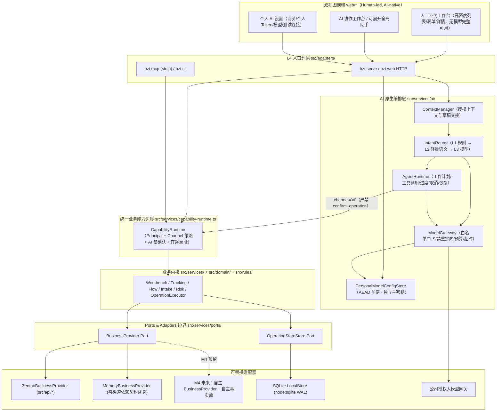

# CR-009 better-zentao 2.0 架构基线、底座解耦与 AI 原生工作台

> 关联总控 Issue：[#7](https://github.com/Dylan5237/better-zentao/issues/7)
> 关联前端子任务：[#6](https://github.com/Dylan5237/better-zentao/issues/6)
> 关联前序交付：[#2](https://github.com/Dylan5237/better-zentao/issues/2)（Server 1.0 已验收关闭）
> 状态：**PRODUCT RC / USER ACCEPTANCE READY**（M1 架构基线、M2 前端产品化、M3 原位协作与 L1/L3 个人模型网关闭环完成，真实公司网关私网实测待所有者授权）
> 基准 Commit：`b716ea579b2f20b181bac0e90912988ec86842fe`（`main`）
> 编制日期：2026-11-27

本文定义 `better-zentao` 从 Server 1.0（禅道增强工作台）演进为 **better-zentao 2.0（Human-led, AI-native · 人类主导、AI 原生研发协作平台）** 的真实代码架构审计、目标分层与 Ports & Adapters 边界、业务底座可替换性垂直切片、统一能力调用与安全控制、个人企业大模型网关配置与凭据隔离方案、双视图前端产品化设计、未来自主底座预留（M4）及可执行验收矩阵。

---

## 1. 六步需求卡片（docs/11 §2）

| 步骤 | 内容 |
| --- | --- |
| ① 意图 | 在保持模块化单体与 Server 1.0 多用户隔离基线的前提下，完成四项演进：（1）补全业务底座、应用状态存储与统一能力调用边界，使未来替换禅道时不推翻上层业务规则、工作台与 AI；（2）以 **Human-led, AI-native** 理念重构前端外壳与双视图（高信息密度人工业务工作台 + AI 协作工作台 + 可展开全局助手），落实 #6 产品化去 Demo 化；（3）建立三层意图漏斗、个人企业大模型网关配置（按员工个人 Token 隔离）及最小可用 Agent 运行时契约；（4）为未来自主业务底座（M4）预留经契约验证的替换边界。 |
| ② 口径 | 业务口径（阶段识别、业务进展、叶子任务统计、需求去重、月度归属、风险规则 R01–R14、缺失/推测标注）100% 沿用 `docs/04`，人工 GUI、内置 AI、CLI 与 stdio MCP 在相同授权范围内遵守完全一致的业务口径。意图识别置信度与模型推理结果不得替代业务授权。 |
| ③ 数据 | 当前业务事实仍由禅道 22.6 API 提供（不直连禅道 DB）；SQLite（`node:sqlite`）继续承载应用自身状态、操作回执、缓存与补充记录。新增受保护的**个人模型凭据存储**（按 `(instanceHash, canonicalAccountKey)` 隔离，应用层 AEAD 加密且主密钥独立于数据库），严禁明文 Token 落业务表、浏览器存储、日志、错误、聊天记录、工具参数或提示词。 |
| ④ 规则 | 完整保留 `docs/11 §3` 全部 13 条不变量、SEC-01–SEC-08、ADR-02/03/04/08/17–23。新增 2.0 核心不变量：（1）**AI 不可自确认**：AI 渠道严禁调用 `confirm_operation`，即便携带 `previewAck=true` 或声称 W1；（2）**在途授权重验**：写入派发每步前重检会话、角色与不可变配置版本；（3）**个人模型凭据零回退**：未配置/失效/额度耗尽时绝不回退他人或全站共享 Token；（4）**受信任网关出站防护**：管理员网关白名单 + TLS 校验 + 禁重定向防 SSRF；（5）**无模型完整可用**：人工工作台与 CLI/MCP 零大模型依赖。 |
| ⑤ 能力 | 不新增突破 20 工具上限的业务 MCP 工具（继续复用 19 个核心业务工具契约）；不引入微服务、消息队列、向量数据库、ORM、HTTP 框架或重型 Agent 框架。M1 新增 `BusinessProvider`、`OperationStateStore`、`CapabilityRuntime`、`IntentRouter` / `ContextManager` / `ModelGateway` / `PersonalModelConfigStore` / `AgentRuntime` 契约与离线垂直切片验证；M2 同步完成 #6 产品化改造与双视图/个人 AI 设置高保真设计。 |
| ⑥ 验收 | 11 组可执行离线验收用例（`M1-BASE-01`、`PC-01..03`、`CAP-01..02`、`AI-01`、`MG-01..02`、`M2-01..02`），以 `ZentaoBusinessProvider` 与零禅道依赖的 `MemoryBusinessProvider` 同用例契约验证、假模型与假网关安全反例测试、前端双模式/8 角色产品化回归及全量 `pnpm lint && pnpm typecheck && pnpm test` 门禁（保留 `operation.ts` 95%/90% 覆盖率门槛）证明交付。 |

---

## 2. 基于真实源码的架构审计与缺口清单（基准 `b716ea5`）

Antigravity 与 Codex 对 `main@b716ea579b2f20b181bac0e90912988ec86842fe` 进行了独立静态依赖扫描与安全审查，逐项核实了 Issue #7 列出的 7 项缺口，并额外发现 **2 项当前代码 P1 风险**与 **2 项 M2/M3 关键安全约束**：

| 编号 | 类别 | 源码位置证据 | 核实结论与影响 | M1/M2 收敛处理 |
| --- | --- | --- | --- | --- |
| **G-01** | 业务服务直连禅道客户端与本地库 | `src/services/workbench.ts:78-179`、`tracking.ts:1-14`、`directory.ts:1-5`、`intake.ts:10-12`、`flow.ts:2-9`、`decompose.ts:1-10`、`management.ts:2-11`、`risk.ts:2-23`、`schedule.ts:1-4` | 10+ 业务服务直接导入 `src/api/*` 与 `ZentaoReadClient`，`workbench.ts` 直接组装 `createZentaoReadClient`、`LocalStore` 与 `createZentaoGateway`。更换底座会波及所有业务服务。 | **M1 收敛**：抽取 `BusinessProvider` Port，落地 `ZentaoBusinessProvider` 与零 `src/api/*` 依赖的 `MemoryBusinessProvider`，用垂直切片证明上层服务可替换；记录其余服务渐进迁移清单。 |
| **G-02** | `OperationGateway` 仍含禅道泄漏语义 | `src/services/operation.ts:94-106, 416-445, 994-1003`、`workbench.ts:181-189`、`zentao-gateway.ts:193-281` | `OperationGateway` 已具备 `readTarget/write/readback/reverseLookup` 接缝（优先复用资产），但执行器直接依赖 `assertCapabilityExecutable`、硬编码拼接 `${type}-view-${id}.html`、Workbench 在写前直接调 `getInstanceConfig` 查禅道版本。 | **M1 收敛**：将能力校验（`checkCapability`）与对象链接格式化（`formatObjectUrl`）纳入 `BusinessProvider` 注入执行器，保留对外 `zentaoId` 契约向后兼容。 |
| **G-03** | `OperationExecutor` 直接绕过存储边界 | `src/services/operation.ts:2-3, 31, 540-581`、`src/core/store/store.ts:201-215` | `LocalStore` 已有 `transaction()`，但执行器仍直接 `new DatabaseSync(dbPath, { readOnly: true })` 跑裸 SQL（`recent()`），并用 `realpathSync(dbPath) + ".operation-lock"` 持有文件锁、内存库另靠 `WeakMap`。 | **M1 收敛**：在 `LocalStore` 补齐 `operations.listRecent(actor, instanceHash, limit)` 与 `withExclusiveLock(fn)`，抽取 `OperationStateStore` Port；**彻底清除** `src/services/operation.ts` 中的 `node:sqlite`、`realpathSync` 与裸 SQL。 |
| **G-04** | 业务规则与禅道编码细节混杂 | `src/domain/roles.ts:75`、`stage.ts:46`、`services/structured-notes.ts:47-196`、`portal-links.ts:15-69`、`workbench.ts:534-550` | 角色解析读正文 `[bzt:v1]` 标签，阶段识别读任务 HTML 标记，阶段要求/豁免折叠禅道评论，链接改写和手工提示直接拼禅道 URL。此外 `foldStageRequirements` 当前未按评论作者做角色校验（P1 证据来源项）。 | **M1 记录 + 边界收口**：在 `BusinessProvider` 收口链接生成与目标读取，明确领域规则（角色/阶段/豁免业务语义）与提供者编码（HTML 标签/评论）的职责拆分；将阶段要求作者校验纳入待确认决策。 |
| **G-05** | 实体解析 ≠ 自然语言意图路由 | `src/services/directory.ts:50-248` | `resolve_context` / `DirectoryService` 仅完成结构化实体匹配与重名消歧，缺少意图分类、参数抽取、缺项判断、多意图分解、拒识与不可信文本隔离契约。 | **M1 收敛**：建立 `IntentRouter` 契约与最小 L1 规则 + L3 模型替身实现，将 `resolve_context` 作为实体解析底座由路由器/Agent 复用。 |
| **G-06** | 身份与工具调度分散在四个入口 | `src/services/server-runtime.ts:515-729`、`portal.ts:149-346`、`adapters/mcp/server.ts:63-160`、`adapters/cli/run-cli.ts:103+` | 集中端、本地 Web、MCP、CLI 各自维护工具路由、角色过滤、参数收窄与 `confirm_operation`/`get_operation` 分支，尚未形成面向 GUI + AI + CLI + MCP 的统一能力调度边界。 | **M1 收敛**：建立 `CapabilityRuntime` 统一调度与策略边界（区分 `channel: "gui" | "ai" | "mcp" | "cli"`），收敛参数校验、角色/范围收窄、`readOnly` 拦截与 AI 确认禁令。 |
| **G-07** | 缺少内置 AI 运行时与个人凭据边界 | `src/`、`eslint.config.mjs:319-421` | 无内置 `ModelGateway`、个人加密凭据存储、`ContextManager` 与 `AgentRuntime`；ESLint 当前仅向 `src/api/internal/**` 开放 `fetch`。 | **M1 收敛**：定义完整 AI 运行时与个人模型配置/网关契约，落地 AEAD 加密 `PersonalModelConfigStore` 与 SSRF/白名单校验器（M1 使用假传输验证，零真实出站 `fetch`；M3 开放独立窄传输例外）。 |
| **F-P1-01** | **【Codex 新发现 P1】在途授权撤权窗口** | `src/services/server-runtime.ts:528-555`、`operation.ts:675-698` | `confirm_operation` 在 `writeCoordinator` 排队或等待 `checkTargets` 回读期间，`assertBeforeDispatch` 仅检查 `session.revoked`，未重验该用户的角色或 `configVersion` 是否已被管理员撤销。 | **M1 直接修复**：将 `assertBeforeDispatch` 升级为异步钩子，在每步派发前实时重读团队配置快照并复核会话、角色及 `configVersion`，排队期撤权确保零上游写入（`CAP-02`）。 |
| **F-P1-02** | **【Codex 新发现 P1】集中端确认重放契约不一致** | `src/services/server-runtime.ts:559-646`、`CR-008` `SRV-OP-03` | 集中端首次 `confirm_operation` 完成后立即 `session.previews.delete(opId)`，导致顺序重放已确认终态操作被拒（`403`）而非按 `SRV-OP-03` 返回原幂等回执。 | **M1 直接修复**：在 `server-runtime.ts` / `CapabilityRuntime` 区分未执行预览授权与原主体终态操作幂等重放，保证终态重放返回原回执且不重复写入/通知，同时保持跨账号/跨实例/跨职责严格拒绝（`CAP-02`）。 |
| **F-P1-03** | **【Codex 新发现 P1】前端部分偏好键缺实例维度 & `readOnly` 作用域未失效** | `web/app.js:542-622`、`meridian-shell.js:70-74`、`daily-pages.js:1072`、`write-views.js:1465` | 首页视图模式、部分页面偏好及回执指针未包含 `instanceId`，同账号跨实例可能串用偏好；仅 `readOnly` 变化时旧作用域未自动失效。 | **M2 产品化修复**：将 `instanceId` 纳入客户端偏好与草稿上下文键，同步将 `readOnly` 变更纳入作用域失效判定（`M2-02`）。 |

---

## 3. 目标架构（better-zentao 2.0 模块化单体）

沿用单进程模块化单体（Node 24 + TypeScript + Zod + 内置 `node:sqlite`），不引入微服务、ORM、HTTP 框架或外部数据库：

---

## 4. M1 核心边界与垂直切片设计

### 4.1 `BusinessProvider` Port（`src/services/ports/business-provider.ts`）

M1 不做空壳全量搬运，而是围绕**最具代表性的读 + 受控写垂直切片**定义真实、可执行的业务原子能力契约：

- **选定垂直切片**：
  1. **读取切片**：`get_story_progress`（覆盖需求详情、关联用户需求、关联执行/任务、叶子任务统计、阶段识别、角色解析、Bug 证据、对象链接与 `partial/gaps` 完整度传播）。
  2. **受控写入切片**：`assign_story` → `confirm_operation` → `get_operation`（单条自指派覆盖 W1，指派他人或批量覆盖 W2；现有对象覆盖乐观指纹 `PLAN_STALE`、跨账号同目标串行化、排除步骤、`partial`/`unknown`/`failed`/`confirmed`/`not_executed` 写入五态及终态幂等重放）。
  3. **创建防重回归**：既有 `create_story` 在 `OperationExecutor` 中「已获对象 ID 绝不重建、无 ID 时唯一反查」不变量继续通过 `PC-03` 与原有 `SV-*` 套件覆盖。
- **两套真实实现**：
  - `ZentaoBusinessProvider`（`src/services/providers/zentao-business-provider.ts`）：封装 `src/api/*`、`createZentaoGateway`、`assertCapabilityExecutable` 及禅道链接规则；原始响应严格不出 `src/api/`（SEC-02）。
  - `MemoryBusinessProvider`（`src/services/providers/memory-business-provider.ts`）：完全独立的内存业务底座实现，**自身及 `ports/*`、`capability-runtime.ts`、`src/services/ai/*` 零 `src/api/*` 传递依赖**（由 `M1-BASE-01` 静态导入图遍历强制断言）；在 `ProviderWorkbench` 运行垂直切片时零 `ZentaoReadClient` 实例化、零上游网络调用，并与 `ZentaoBusinessProvider`（基于真实可写 `fake-zentao`）共享同一套上层服务与精确回执契约测试（`PC-01`、`PC-02`）。（注：现有 `DirectoryService` / `TrackingService` / `FlowService` 为向后兼容既有 `{ client }` 构造签名仍保留对 `ZentaoBusinessProvider` 的回退导入，将在 M4 全服务迁完后移除。）
- **剩余耦合与渐进迁移清单（M1 后分批收口，不阻塞 M2/M3）**：
  - `IntakeService`（`getStoryCreateMetadata` / `getPlanDetail`）、`DecomposeService`、`ManagementService`、`RiskService`、`ScheduleService`、`SnapshotService`、`NotifyService` 当前仍通过 `ZentaoReadClient` 访问 `src/api/*`；后续每新增或重构一条业务链路即按同一 `BusinessProvider` 切片模式迁入，无需一次性重写全仓。

### 4.2 `OperationStateStore` Port（`src/services/ports/operation-store.ts`）

- 将 `OperationExecutor` 依赖收敛为窄接口 `OperationStateStore`：
  - `location`（`instanceHash`、`account`）
  - `transaction(work)`（单事务原子落盘 `operations` + `operation_steps`）
  - `operations`（`insert`、`get`、`updateStatus`、`listRecent(actor, instanceHash, limit)`）
  - `operationSteps`（`insert`、`get`、`list`、`update`）
  - `cache`（`delete`）
  - `withExclusiveLock(work)`（独占执行抢占，SQLite 实现继续使用独立 `.operation-lock` 文件锁以允许网络等待期间主库检查点独立提交；内存实现使用按实例并发互斥锁）
- **实测效果**：`src/services/operation.ts` 彻底移除 `node:sqlite`、`node:fs`（`realpathSync`）和 `sqlite-support.ts` 导入，同时保持 `vitest.config.ts` 的 95% 行覆盖、90% 分支覆盖门槛。

### 4.3 `CapabilityRuntime` 与安全控制（`src/services/capability-runtime.ts`）

- 统一接收不可伪造的服务端主体 `TrustedPrincipal`（`instanceId`、`instanceHash`、`account`、`sessionId`、`roles`、`configVersion`、`readOnly`）与调用渠道 `channel: "gui" | "ai" | "mcp" | "cli"`。
- **核心不变量**：
  1. **确定性路径零 AI 依赖**：`gui` / `mcp` / `cli` 渠道直接调用业务服务，无需配置或调用任何大模型。
  2. **AI 确认禁令（P0）**：当 `channel === "ai"` 时，对 `confirm_operation` 无条件返回 `PERMISSION_DENIED`，即便参数携带 `previewAck: true` 或操作为 W1 级别；AI 只能查询、分析与生成可信操作预览，最终确认必须由人类在 GUI/CLI 经可信人工通道触发。
  3. **在途授权重验（修复 F-P1-01）**：写操作进入 `TargetWriteCoordinator` 排队或回读后，每一步派发前调用异步 `assertBeforeDispatch` 重检会话状态、当前团队配置版本及角色授权，撤权后零上游写入。
  4. **终态重放幂等与回执隔离（修复 F-P1-02）**：原主体在有效角色授权下对已执行终态操作重复 `confirm_operation`，按 `SRV-OP-03` 返回原回执且零重复副作用；跨账号、跨实例、跨职责查询或确认一律拒绝。

---

## 5. 个人企业大模型网关配置与凭据隔离设计（Issue #7 §4）

> 公司向每位员工发放个人大模型网关 Token，**用户必须自行完成配置并通过连接验证才能使用内置 AI 助手**；绝不使用全站共享 Key，绝不跨用户回退。

### 5.1 归属与隔离边界

- **归属键**：`(instanceHash, canonicalAccountKey)`（与现有多用户状态库物理分库键一致，严格由服务端可信会话决定，不信任客户端传参）。
- **多职责共享、跨主体严禁复用**：同一已认证账号在多个已授权职责间复用自己的模型配置，且模型 Token **完全不参与**禅道或未来自主业务底座的身份认证与 ACL 授权。
- **零回退原则**：当个人配置缺失、未验证通过、Token 被撤销/失效、额度耗尽、被删除或所选模型不可用时，返回明确的结构化状态与中文引导，**绝不**静默回退到其他用户凭据、环境变量公共 Key 或外部公有云模型。

### 5.2 受保护凭据持久化与生命周期（`src/services/ai/personal-model-store.ts`）

| 安全维度 | 设计方案 |
| --- | --- |
| 加密算法 | 应用层认证加密 **AES-256-GCM**（每条记录独立 96-bit 随机 IV + AAD 绑定 `instanceHash + "\0" + account + "\0" + keyVersion`，防止密文跨用户拷贝重放）。 |
| 主密钥管理 | 独立于数据库与业务配置，由运维通过环境变量（`BZT_AI_MASTER_KEY`）或受限权限密钥文件（`masterKeyFile`，`0600`）注入；支持 `keyVersion` 以便平滑轮换。主密钥缺失或失效时拒绝读写凭据并返回明确错误，不影响人工工作台。 |
| 持久化位置 | 独立受保护凭据文件/独立表，与普通业务表、缓存、会话日志隔离；重启后凭据可按主密钥安全恢复，无需用户每次重登重新填写。 |
| 脱敏回显 | 前端与管理查询仅返回 `{ configured, verified, verifiedAt, baseUrl, protocol, modelId, tokenHint (如 "••••9f2a"), lastErrorCode }`，**永不**返回完整已保存 Token。保存成功后前端清空明文输入框。 |
| 轮换与删除 | 支持更换 Token（覆写密文并将验证状态重置为待验证或验证后生效）与删除配置（彻底擦除密文记录与验证状态）；备份仅含密文，恢复需配合受控主密钥。 |
| 零泄露红线 | Token 严禁进入 `localStorage` / `sessionStorage`、HTTP 查询串、服务端日志、`projectToolError` 错误详情、Agent 提示词、工具参数、聊天历史、截图或 Git 仓库。 |

### 5.3 出站 SSRF 与网关协议控制（`src/services/ai/model-gateway.ts`）

1. **管理员受信任网关白名单（`server.json` 新增可选 `ai.allowedGateways`）**：
   - 用户可自行填写公司授权的企业网关 Base URL 与 Model ID，但服务端强制校验目标地址命中管理员配置的受信任来源（协议、主机名、端口与路径前缀），未在白名单内直接拒绝（零出站请求）。
   - 禁止 URL 携带内嵌 `username:password`；默认要求 `https:`（仅管理员在受控内网显式配置时允许受控内网协议与企业私有 CA）；禁用自动重定向（`redirect: "error"`），防止 301/302 把个人 Token 转发至非授权域名；实际连接阶段复核解析目标防止 DNS 重绑定。
2. **协议兼容性不硬编码假设**：
   - 配置模型显式区分 `protocol`（如 `"openai-compatible"` / `"anthropic-compatible"` / `"enterprise-custom"`，具体以本地核实的企业网关协议为准），不默认假设完全兼容 OpenAI API 或 `/v1/models` 枚举接口；支持手工填写模型标识并在连接测试时验证。
3. **最小非业务数据连接测试**：
   - `testConnection` 仅发送极简非业务探活输入（如固定短健康检查文本），**零禅道业务数据、零业务工具调用**，仅验证网关可达、凭据有效、目标模型可用及额度正常。
4. **出站数据合规**：
   - 未经公司授权，禁止将真实禅道业务数据发送至外部公有模型服务；ESLint 在 M3 仅为独立 `src/services/ai/internal/` 传输模块放行窄 `fetch` 例外，继续维持全仓网络隔离。

---

## 6. M2（#6）前端产品化与双视图高保真设计

复用既有 Issue #6，不另建重复前端任务。在 M1 架构基线阶段同步完成两项交付：

### 6.1 生产工作台（`web/`）安全产品化落地（本轮基线 + M2-收口）

针对 #6 的 5 项用户反馈，本轮已在现有原生前端架构上落地首批无安全边界变更的产品化与隔离改造（保留全部现有业务能力、8 类职责权限、深浅主题、键盘操作、窄屏适配与本地/集中双模式），并明确 M2-收口项：

1. **统一正式品牌（本轮已落地）**：统一使用 `better-zentao`，移除“脉序 × better-zentao”与顶部原型版本徽标 `v3.1`；修正 `web/index.html` 与 `web/meridian-shell.js` 硬编码“本机门户”在集中端显示错误的问题，改为根据真实运行模式展示「集中工作台（只读）/ 集中工作台 / 本机工作台」。
2. **收口顶部职责切换（本轮已落地）**：单职责仅显示清晰当前职责标识（无多余选择器）；多职责提供简洁紧凑切换器，去除“X 角色”计数装饰。
3. **去除“一档/二档/三档”Demo 标签（本轮已落地）**：将原三档 Demo 按钮收口为自然的个人视图偏好标签（`表格台账` / `混合视图` / `卡片概览`），保留原高密度表格台账与卡片概览的全部业务能力、筛选与操作入口 100% 可达。
4. **跨实例与 `readOnly` 上下文隔离加固（本轮已落地，关闭 F-P1-03）**：补全 `meridian-shell.js`、`workbench-page.js`、`daily-pages.js`、`management-pages.js`、`write-views.js` 存储键的 `instanceId` 维度，并在 `app.js` `createPortalSession.sync()` 将 `readOnly` 变更纳入作用域失效判定。生产 UI **不暴露未实现的假 AI 按钮**。
5. **M2-收口项（已落地生产前端 `web/`）**：已将侧栏 Demo 账号卡与全屏账号弹窗改造为右上角常规头像/账号下拉菜单（含「关于与系统信息」弹窗、本地模式「我的职责」与启用 AI 时的「个人 AI 设置」入口），去除顶部职责切换的分组标签装饰，并整合工作月份与真实同步反馈状态条；已完成本地合成数据浏览器交互验证，真实企业模型网关私网实测仍待项目所有者授权。

### 6.2 双视图 + 个人 AI 设置高保真交互原型（`docs/design/bzt-2.0-dual-view-prototype.html`）

以 100% 合成数据构建单文件可交互高保真原型（支持浅色/深色主题、桌面/窄屏、三视图无缝切换）：

1. **人工业务工作台（默认视图）**：高信息密度需求/任务表格 + 多维筛选 + 详情抽屉 + 右侧可展开/收起全局 AI 助手抽屉（明确呈现“未配置个人模型网关”的清晰引导态与“已验证可用”态，绝不阻碍确定性人工操作）。
2. **AI 协作工作台（平等视图）**：统一自然语言意图输入框 + 会话管理 + 可视化执行步骤（L1 规则 / L3 模型路由 → `CapabilityRuntime` 工具调用）+ 结构化可信业务组件（需求进展卡、风险清单表、可编辑需求草稿表单、带显式人工确认门禁的操作预览卡）+ 一键「转入人工工作台继续编辑」上下文无损交接。
3. **个人 AI 设置面板**：企业网关 Base URL（展示管理员允许范围提示）、只写个人 Token 输入框 + 脱敏状态（`••••9f2a`）、协议与模型标识、测试连接（含未配置/验证通过/Token 失效/额度耗尽/非法网关拦截等状态演示）、更换与删除 Token。

---

## 7. M4 未来自主业务底座预留边界（本轮仅预留，不开发第二套系统）

| 演进维度 | 当前基线（ZenTao 22.6） | M4 自主业务底座预留边界 | 演进与兼容策略 |
| --- | --- | --- | --- |
| 业务事实源 | 禅道 API（`ZentaoBusinessProvider`） | 自主 `NativeBusinessProvider` + 独立业务事实库 | 通过 `BusinessProvider` 契约切换；应用状态库（SQLite）与业务事实库解耦，无需同时替换。 |
| 对象标识 | 数字 ID（`storyId`/`taskId`）+ `instanceHash` | 内部统一为 `BusinessObjectRef { provider, instanceHash, type, id }` | 对外工具契约保留数字/字符串兼容投影与外部链接映射（`formatObjectUrl`），不破坏 19 个工具消费者。 |
| 扩展元数据 | 正文 `[bzt:v1]` 标签 + 结构化评论 + 本地缓存表 | 原生一等字段（维护人、接收人、阶段要求、豁免审批） | 由 Provider 负责读写映射，上层 `domain/` 与 `rules/` 只消费标准化证据与来源结构。 |
| 身份与权限 | 禅道账号 Token + 团队配置 `roles` | 自主 `IdentityProvider`（支持企业 SSO/OIDC + 原生 RBAC/ACL） | `CapabilityRuntime` 仅依赖服务端不可伪造的 `TrustedPrincipal`，切换身份源不改业务工具与前端视图。 |
| 历史数据迁移 | 禅道 22.6 现网数据 | 分产品/分阶段双跑与只读归档导入 | 先在单产品试点切换 Provider，保留原禅道对象映射表与历史回执可查性，不做一刀切迁移。 |

---

## 8. Codex 独立审查发现收敛汇总

| 编号 | 级别 | Codex 审查发现 | 核实与处理 |
| --- | --- | --- | --- |
| **A-01** | P0（M3 门禁） | 个人凭据加密隔离、独立主密钥、零回退、禁泄露 | **采纳**：M1 实现 `PersonalModelConfigStore`（AES-256-GCM + 独立主密钥 + AAD 绑定主体）并完成 `MG-01`/`MG-02` 离线安全验证。 |
| **A-02** | P0（M3 门禁） | 企业网关白名单、TLS 校验、禁重定向、DNS/SSRF 防护、最小合成探活 | **采纳**：M1 实现 `ModelGateway` 目标策略校验器与最小非业务探活契约并完成 `MG-02` 假网关反例测试。 |
| **A-03** | P0（M1 落实） | AI 渠道不得继承 Web 确认通道，必须从服务端禁止 AI 调用 `confirm_operation` | **采纳**：M1 在 `CapabilityRuntime` 强制阻断 `channel === "ai"` 的 `confirm_operation`（含 W1 与 `previewAck=true`），纳入 `AI-01` 验证。 |
| **A-04** | P1（现网代码） | 集中端写入排队/回读期间职责被撤销存在窗口（`server-runtime.ts:528,551`） | **采纳并在 M1 直接修复**：`assertBeforeDispatch` 升级为异步并在每步派发前重验有效团队配置版本与角色授权（`CAP-02`）。 |
| **A-05** | P1（契约差异） | 集中端终态重复 `confirm_operation` 与 `SRV-OP-03` 幂等回执约定不一致（`server-runtime.ts:621,635`） | **采纳并在 M1 直接修复**：区分活跃预览授权与原主体终态幂等重放，保证不重复写入/通知且跨账号/跨职责严格拒绝（`CAP-02`）。 |
| **A-06** | P1（M2 落实） | 双视图与客户端存储键缺失 `instanceId`、`readOnly` 变更未失效旧作用域 | **采纳并在 M2 收口**：补全前端存储键实例维度、`readOnly` 作用域失效与双视图上下文重鉴权设计（`M2-02`）。 |
| **A-07** | P1（业务规范） | `foldStageRequirements` 评论折叠未按作者角色过滤 | **记录为待确认决策（§10 D-204）**：保持现有已验证口径不变，在架构基线评审中明确是否收紧阶段要求评论作者权限。 |
| **A-08** | P2（M2 产品化） | 去除三档 Demo 时须盘点并保留所有真实可用业务入口 | **采纳**：保留高密度表格台账与卡片概览为自然视图偏好，确保全部列表、筛选、详情与操作可达（`M2-01`）。 |

---

## 9. 可执行验收矩阵与 M2/M3 后续实施路线

### 9.1 验收矩阵（离线自动化执行，零真实禅道写入 / 零真实模型外发）

| 用例 ID | 阶段 | 验证内容与通过条件 |
| --- | --- | --- |
| **M1-BASE-01** | M1（本轮） | 静态与传递依赖检查：`MemoryBusinessProvider` 路径零 `ZentaoReadClient` / `src/api/*` 依赖；`src/services/operation.ts` 零 `DatabaseSync` / `realpathSync` / 裸 SQL；既有 19 个工具契约全量回归通过。 |
| **PC-01** | M1（本轮） | `ZentaoBusinessProvider` 与 `MemoryBusinessProvider` 运行同一 `get_story_progress` 契约测试集：覆盖空/拒绝/数据源缺失（`partial/gaps`）、叶子任务、角色证据、链接及重复对象 ID，业务口径完全一致。 |
| **PC-02** | M1（本轮） | 两套 Provider 运行同一 `assign_story → confirm_operation → get_operation` 契约测试集：覆盖写入五态、W1/W2、确认间隔、排除步骤、能力禁用/未验、`PLAN_STALE` 及过期，拒绝路径上游写入数为 0。 |
| **PC-03** | M1（本轮） | `OperationStateStore`（SQLite 双连接 + 内存实现）与跨账号同目标协调：验证原子预览、并发抢占、检查点持久恢复、创建已获 ID 绝不重建、无 ID 反查零/多候选保持 `unknown`。 |
| **CAP-01** | M1（本轮） | `CapabilityRuntime` 跨渠道一致性：覆盖 FB/RD 范围收窄、`markSeen: false`、未授权职责、`readOnly`、伪造主体/级别、W3 拒绝与授权先于缓存。 |
| **CAP-02** | M1（本轮） | 集中端在途授权与确认重放：排队/预检期间撤销职责、登出或计划过期后零新增上游写入；终态重复确认返回原幂等回执且收尾/通知最多执行一次；跨账号/实例/职责拒绝。 |
| **AI-01** | M1（本轮） | `IntentRouter` + `AgentRuntime`（规则 + 假模型）：覆盖清晰单意图、歧义澄清、缺项追问、多意图拆解、不支持拒识、不可信提示词注入；AI 即使传入 `opId`、`previewAck: true` 或声称 W1 仍无法确认操作。 |
| **MG-01** | M1（本轮） | `PersonalModelConfigStore` + `ModelGateway` 隔离验证：双用户并发不同合成 Token、同名跨实例、多职责共用；覆盖未配置、未验证、失效、更换、删除、额度耗尽、重启后主密钥恢复；零跨用户/共享回退。 |
| **MG-02** | M1（本轮） | `ModelGateway` 安全反例：非白名单网关、HTTP 降级、URL 嵌凭据、非法重定向、私网/元数据地址、超时与取消均被阻断且零业务数据/Token 外发；扫描响应/日志/错误/存储/历史，合成 Token 出现次数为 0。 |
| **M2-01** | M2（本轮+续） | 合成数据验证 8 职责 × 双部署模式：统一品牌、单/多职责切换、常规账号菜单、月份与真实同步反馈、卡片/表格视图切换且原入口全部可达、键盘/窄屏/深色主题及无 AI 完整可用。 |
| **M2-02** | M2（本轮+续） | 双账号与跨实例上下文隔离：切换账号/实例/职责/`readOnly` 后偏好、草稿、迟到请求正确隔离与失效，无越权恢复或模型出站。 |

### 9.2 M2 / M3 后续实施路线（架构基线评审通过后自主推进）

| 里程碑 | 范围 | 主要产出与门禁 |
| --- | --- | --- |
| **M1（本轮已交付基线）** | 架构审计、CR-009、ADR-24..27、`BusinessProvider` + `OperationStateStore` + `CapabilityRuntime` + AI 契约与离线验证 | Draft PR + 全量 CI 绿灯 + Issue #7 `ARCHITECTURE BASELINE REVIEW REQUESTED` |
| **M2-收口（#6）** | 完成产品化前端独立验证、双视图框架骨架（人工视图默认 + AI 协作视图占位/配置态开关）与个人 AI 设置前端表单对接 | 合成数据脱敏前后对比 + `M2-01`/`M2-02` 全绿 + 项目所有者体验验收 |
| **M3-a（模型网关与凭据）** | 核实公司实际企业大模型网关协议与白名单策略；接入 `src/services/ai/internal/` 窄传输层与 `/api/ai/settings`（保存/测试连接/删除/脱敏读取） | 真实网关协议适配测试 + `MG-01`/`MG-02` 全绿 + ESLint 窄例外护栏测试 |
| **M3-b（意图与 Agent 闭环）** | 上线首批 5 个端到端场景（查个人工作、查需求进展、分析风险、自然语言拟定需求、生成可编辑可信预览）与结构化生成式业务卡片 + 人工接管闭环 | Codex 意图评测集（常规/歧义/多意图/拒识/提示词注入）+ 2.0 Release Candidate |
| **M4（后续独立排期）** | 按需分服务迁完 `BusinessProvider`，评审自主业务事实库、独立身份权限与试点产品迁移方案 | 另行立项 CR，不阻塞 2.0 RC |

---

## 10. 提请 ChatGPT / 项目所有者决策事项

本架构基线中普通技术细节已由本地团队收敛，以下 **4 项架构/合规边界** 提请在 `ARCHITECTURE BASELINE REVIEW` 中确认：

| 编号 | 议题 | 推荐方案 | 不采纳/悬而未决的影响 |
| --- | --- | --- | --- |
| **D-201** | **批准 ADR-24 / ADR-25 / ADR-26 / ADR-27** | 接受四项提议 ADR 作为 2.0 架构基线，授权本地团队自主推进 M2 收口与 M3 实现至 2.0 RC。 | M3 模型出站边界、加密存储与双视图方向无法固化。 |
| **D-202** | **公司企业大模型网关实际协议、白名单与业务数据出站授权** | M3-a 接入真实网关前，由项目所有者提供受控环境内的公司授权网关地址、API 协议（OpenAI 兼容 / Anthropic / 内部定制）、私有 CA 要求，并确认允许经企业内网网关发送受控禅道业务上下文。 | M3 只能停留在假网关离线验证，不可连接真实企业网关或处理真实业务数据。 |
| **D-203** | **个人模型凭据主密钥的运维托管方式** | 推荐在集中端通过 systemd `EnvironmentFile` / 独立 `0600` 密钥文件提供 `BZT_AI_MASTER_KEY` / `masterKeyFile`（与 `dataDir` 及数据库备份物理分离），并沿用 `better-zentao-release` Skill 管理部署。 | 若未明确主密钥托管与备份分离策略，服务重启恢复或备份脱敏边界将存在隐患。 |
| **D-204** | **阶段要求评论（`[bzt:meta v1]`）是否收紧作者角色校验（Codex P1 A-07）** | 建议在后续迭代中将阶段要求修改限定为有相应职责角色（如 PM / DM / RM）的评论生效，与豁免评论校验对齐；M1 暂保持现有已验证行为不变避免破坏既有夹具与回归测试。 | 若不收紧，具备普通评论权限的任意禅道用户均可借结构化评论文本影响阶段必需判定。 |

---

## 11. M1 评审拍板与 M2/M3 原位协作修订（2026-11-27）

### 11.1 M1 评审结论（PR #8 / Issue #7）

- **ADR-24 ~ ADR-27 全部批准**：模块化单体、渐进式 Ports & Adapters、统一 `CapabilityRuntime`、个人企业大模型网关与 AES-256-GCM 逐用户加密存储、Human-led 双视图。
- **D-202（企业模型接入）**：批准在最窄目录 `src/services/ai/internal/` 增加受控 HTTP 传输层（优先支持 OpenAI-compatible，并支持 Anthropic-compatible；落地 DNS 私有地址拦截、`redirect: "error"`、超时与取消）；实际公司网关 URL 与业务数据出站仍待私有环境核实与所有者授权，离线阶段以受控假网关端到端验证，不回退公共网关或共享 Token。
- **D-203（主密钥托管）**：独立受保护密钥文件（`masterKeyFile`）或环境变量注入（`BZT_AI_MASTER_KEY`），与业务配置、SQLite 状态库及普通备份物理分离；主密钥缺失或失效时仅禁用 AI，人工业务工作台 100% 不受影响。
- **D-204（阶段要求评论作者授权）**：原则批准收紧，纳入 M3 工具链安全收口，按现有规范角色与历史兼容口径推进，不静默改变既有业务历史状态。

### 11.2 AI 原位协作（In-context Copilot）修订（Issue #6 反馈 · ADR-28）

根据项目所有者对 M1 原型的直接体验反馈，M2/M3 交互机制修正为 **AI 原位协作（In-context Copilot）**：

1. **真实业务表单为唯一工作载体**：常规业务操作（如「提出需求」）始终打开正式业务页面或表单，不再强制跳转 AI 视图，也不在业务列表每行放置「交给 AI」转交按钮。
2. **单一共享草稿状态**：人工与 AI 共享同一份结构化表单状态（含单调递增 `revision`、`userEditedFields`、`aiFilledFields` 与 `undoStack`），避免双份草稿与跨视图复制同步。
3. **受控结构化字段变更契约（`FormPatchProposal`）**：
   - AI 不直接操作 DOM，不执行任意脚本，不直接修改数据库；所有变更必须经服务端 `validateFormPatchProposal` 按当前可信主体、职责白名单、字段白名单、`formId`、`targetObjectId` 与 `baseRevision` 严格校验。
   - 事实性字段（如 `backfilled.actualStartedAt`）严禁 AI 编造。
   - **非破坏性合并**：空字段自动填充并显式标注 `origin: "ai"`（支持一键撤销）；用户已手工填写的字段绝不静默覆盖，转为显式对比建议卡由用户选择「采纳」或「忽略」。
   - **防迟到覆盖**：用户手工编辑、切换表单或切换业务对象立即递增 `revision` / 切换上下文，迟到的在途 AI 响应自动丢弃或返回 `409 PLAN_STALE`。
4. **自然语言发起与独立 AI 协作视图分工**：
   - 用户通过自然语言发起提需时，系统打开同一正式「提出需求」表单并注入结构化草稿，随后由既有确定性校验生成可信 `OperationPlan` 预览并由人工亲自确认。
   - 独立「AI 协作工作台」继续保留，专注跨业务对象分析、风险汇总与多步骤研究，不再作为常规表单操作的中转站。
