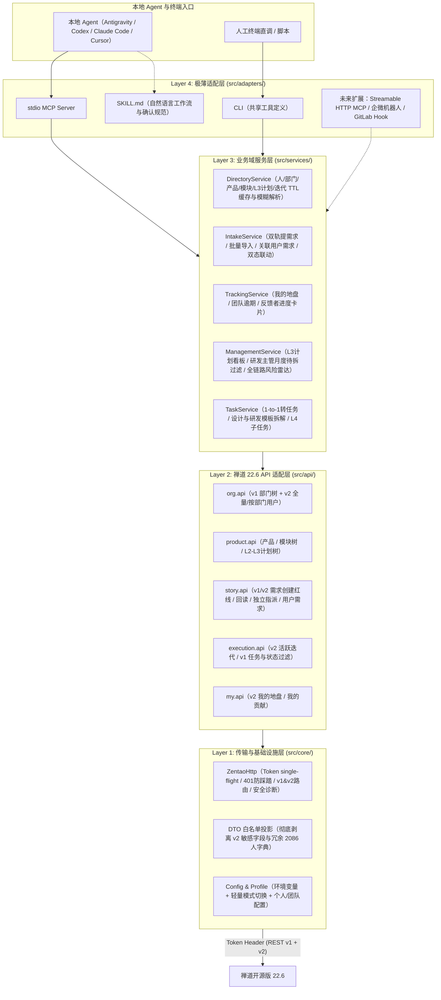

# `better-zentao` 架构与业务封装设计方案

> 基于内网禅道开源版 **22.6** 实测探测结论（见 [`docs/research/2026-11-19-zentao-22.6-api-probe.md`](../research/2026-11-19-zentao-22.6-api-probe.md)），面向 **天宫（设计态）+ OneLink 7.0（运行态）** 研发与设计协作全链路，从零构建高语义本地 Agent 引擎（stdio MCP + CLI + Skill），并为后续远程 HTTP MCP、企微待办/提单机器人、GitLab 状态联动预留清晰扩展边界。

---

## 一、核心业务诉求映射（管理视角 + 设计主管视角 + 研发主管视角）

| 视角与场景 | 痛点与管理规则 | 对应能力封装 |
| :--- | :--- | :--- |
| **第一目标：降低提需求门槛** | 业务方/团队觉得禅道表单繁琐，需按规范把设计类/研发类需求提上来并关联计划、模块、反馈者与用户需求；设计态（天宫）与运行态（OneLink 7.0）同时涉及时需在双产品分别建单 | `create_story`（自然语言中文解析 + `dryRun` 预览 + `category=design/feature` + L3 计划 + `feedbackBy` + 用户需求关联 + 双态联动建单） |
| **设计组：反馈者进度同步** | 业务方不知道需求流转到哪了，人工逐一回复太耗时；禅道有 `feedbackBy` 与用户需求关联但查询路径太深 | `get_story_progress`（按需求 ID / 反馈者姓名 / 用户需求 ID 一键输出可读阶段、关联任务与预计/逾期风险，可直接复制回复或未来接企微） |
| **设计组 & 研发：高效拆解任务** | 禅道“批量转任务”受限，日常常用 1 需求转 1 主任务再按需拆 L4 子任务；设计类有固定步骤（调研/概要设计/原型/评审/传递）；研发类按研发→测试→产品验收→交付培训流转 | `decompose_story_to_tasks`（支持 `single` 1-to-1 / `design_template` / `dev_handoff` 下游任务 / `subtasks` L4 拆解，默认 `dryRun` 校验全部必填项） |
| **产品管理：L3 计划进度视角** | 按管理规划列 L2→L3 计划（计划名备注模块负责人与月份），需基于 L3 查看整体完成情况（如某月计划下研发是否完成） | `get_plan_progress`（展平 L2→L3 计划树，按产品/月份/负责人聚合需求与任务完成率、逾期数） |
| **研发主管：月度过滤与迭代力度** | ① 如何过滤出这个月要研发的需求（含待拆解清单）；② 评估各迭代粒度、负载与推进力度 | `get_monthly_dev_queue`（按月结合 L3 计划与迭代过滤待拆/在研需求 + 迭代负载/进度/逾期统计） |
| **个人与团队：任务逾期监控** | 查看本人名下逾期、查看团队/部门成员是否有逾期（需准确处理父子任务与多人任务） | `get_my_dashboard`、`get_team_overdue`（并发聚合 + 父子去重 + 多人任务解析 + 全未完成状态覆盖） |
| **全链路管理盲区：流程风险巡检** | 研发任务完成后迟迟未建测试任务；任务全完但需求未关；需求未挂计划；需求滞留未拆任务；设计类需求卡点 | `scan_workflow_risks`（一键扫描 5 类流程断档与规范违例风险） |
| **后续扩展（非本阶段强耦合）** | 企微待办/提单机器人打通、下游任务企微直建、GitLab 任务状态联动、团队远程 HTTP MCP | 保持核心 Service 层传输无关，后续以独立 Adapter 接入 |

---

## 二、总体分层架构

延续 TypeScript（Node.js 18+/24 + Zod + Vitest）技术栈，严格拆分为 4 层：



### 不可妥协的工程红线（继承自旧版 `zentao-mcp` 并强化）
1. **DTO 白名单投影红线**：v2 接口禁止原始透传（已实测部分 v2 响应含密码哈希与全量用户字典），所有 `api/` 方法必须做显式字段裁剪。
2. **22.6 写入安全与防重红线**：
   - `story` 创建前强制预检 `/requiredFields` 与产品 `moduleOptionMenu`；
   - 必填含 `assignedTo` 自动切换 v2 创建并双写 `module` 与 `modules: [module]`，显式传 `reviewer: []`；
   - 独立指派走 `POST /stories/{id}/assign`（禁用 `PUT` 静默忽略）；
   - 所有创建/指派/删除操作后必须 **GET 回读确认**；创建返回 ID 但回读或指派未确认时，保留 ID/URL 并**严禁重试创建**；
   - 软删除必须显式 `confirm: true`。
3. **统计口径准确红线**：
   - 自动识别父子任务（`isParent: 1`），默认按叶子任务口径统计逾期与工作量，避免父子双算；
   - 识别多人协作任务（`mode: linear/multi`）并用用户目录反查成员姓名；
   - 未完成状态完整涵盖 `wait / doing / pause / changed`。

---

## 三、轻量配置与双模式切换

保持配置极简，无复杂策略引擎：

1. **连接凭据（环境变量 / 本地 `.env`，严禁入库）**：
   - `ZENTAO_BASE_URL`、`ZENTAO_ACCOUNT`、`ZENTAO_PASSWORD`、`ZENTAO_TIMEOUT_MS`
2. **业务偏好（可选 `better-zentao.local.json`，零配置也能运行）**：

```json
{
  "mode": "personal",
  "defaults": {
    "designProduct": "天宫平台（正式）",
    "runtimeProduct": "OneLink 7.0（正式）",
    "defaultPri": 2
  },
  "teams": {
    "设计组": { "members": ["成员A", "成员B"] },
    "本部门": { "department": "中台架构研发部" }
  }
}
```

### 两种写模式对比（`mode`）

| 维度 | `strict-ai` 模式（AI 批量生成入池） | `personal` 模式（默认，个人日常自然语言提单） |
| :--- | :--- | :--- |
| **标题前缀** | 强制 `[AI创建] ` | 不加前缀 |
| **描述头声明** | 强制注入 `【AI创建】...` 头部 | 不注入 |
| **来源溯源** | `source: "ai"` + `sourceNote` 强制写入 | 按需填写 `source`、`feedbackBy` |
| **默认状态** | 强制 `draft` | 默认 `draft`（可按配置/参数调整） |
| **安全防重门禁** | **始终强制**（`dryRun` 预览、必填预检、GET 回读、防重、`confirm=true`） | **始终强制** |

---

## 四、高内聚工具集规划（12 个 MCP Tools + 同名 CLI）

### A. 上下文解析（1 个）
1. `resolve_context`：模糊解析中文人名/拼音、部门、产品、模块、L2/L3 计划、迭代，返回候选 ID 并显式标注歧义。

### B. 个人与团队看板（4 个）
2. `get_my_dashboard`：我的地盘聚合（我名下已逾期任务、临期任务、待办计数、指派给我的需求、我提的需求）。
3. `get_team_overdue`：团队/部门逾期雷达（按团队别名、部门名或成员列表聚合，按人分组输出逾期数、最大逾期天数与明细）。
4. `query_stories`：全维需求检索（跨页筛选：产品、关键词、类别 `design/feature`、状态、阶段、L3 计划、指派人、创建人、反馈者 `feedbackBy`、三级需求类型）。
5. `get_story_progress`：需求全景与反馈者同步视图（支持需求 ID / 反馈者姓名 / 用户需求 ID，聚合阶段、L3 计划、关联任务及逾期风险，生成可直接发给反馈者的进度摘要）。

### C. 管理视角与风险巡检（3 个）
6. `get_plan_progress`：产品管理 L3 计划看板（展平 L2→L3 计划树，按月份/负责人/L2 目标统计需求完成率与任务逾期情况）。
7. `get_monthly_dev_queue`：研发主管月度过滤与迭代力度视图（过滤本月要研发/待拆解的需求 + 各迭代任务数、工时负载、进度与逾期率）。
8. `scan_workflow_risks`：全链路流程风险巡检（① 开发完未建测试；② 任务全完需求未关/缺下游验收交付；③ 活跃需求未挂计划；④ 已入计划滞留未拆任务；⑤ 设计类需求逾期/卡点）。

### D. 标准化提单与高效拆解（4 个，均带 `dryRun` 门禁）
9. `create_story`：自然语言标准化提需求（中文名/产品/模块/L3 计划解析、`design/feature` 分类、`feedbackBy`、关联用户需求、支持设计态+运行态双建 `dualMode`，默认 `dryRun=true`）。
10. `import_stories`：批量需求移交导入（沿用移交协议并增强中文实体解析与计划支持）。
11. `decompose_story_to_tasks`：高效拆任务（`single` 1-to-1 转任务、`design_template` 设计标准步骤、`dev_handoff` 补建测试/验收/交付下游任务、`subtasks` L4 子任务，默认 `dryRun=true` 预检全部 9 项必填字段）。
12. `assign_story` / `delete_story`：需求独立指派（回读确认）与软删除（`confirm=true` 守卫）。

---

## 五、分阶段实施路线图

> 所有新写路径（创建任务、子任务、关联用户需求、关联计划、双态建单）上线前均先核实只读元数据，并仅在获得明确批准后于专用验证产品 **`#29 禅道研发验证项目`** 做单条受控冒烟并即刻软删除回读确认。

- **Phase 1：工程骨架 + 组织目录 + 高频只读看板**
  - 搭建 4 层架构、`ZentaoHttp`、DTO 白名单、`DirectoryService`；
  - 落地 `resolve_context`、`get_my_dashboard`、`get_team_overdue`、`query_stories`、`get_story_progress`；
  - 接通 `stdio MCP` + `CLI` + Vitest 单元测试 + 内网只读冒烟。
- **Phase 2：管理视角分析引擎**
  - 落地 `get_plan_progress`、`get_monthly_dev_queue`、`scan_workflow_risks`；
  - 用天宫 `#42` 与 OneLink 7.0 `#43` 真实只读数据交叉校准统计口径。
- **Phase 3：标准化提单 & 高效拆解任务 + Agent Skill**
  - 落地 `create_story`（含双模式、双态联动、L3 计划、`feedbackBy`、用户需求关联）、`import_stories`、`decompose_story_to_tasks`、`assign_story`、`delete_story`；
  - 配套 `SKILL.md` 交互规范并在 `#29` 完成受控写冒烟。
- **Phase 4：远程 HTTP 服务与外部生态联动（后续）**
  - 外挂 `Streamable HTTP MCP`（借鉴旧项目多用户凭据隔离与脱敏机制）；
  - 对接企业微信待办/提单机器人与 GitLab 任务状态联动。

---

## 六、待确认决策项

1. **阶段顺序**：是否按 `Phase 1（只读看板）→ Phase 2（管理与风险分析）→ Phase 3（提单与拆任务）` 推进，还是将第一目标 `create_story` 提前至 Phase 1/2 优先交付？
2. **默认主力产品**：日常提单与查询是否默认聚焦 `#42 天宫平台（正式）`（设计态）与 `#43 OneLink 7.0（正式）`（运行态）？
3. **风险巡检判定口径**：研发任务是否按 `type === "devel"`、测试任务按 `type === "test"`；产品验收与交付/培训任务通常用什么 `task.type` 或标题关键词？
4. **CLI 命令名与本地 Agent**：CLI 命名为 `bzt` 还是沿用 `zentao`？当前主力接入哪些本地 Agent（Antigravity / Codex / Claude Code 等）？
