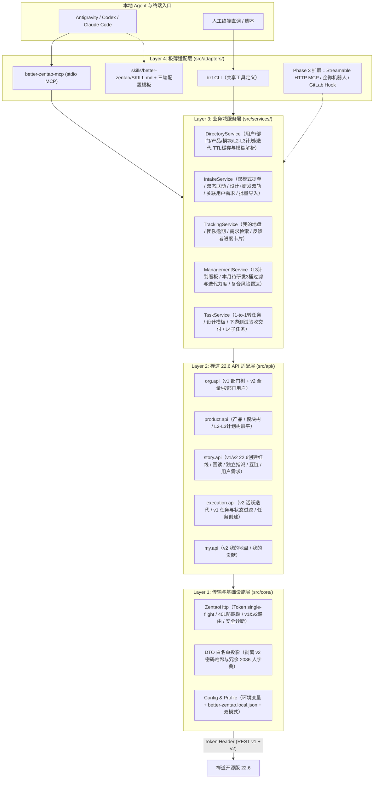

# `better-zentao` 架构与业务封装设计方案（已确认定稿 v1.0）

> 基于内网禅道开源版 **22.6** 实测探测结论（见 [`docs/research/2026-11-19-zentao-22.6-api-probe.md`](../research/2026-11-19-zentao-22.6-api-probe.md)）及 7 项核心业务决策对齐结果，面向 **天宫（设计态）+ OneLink 7.0（运行态）** 研发与设计协作全链路，从零构建高语义本地 Agent 引擎（`better-zentao-mcp` + `bzt` CLI + 通用 `SKILL.md`），并为后续远程 HTTP MCP、企微待办/提单机器人、GitLab 状态联动预留清晰扩展边界。

---

## 一、已对齐的 7 项核心架构与业务决策

| # | 决策主题 | 最终定稿规则 |
| :--- | :--- | :--- |
| **1** | **交付节奏** | **Phase 1 (MVP)** = 核心骨架 + 组织目录 + 核心只读看板（我的地盘/团队逾期/需求检索与反馈者进度）+ **标准化提单闭环（`create_story` / `assign_story` / `delete_story` / `import_stories`）**；**Phase 2** = L3 计划看板 + 研发主管月度待研发过滤 & 迭代力度 + 复合规则风险雷达 + 高效拆任务 `decompose_story_to_tasks`；**Phase 3** = 远程 HTTP MCP / 企微 / GitLab 扩展 |
| **2** | **主力产品与双态建单** | 默认聚焦 **`#42 天宫平台（正式）`**（设计态）与 **`#43 OneLink 7.0（正式）`**（运行态），其他产品显式指定可用；双态需求时由 `create_story` 一次预览两份草稿，确认后分别在两产品建单并以同批次溯源 + 相关需求互链 |
| **3** | **提单规范与安全边界** | `personal` 模式（默认）不加 AI 标题前缀和描述头，**但默认仍建 `draft`**（防 AI 误提直接流转），允许显式传参跳过评审激活；**L3 计划在 `dryRun` 中做强提醒**（未填返回警告并附目标产品活跃候选 L3 计划，不硬阻塞）；`strict-ai` 模式完整保留旧版 AI 标注与 `draft` 红线 |
| **4** | **反馈来源与设计/研发双轨** | 口头/企微需求直接建研发需求并写入 `feedbackBy`（不强制先建用户需求）；若传入已有用户需求 `requirementId`，建完研发需求后自动双向关联回用户需求；需设计的过程默认先建设计类需求（`category: "design"`），同时支持显式开启“设计类 + 研发类双单一次预览创建并互链” |
| **5** | **研发主管视角（Phase 2）** | 以「本月 L3 计划内的研发类需求（排除 `category=design`，按计划起止日期重叠判定）」为主池，与「本月研发迭代」交叉分层输出 **① 已入本月计划待拆解（研发主管待扫队列） ② 本月迭代在研中 ③ 上月遗留未完结**；迭代力度输出各迭代的任务数、拆解覆盖率、人天负载、进度、逾期率与跨月顺延占比 |
| **6** | **风险雷达与环节口径（Phase 2）** | **复合规则识别**防误报：仅对研发类需求（排除 `category=design` 与 `【设计】` 迭代）检测“开发完未建测试”；结合 `task.type` + 标题关键词（研发/开发、测试、验收、交付/培训，可配置）+ 负责人角色判定环节；支持容忍阈值（默认开发完成超过 **1 个工作日** 仍无测试任务才告警） |
| **7** | **本地命名与 Agent 接入** | 新命名避免与旧 `zentao-mcp` 冲突：CLI 用 **`bzt`**、MCP 用 **`better-zentao-mcp`**；提供通用 **`SKILL.md`** 及 **Antigravity / Codex / Claude Code** 三端接入配置模板 |

---

## 二、总体分层架构

延续 TypeScript（Node.js 18+/24 + Zod + Vitest）技术栈，严格拆分为 4 层。**核心引擎与传输协议零耦合**，Phase 3 扩展 Streamable HTTP MCP、企微或 GitLab 时仅新增 Adapter，零改动业务层。



### 不可妥协的工程红线
1. **DTO 白名单投影红线**：v2 接口禁止原始透传（已实测 `/v2/my/todo` 含 `user.password` 哈希且列表响应夹带 2,086 人字典），`api/` 层必须显式白名单投影。
2. **22.6 写入安全与防重红线**：
   - `story` 创建前强制预检 `/requiredFields` 与 `moduleOptionMenu`；
   - 必填含 `assignedTo` 自动切 v2 创建并双写 `module` 与 `modules: [module]`，始终显式传 `reviewer: []`；
   - 独立指派走 `POST /stories/{id}/assign`（禁止 `PUT` 合并指派）；
   - 创建/指派/删除后强制 **GET 回读确认**；已返回 ID 但回读或指派未确认时，保留 ID/URL 并**严禁重试创建**；
   - 软删除必须显式 `confirm: true`。
3. **统计口径准确红线**：
   - 逾期与工作量统计自动区分父任务（`isParent: 1`）与叶子任务，默认按叶子任务汇总防双算；
   - 识别多人协作任务（`mode: linear/multi`）并用用户目录按 `account` 修正禅道 `team[].realname` 缺陷；
   - 未完成状态完整涵盖 `wait / doing / pause / changed`；
   - L3 计划按月归属优先按 `begin` / `end` 日期重叠判定，兼容无月份字样的计划标题。

---

## 三、简洁配置与双模式切换

1. **凭据（环境变量 / 本地 `.env`，严禁入库）**：
   - `ZENTAO_BASE_URL`、`ZENTAO_ACCOUNT`、`ZENTAO_PASSWORD`、`ZENTAO_TIMEOUT_MS`
2. **业务偏好（可选 `better-zentao.local.json`，零配置可跑）**：

```json
{
  "mode": "personal",
  "defaults": {
    "designProductId": 42,
    "runtimeProductId": 43,
    "defaultPri": 2
  },
  "teams": {
    "本部门": { "department": "中台架构研发部" },
    "天宫设计组": { "members": ["成员A", "成员B"] }
  },
  "riskRules": {
    "devDoneWithoutTestGraceWorkdays": 1,
    "stageKeywords": {
      "design": ["调研", "概要", "详设", "原型", "评审", "传递", "UI"],
      "test": ["测试", "用例"],
      "acceptance": ["验收"],
      "delivery": ["交付", "培训", "手册"]
    }
  }
}
```

### 双模式对比（`mode`）

| 项 | `personal`（默认，日常自然语言提单） | `strict-ai`（AI 批量生成入池） |
| :--- | :--- | :--- |
| 标题前缀 & 描述头 AI 声明 | 关闭（干净业务文本） | 强制 `[AI创建] ` + `【AI创建】...` 声明头 |
| `source` / `sourceNote` | 按需填写（支持 `feedbackBy`） | 强制 `source="ai"` + `sourceNote` 批次号 |
| 初始状态 | 默认 `draft`，允许显式传 `skipReview: true` 跳过评审激活 | 强制 `draft`，禁止跳过评审 |
| L3 计划提醒 | `dryRun` 未填给强警告 + 候选活跃 L3 计划列表（不硬阻塞） | 同左 |
| 防重与回读红线 | **始终强制** | **始终强制** |

---

## 四、工具目录与阶段划分

### Phase 1（MVP：只读看板 + 标准化提单闭环，9 个核心工具）

| 工具名（MCP / `bzt` 子命令） | 核心能力 |
| :--- | :--- |
| `resolve_context` / `bzt resolve` | 模糊解析中文名/拼音、部门、产品、模块、L2/L3 计划、迭代，显式标出重名歧义 |
| `get_my_dashboard` / `bzt me` | 我的地盘：我名下已逾期/临期任务、待办计数、指派给我的需求、我提的需求 |
| `get_team_overdue` / `bzt overdue` | 团队/部门逾期雷达：支持团队别名、部门名（默认本部门）或成员名单，按人分组输出逾期数与明细（父子去重、多人任务解析） |
| `query_stories` / `bzt stories` | 全维需求检索：跨页按产品、关键词、类别（`design/feature`）、状态、阶段、L3 计划、指派人、创建人、`feedbackBy`、三级需求类型筛选 |
| `get_story_progress` / `bzt progress` | 需求全景 & 反馈者进度卡片：支持需求 ID / 反馈者姓名 / 用户需求 ID，聚合阶段、L3 计划、关联任务及逾期风险，生成可直接发给业务方的进度摘要 |
| `create_story` / `bzt create` | 标准化提单：中文实体解析、`design/feature` 分类、L3 计划、`feedbackBy`、已有用户需求自动关联、支持双态建单（`dualMode`）与设计+研发双单（`createDevPair`），默认 `dryRun=true` 预览校验并回读确认 |
| `import_stories` / `bzt import` | 批量需求移交导入（默认 `dryRun=true`，支持 `--file` / `--stdin` 与中文实体解析） |
| `assign_story` / `bzt assign` | 需求独立指派（`POST /stories/{id}/assign` + GET 回读确认） |
| `delete_story` / `bzt delete` | 软删除需求（强制 `confirm=true` + 回读确认） |

> 同步交付：`better-zentao-mcp`（stdio）、`bzt` CLI、`skills/better-zentao/SKILL.md`、Antigravity / Codex / Claude Code 三端接入模板、完整 Vitest 单元测试与只读冒烟脚本（写路径先探测关联/双建接口，经你批准后仅在 `#29` 做受控冒烟并即刻软删除清理）。

### Phase 2（管理视角引擎 + 高效拆任务，新增 4 个工具）

| 工具名（MCP / `bzt` 子命令） | 核心能力 |
| :--- | :--- |
| `get_plan_progress` / `bzt plan-progress` | 产品管理 L3 计划看板：展平 L2→L3 树，按产品/月份/负责人聚合需求完成率与任务逾期 |
| `get_monthly_dev_queue` / `bzt dev-queue` | 研发主管月度待研发 3 桶过滤（待拆解 / 在研中 / 上月遗留）+ 迭代力度指标（任务数、拆解覆盖率、人天负载、逾期率、跨月顺延占比） |
| `scan_workflow_risks` / `bzt risks` | 复合规则 5 类流程风险巡检：开发完超 1 工作日未建测试、任务全完未关单/缺下游验收交付、需求未挂计划、入计划滞留未拆任务、设计类卡点 |
| `decompose_story_to_tasks` / `bzt decompose` | 高效拆任务（`single` 1-to-1 / `design_template` 设计规范 / `dev_handoff` 补建测试验收交付 / `subtasks` L4 子任务），默认 `dryRun=true` 预检全部 9 项必填字段 |

### Phase 3（后续扩展）
- `Streamable HTTP MCP` 远程多用户服务（复用旧项目凭据隔离与响应脱敏架构）；
- 企业微信待办/提单机器人入口（业务方自助提单/查进度、企微侧流转与下游任务创建）；
- GitLab MR / Commit 与任务状态联动。

---

## 五、Phase 1 实施前最后一步技术核实

在实现 Phase 1 的 `create_story` 之前，需做一次极轻量只读核实（不写业务数据）：
1. 核实禅道 22.6 `POST /api.php/v2/stories` 接受的精确字段名：`plan`（或 `plans`）、`feedbackBy`、`category: "design"`、`needNotReview`（跳过评审参数）；
2. 核实「研发需求 ↔ 用户需求（Requirement）」关联与「双态研发需求互链（`linkStories`）」的精确 v1/v2 端点签名。
